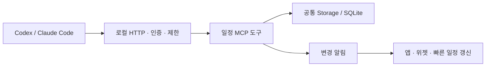
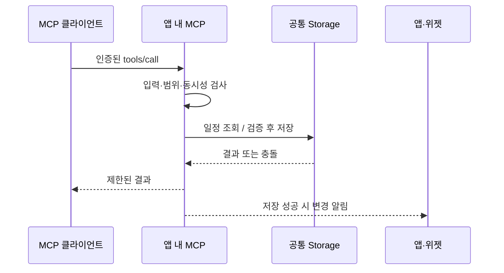

# 최소 로컬 일정 MCP — 개발 사이클

## 승인과 범위 (spec v1)

- 사용자 승인: 2026-11-02 대화에서 앱 실행 중의 초경량 공용 MCP와 단계별 진행을 논의한 뒤, 사용자가 “그럼 순서 1번 시작해달라”라고 명시적으로 구현을 지시했다. 추가 범위 승인을 요구하지 않고 이 1번을 수행한다.
- 기준 커밋: `f5b04814dee01f607583f3cb1c1f288b16fd2206`; 브랜치: `codex/local-calendar-mcp`.
- 개인 Windows PC에서 TimeSchedule이 실행 중일 때만 동작하는 Streamable HTTP MCP. Codex 및 Claude Code에 공통 도구를 제공한다.
- 최소 도구: 기간별 일정 목록, 단일 일정 상세, 일정 추가, 일정 수정. 삭제, 프로젝트 자동 수집, 개발 기록 승인 화면, Space 변경, 개인 서버 배포는 다음 단계다.
- 대표 버전 0.9.0. 기존 앱의 일정 저장/검증, SQLite, 앱/위젯/빠른 일정 갱신 경로를 재사용한다. Tauri 경로와 사용자 데이터는 보존한다.
- 앱 안에서 서버를 시작하고 완전 종료 시 중지한다. 트레이 상주 중에는 작동한다. 기록 전용 CLI 호출에는 MCP 서버를 시작하지 않는다. 포트 충돌 등 MCP 오류로 일정 앱 자체가 시작 실패해서는 안 된다.
- 127.0.0.1에만 바인딩하며 고엔트로피 비밀 토큰으로 인증한다. Host/Origin을 검사하고 비밀/개인 일정은 로그에 남기지 않는다. 인증 없이 도구 목록이나 데이터를 노출하지 않는다.
- 요청 크기, 동시 실행, 날짜 조회 범위, 반환 개수에 상한을 둔다. 긴 본문은 상세 조회에서만 반환한다. 임의 SQL/파일/명령 실행 기능은 노출하지 않는다.
- 변경은 저장 완료 후 성공으로 반환하며 앱/위젯/열린 빠른 일정에 반영한다. 열려 있는 편집 초안은 덮어쓰지 않는다. 오래된 MCP 수정은 충돌로 거절할 수 있어야 하며, 생략한 필드가 지워지면 안 된다.
- 실제 MCP 협상, tools/list, tools/call과 오류 응답을 검증한다. 사용 SDK와 프로토콜 호환 범위를 명시한다. 제품별 연결 안내를 제공하고, 실제 제품 연결 확인 여부를 구분한다.
- MCP 자체는 모델을 실행하지 않는다. 기본값으로 AI/Space 실행이나 새로운 정기 작업을 추가하지 않는다.
- 설치/설정 안내에는 사용자가 사용할 연결 주소, 인증 설정, 시작/정지 상태를 확인하는 방법을 제공한다. 비밀을 PR/기록/로그/최종 답변에 포함하지 않는다.
- 성능 목표: 기존 앱 대비 MCP 유휴 추가 작업집합 20MiB 이내, 추가 CPU 1코어 기준 평균 0.1% 이내. 목표이지 확인 전 보장치가 아니다. 같은 fixture와 화면 조건에서 비교하고 측정 한계를 남긴다.

## 선택한 구조

기존 Rust 네이티브 앱 안에 MCP 연결부를 넣어 공통 저장소를 사용한다. 별도 Node 상주 서버 방식은 런타임과 상태 전달이 추가되어 선택하지 않았다. 개인 서버 분리는 후속 범위다. 라이브러리 선택 및 작은 내부 인터페이스는 구현자가 확정하고 기록한다.

## 소유권과 권한

- 이 파일의 유일 작성자는 main(/root). 승인된 범위의 설계·계획·검증 사실만 유지한다.
- 작업자는 제품 코드/테스트/설정/사용 안내를 수정한다. 다른 검토자가 고정 변경을 독립 검토한다. main은 제품 코드를 수정하지 않는다.
- 브랜치/커밋/푸시/PR/현재 채팅 연결은 AGENTS.md에서 승인된 기본 절차다. 머지는 사용자 테스트와 명시 승인까지 보류한다.
- 실행 중 사용자 앱을 강제 종료하지 않는다. 대표 EXE 교체가 막히면 빌드 산출물을 보존하고 마지막에 종료 요청한다. 검증은 분리된 fixture만 사용한다.
- 외부 작업 재시도는 먼저 상태를 읽어 불확실한 중복을 피한다. 구현/검증 실패는 근거를 좁혀 수정하고 재실행한다. 같은 환경 차단이 2회 반복되면 무의미한 재시도를 중지하고 main에 보고한다. 이 정책은 외부 전송 프로그램의 기존 정책을 변경하지 않는다.

## 작업 할당

### 구현
1. cycle: local-calendar-mcp
2. task: 최소 로컬 일정 MCP 구현 및 검증
3. spec version: v1 (위 내용), 구현 계획 `docs/superpowers/plans/2026-11-02-local-calendar-mcp.md`
4. owner: implement_local_mcp; 실제 executor `/root/implement_local_mcp` (collaboration.spawn_agent 반환)
5. allowed files: `apps/timeschedule-native/**`, `crates/timeschedule-core/**`, 필요시 `crates/timeschedule-desktop/**`, `Cargo.toml`, `Cargo.lock`, `README.md`, `CHANGELOG.md`, `scripts/*mcp*`, `tests/*mcp*`, `docs/local-mcp.md`, 무시되는 `.cache/`와 빌드 산출물. 이 사이클 파일/계획은 읽기만. 기존 제품 소스 외의 사용자/전역 설정 수정은 하지 않는다.
6. deps: 승인된 단계 1, 현재 AGENTS.md, 최소 설계와 계획
7. acceptance: 정상 일정 왕복, 인증 실패·Origin/Host·잘못된 입력·조회 제한·동시 수정·앱 종료를 실제 코드로 검증. 기존 workspace 테스트, Node 테스트, 릴리스 빌드. 실제 확인/미확인 구분.
8. evidence: 실패하는 회귀/기능 테스트를 먼저 확인한 뒤 구현. 실행 명령/결과/변경 파일/프로토콜 호환/사용 방법/환경 제약을 간결하게 보고. main이 고정 diff를 독립 검토에 전달.
9. requested decisions: none. 범위를 바꾸거나 구현 차단 시 main에게 제안.
10. return limit: 1500단어 이내. 사용자용 동작 설명, 검증, 실행/설치 상태, needs/friction/harness/memory 관찰을 포함. 완료 후 수정·관련 실행 중지.

### 독립 검토
1. cycle: local-calendar-mcp
2. task: 고정 변경의 요구사항·회귀·인증·데이터 무결성 검토
3. spec version: v1
4. owner: review_local_mcp; 실제 executor `/root/review_local_mcp` (구현자와 다른 collaboration.spawn_agent 실행자)
5. allowed files: 저장소 읽기; 필요시 무시되는 `.cache/`의 검증 자료만 작성. 제품/사이클/계획 수정 금지.
6. deps: 고정 diff 또는 커밋, 실제 테스트 증거
7. acceptance: 사용자 범위 충족, 호출 가능한 MCP, 보호된 로컬 노출, 안전한 일정 갱신, 앱·위젯 새로고침, 종료 정리, 한정된 자원, 빌드·문서 일치
8. evidence: 구체적인 경로/줄/재현 조건과 영향. 기존 증거 재사용하고 위험 또는 빠진 증거가 있을 때만 검증 확대.
9. requested decisions: none
10. return limit: 1200단어 이내. 중요한 발견과 미확인 한계, needs/friction/harness/memory 관찰. 완료 후 중지.

## 체크포인트

- main이 clean main을 확인하고 작업 브랜치를 생성했다.
- `/root/implement_local_mcp`가 제품 구현을 담당한다. main은 제품 코드와 겹치지 않는 상태 확인·검증 준비를 진행한다.
- 현재 PC에서 `codex mcp add --help`와 `claude mcp add --help`를 읽어 두 클라이언트가 HTTP 및 인증 설정을 제공함을 확인했다. 연결을 추가하거나 모델을 실행한 것은 아니다.
- 성능 검증은 완성된 동일 EXE의 MCP 활성/비활성 모드를 같은 fixture 및 화면으로 실행하고 비교한다. 기존 `benchmark-ui.ps1`은 과거 EXE 해시를 고정하므로 그대로 재사용하지 않는다. 기존 `measure-memory.ps1`/측정 helper는 활용 가능하다.
- 구현자가 확정한 내부 선택: 공식 `rmcp 3.8.0` + axum, stateless JSON Streamable HTTP, 기본 포트 39281. `TIMESCHEDULE_MCP_PORT`로 fixture 포트를 분리하고 `TIMESCHEDULE_MCP_DISABLED=1`로 동일 EXE 비교를 지원한다. 기존 500ms Tick에서 atomic 변경 플래그만 확인한다.
- 목록은 SQL에서 최대 100개, 기간은 366일까지 제한한다. 수정은 expectedUpdatedAt를 저장과 같은 임계영역에서 검사하며 변경 시각을 단조 증가시킨다.
- 구현자 중간 증거: core 전체 37개 통과·fixture 1개 ignore. MCP 도구/HTTP/토큰 테스트는 먼저 실패 확인 후 구현 중. 최종 대상 검증은 아직 아님.
- 현재 설치된 클라이언트 버전(읽기만): Codex CLI 0.163.0, Claude Code 2.1.283.
- 제품 작성 중지(frozen): `.cache/local-mcp-review-manifest.json`, SHA256 `F0F5B888242A598A308A14782E92A21140CD2906797C8EF2E2F71EF1DB111281`, 제품/테스트/문서 14개 파일. 독립 검토 대상은 이 manifest와 기준 커밋의 차이다.
- 최종 자동 검증 로그: `.cache/local-mcp-rust-tests.log` (core 38, desktop 12, native 76 통과; fixture 2개 ignore), `.cache/local-mcp-node-tests.log` (33/33 통과). fmt/diff check 통과 보고 및 main의 결과 확인.
- 해결한 검증 문제: 설정 테스트의 PowerShell 실행 정책은 테스트 child에만 적용해 해결(전역 변경 없음). 불완전 HTTP 헤더/느린 본문으로 종료 지연을 재현한 후 종료 대기 상한을 추가해 통과.
- 최초 릴리스 컴파일 성공: `.cache/local-mcp-build.log`. 실행 중 사용자 앱 때문에 대표 EXE 교체만 차단됐다.
- 독립 검토에서 P2 1건: `axum::serve`의 연결 수와 헤더 파싱 대기가 요청 미들웨어의 제한 밖에 있다. 수신 연결 수와 헤더 대기를 제한하는 수정은 승인된 자원 상한 수락 기준의 보완이며 범위 변경이 아니다.
- 구현 패킷 갱신(v1 유지): 동일 구현자/쓰기 범위/중지 정책으로 위 P2의 실제 실패 재현, 최소 수정, 해당 회귀 및 native 테스트·릴리스 재빌드·새 manifest를 수행한다. 기존 미변경 core/desktop/Node 증거는 재사용한다. 고정 대상이 바뀌므로 수정된 전송부를 독립 재검토한다. 대표 사용자 앱은 계속 보존한다.
- 수정된 제품 작성 중지: `.cache/local-mcp-review-manifest-v2.json`, SHA256 `BBF540203A19FE651C6EC2A7C2517A746F47DE3549F8E01EBDA230849D95309F`. 전송부·Cargo manifest·lock·안내 4개만 이전 검토 대상에서 변경됐다. 검토 패킷 갱신: 동일 검토자/권한으로 이 차이의 연결 수·헤더 시간·정상 HTTP/종료 영향과 관련 회귀를 독립 재검토한다. 기존 전체 검토는 미변경 범위에 재사용한다.
- P2 재현: 미완성 헤더 20개가 모두 유지되고 7초 내 닫히지 않는 테스트가 실패했다. 수정 후 최대 16연결·헤더 5초 제한과 keep-alive 재사용 테스트가 통과했다. `.cache/local-mcp-p2-native-tests.log`: native 79개 통과, fixture 1개 ignore. 재빌드는 `.cache/local-mcp-p2-build.log`.
- 과거 실행 앱 0.8.1의 10초 관찰에서 작업집합 약 44.7MiB, 전체 CPU 약 0.038%(논리 CPU 12개). 엄밀한 동일 조건 비교 기준으로 사용하지 않는다.

## 완료 평가

- 결과·고정 대상: spec v1 구현 완료, manifest v2의 14개 제품 파일. 최종 EXE 0.9.0, 8,251,904바이트, SHA256 `5318A00196333AD681636C3F69CBE43E7C6665DEC6FDB3D58254ED8FB5BE881D`. 수정된 전송부에 대한 별도 검토자 `/root/review_local_mcp`의 재검토에서 P2가 해소됐고 추가 수정 사항은 없었다. 미변경 영역의 최초 검토를 재사용했다.
- 검증: core 38 + desktop 12 + native 79 = Rust 129개 통과, fixture 2개 ignore. Node 33개 통과. fmt/diff check와 릴리스 컴파일 통과. main의 최종 EXE 격리 검증은 `.cache/mcp-acceptance-4500bcfe-ffef-4856-8757-b382063332db/result.json`: 인증된 설정/도구 4개/버전, 한글 일정 생성·조회, 부분 수정·필드 보존·revision 증가, 오래된 수정 거절, 목록·메모 생략, 미인증 401의 10개 확인을 통과했다.
- 자원 실측: `.cache/mcp-acceptance-86b6fdbf-65ee-49bf-9f90-7f482b62a1a1/result.json`. 동일 최종 EXE·합성 fixture(sha256 `F9BB28365BF8BA605A8B5B33F04E99DC4063F1878C3846D101304D2F86217FD2`), 메인 창 1176×859·위젯 960×640·96dpi 모두 표시, 15초 안정화 뒤 각 약 70초/13샘플. MCP 활성 상태는 인증 초기화·목록 요청을 먼저 실행했다. 비활성→활성 작업집합 34.084→35.409MiB(+1.325), private working set 15.105→15.422MiB(+0.318), private commit 16.447→16.895MiB(+0.449). CPU 1코어 기준 평균 3.197→3.195%, 12논리코어 전체 기준 0.266→0.266%. 이 짧은 측정에서는 추가 작업집합 20MiB·CPU 0.1%p 목표 이내였지만 장기/다른 PC/고부하 보장이나 CPU 감소의 증거는 아니다. 백그라운드 사용자 작업을 통제하지 않았다. 최초 4회 중 한 번 메인 창 표시 상태가 달라진 자료는 주 비교에서 제외하고 다시 측정했다.
- 대표 EXE: 사용자가 저장·완전 종료를 확인한 뒤 `scripts/build-native.ps1 -Offline`로 교체했다. `.cache/local-mcp-publish.log` exit 0, installed hash가 위 최종 빌드와 일치한다. 이전 EXE는 `artifacts/archive/TimeSchedule-20261102-220722-1e270458684543159e5d09326d4ff3e8.exe`에 보관됐다. 검증 앱은 격리된 데이터·PID/경로/시작 시각을 확인해 정리했고 사용자 앱을 강제 종료하지 않았다.
- 전달·한계: 커밋·푸시·PR·개발 기록을 마무리한다. 실제 Codex/Claude Code의 모델을 통한 호출, 사용자 화면·접근성·트레이 조작은 확인하지 않았다. 전역 클라이언트 설정은 변경하지 않았다. 사용자 테스트와 머지 승인은 별개다.
- Needs and friction: 불완전 HTTP 연결의 자원 제한 누락을 재현하고 해결했다. 실측과 사용자 확인 외에 이 범위의 미해결 제품 결함은 관찰되지 않았다. 후속 프로젝트/다이어리/승인 화면 범위를 이 변경에 추가하지 않았다.
- Harness: sandbox의 사용자 전역 Git ignore 읽기 경고는 읽기 검토를 막지 않았다. Windows PowerShell 5 검증 스크립트는 UTF-8 BOM과 JSON 응답의 명시적 UTF-8 디코딩이 필요했다. 실행 정책 조정은 테스트 자식 프로세스에만 적용했다. 새 runner/hooks·정기 자동화·전역 정책은 추가하지 않았다.
- Agent memory management / Context: 현재 합의·권한·고정 대상·검증 한계를 이 파일과 기존 계획에 유지했다. 작업 재개 시 같은 실행자와 변경된 패킷을 사용했다. 오래된 사양 충돌은 관찰되지 않았으며 별도 장기 기억은 읽거나 변경하지 않았다.
- Repeated roles: 구현자와 독립 검토자의 교차 검토가 실제 P2를 발견했다. 추가 역할 자동화나 별도 상시 검토 체계를 도입할 근거는 없다.
- Dependencies: 공식 rmcp/axum을 재사용하고, 수신 단계 제한에 필요한 기존 Hyper/Hyper-util을 직접 의존성으로 선언했다. 새 상주 프로세스나 Node 서버는 없다.
- File indexing: README→MCP 안내, 이 사이클→계획/고정 대상/검증 근거를 연결했다. 관련 범위의 안내 경로 불일치는 관찰되지 않았다.
- Code quality: 변경 저장의 원자적 충돌 검사, GUI 초안 보존, 입력·조회·실행·연결 상한과 종료 동작의 코드·테스트를 비교했다. 실제 화면/제품 연결의 미확인을 자동 테스트 통과로 대체하지 않는다. 완료 사이클 파일은 사용자 수락 전까지 유지한다.
