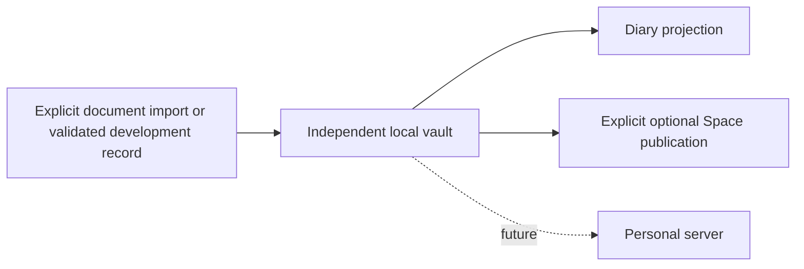
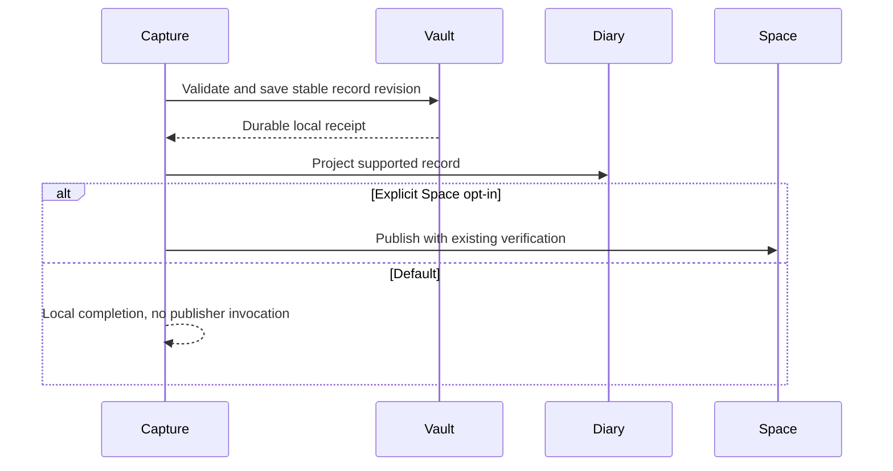

# Local personal document vault — approved scope v1

Owner: main (/root), sole writer of this cycle file. Baseline: `4674b2eecdc96307bc0515030d41b10049179589`; branch `codex/local-document-vault`.

User approval: user selected a personal vault for multiple projects and study materials, local-first without a server, optional Space, and explicitly requested `C:\Users\ycg03\Documents\TimeScheduleData`. Existing AGENTS authorizes implementation, tests/build, commit/push/PR, not merge. Routine design/file choices are delegated by this request. No further design approval needed for this scope.

## Design and acceptance

- Create the selected external vault through an explicit supported initialization command. Never move/delete existing diary data or unrelated Documents files. Root path configurable, default user's Documents/TimeScheduleData; persist the actual selected root. Do not commit personal paths/data into Git.
- Human-readable UTF-8 Markdown records, stable IDs, versioned metadata, projects and study classification, attachments directory, separate local synchronization state. This is a reusable personal vault, not hardwired to one repository. A documented CLI can import/update manually supplied study/project documents without Git evidence; automatic development capture retains its existing Git evidence gate.
- Existing automatic development record flow must durably save vault documents and locally project to diary, with no Codex/Pages calls by default. Space publishing requires explicit opt-in; saved-local and published are distinct. Existing pending jobs cannot publish automatically under default-off policy; preserve historical completed mappings and conflicts.
- Existing diary data remains authoritative for existing diary edits; do not silently create two writable masters. For vault-authored/imported records protect manual edits with conflicts and explain initial diary projection limitations. No sweeping migration of old records or private notes. New records must be available as files independent of diary runtime.
- Atomic recoverable writes, repeat imports idempotent, revision history or equivalent preservation, validation/path containment, safe collision behavior. No network server, background service, actual future transport or AI layer required now.
- User can initialize/open location, add study/project documents using documented commands, see status and explicitly enable/disable Space. Add native user-facing controls where practical, reuse current app settings patterns and avoid needless new UI framework.
- Bump native version to 0.13.0, Cargo.lock, README, CHANGELOG; build canonical artifacts/TimeSchedule.exe with scripts/build-native.ps1. Never terminate user app. Test with isolated vault paths; never tests in real user vault.
- Document new procedure in docs/project-records.md and AGENTS.md to match user's explicit local-first optional-Space instruction. Automatic capture for this change must use this new default without sending to Space.

Alternatives: project-local data rejected for lifetime/cross-project coupling; standalone app now deferred to avoid duplicate deployment. Chosen: same repository implementation + independent storage, separable transport later.

## Implementation plan

Use writing-plans and test-driven-development principles. Worker records concrete public command contract and tests in its handoff; main integrates here.

1. Add focused vault module and CLI under scripts/ with isolated tests under tests/: init, add/update, config/status; stable IDs, project/study metadata, protected paths, atomic writes and conflict handling. Red then green meaningful behavior tests.
2. Integrate scripts/project-records.mjs with vault and explicit default-off Space setting; adapt existing tests so Space tests opt in explicitly and verify default never invokes publisher, queued diary behavior and existing pending records.
3. Update native integration labels/settings as needed, versions and usage documentation. Keep current core diary behavior safe and explicit.
4. Run relevant Node tests, native checks and canonical native build. Provide test command/results, executable hash/version and limitations. Independent reviewer checks fixed changes; repair verified findings within same scope.
5. Main initializes actual requested vault after tested implementation, commits/pushes/creates PR and records this development via new local-only pipeline. No merge.

Review focus: paths and symlinks escaping root; duplicate/manual edits; interrupted multi-file save; legacy pending publication under default-off; tests accidentally touching real Documents; app retry registration and setting consistency.

## Assignments

| Field | Implementation |
|---|---|
| cycle | local-vault |
| task | Implement local vault and optional Space |
| spec version | v1 |
| owner | implementer `/root/implement_vault` (observed spawn task identity) |
| allowed files | scripts/, tests/, apps/timeschedule-native/, crates/ if necessary, Cargo.lock, README.md, CHANGELOG.md, docs/, AGENTS.md; exclude this cycle file |
| deps | approved scope above; clean baseline; existing project rules |
| acceptance | above criteria; relevant Node tests + native build; no personal data mutation during tests |
| evidence | fixed diff, commands and outcomes, intentional limitations; no full personal logs |
| requested decisions | none; report material contract changes |
| return limit | concise handoff with changed paths/tests/risks and STOP writing |

| Field | Independent review |
|---|---|
| cycle | local-vault |
| task | Independently review final patch and evidence |
| spec version | v1 |
| owner | independent reviewer `/root/review_vault`, assigned after implementation freeze |
| allowed files | read-only; isolated test temp artifacts only |
| deps | fixed implementation handoff |
| acceptance | assess scope, correctness, preservation, failure handling and meaningful checks |
| evidence | actionable findings with exact paths and reproduction, or no blocking findings with limits |
| requested decisions | none |
| return limit | concise independent result; STOP |

Retry policy: ordinary in-scope fixes allowed; investigate a failed check before retry, do not weaken assertions. Permission escalation uses existing explicit authorization. Uncertain external writes are read back before retry. No destructive cleanup, no merge. Main handles material scope/authority questions.

## Checkpoint

Branch created with escalation because sandbox blocks .git writes. Selected external folder created through explicitly authorized elevation; currently empty pending validated initialization. Worker `/root/implement_vault` owns product edits. First five isolated vault tests passed per worker handoff; integration and full validation remain pending.

Concrete command contract under implementation: `node scripts/document-vault.mjs init --root PATH`, `import --input JSON`, `status`, `config --space on|off`; manual edit adoption preserves history. Selected root persists in ignored `.cache/project-records/vault-settings.json`; general imports never publish. Space opt-in is scoped to this development capture state, not all personal documents. Existing six pending jobs observed via wake count only; main will sync only this task's new workId. Connected GitHub repository access confirmed. No application process observed at pre-build check.

## Completion assessment

Implementation frozen for independent review after worker reported final product source/docs ready. Node focused suite and canonical native build in progress; prior core project_records test result 9/9. Reviewer receives full current patch against baseline and new files, excluding this main-owned cycle file. No substantive product edits until review feedback. Native version 0.13.0; documentation entrypoint docs/document-vault.md. Actual UI interaction unverified; no new GUI editor/control in scope of delivered initial CLI.

Independent review found blocking legacy migration collision: rev1 diary pending revision 1, rev2 prepared local revision 3; switching Space off migrates rev1 to local revision 3 and leaves rev2 at 3, conflicting payloads. Fix assigned to same implementer with unique monotonic same-work diary revision allocation and regression test; affected Node validation/review must refresh. Existing Node 42/42 result predates this fix. Also generated vault README needs adopt instructions; worker owns source text correction. Actual root initialization/status passed with Space false and vaultId `2bba0f8d-1446-4c60-832d-9be829b58fa8`; no documents imported yet.

Spec clarification v1.1: enabling Space may process pending/new development captures, but already-local-complete history is promoted only by explicit `sync --work-id UUID`; background sync never bulk-promotes history. This narrows external publication and implements the approved optional-Space intent. Worker added regressions for this and migration allocation plus deleted-directory preservation. Focused Node suite now 45/45 passed. Native build via canonical script succeeded: 132 passed/7 ignored, version 0.13.0, 8,886,784 bytes, SHA256 `D055E3E0856F0B257EA1A99ACB9D06A7F43719ECFC903FD44D960FE218F3757D`. Independent refreshed review and actual native CLI isolated smoke pending.

Implementation and independent refreshed review complete; no remaining blocking finding. Main compared review reproduction/fix evidence to scope and observed artifact hash. Reviewer independently ran 5 targeted regression cases, all passed. Actual native EXE isolated smoke passed 1/1 with local_complete, exact Markdown, schedule.db and modelCalls=0. Product sources frozen: document-vault.mjs SHA256 `C554E7522541007C758E03EC9D8CB21542528A3FF74C04C144BCC3E40536D186`; project-records.mjs `8D535B0377298DBB1E5C78E4E229381DD84118FFBFFCC81E3CA306A832D10895`. Main verified canonical EXE hash matches build receipt. Both workers STOPPED product writes/execution. Git commit/push/PR and this task's local capture are main's next actions; merge explicitly withheld.

Validation commands: focused `node --test tests/document-vault.test.mjs tests/project-records-local.test.mjs tests/project-records.test.mjs tests/project-records-offline.test.mjs tests/project-records-git.test.mjs` (45 passed before optional executable test addition); `cargo test -p timeschedule-core --locked --offline project_records` (9 passed); `scripts/build-native.ps1 -Offline` (132 passed, 7 ignored, release and canonical replacement successful); `TIMESCHEDULE_RECORD_TEST_EXE` set to canonical executable with `node --test --test-name-pattern 'built native executable' tests/project-records-local.test.mjs` (1 passed); `git diff --check` clean. Seven existing ignored native cases were not run; actual user GUI and external Space publishing unverified. Future server transport is not implemented.

User validation: open selected root README; from project PowerShell run `node scripts/document-vault.mjs status` and confirm exact root and Space false; import a new study sample per guide, open its returned Markdown; optionally edit and adopt, check revision/history. Open canonical app and inspect new local development record. Existing diary edits and general document files are not automatically synchronized both ways. No bulk migration performed.

Needs/friction: external Documents initialization and .git mutations required authorized elevation; no repeated permission request to user. Harness: no new dependencies, daemons, or automations; core/native compatibility covered by actual executable smoke. Context/memory: this cycle file was the canonical handoff; no personal memory inspected, no observed context loss. Five close dimensions (context, repeated roles, dependencies, file indexing, code quality) reviewed within changed scope, no further blocker observed; no speculative harness/memory additions. Mermaid source authored only, rendering not checked. Keep this file pending explicit acceptance of the completed target.
