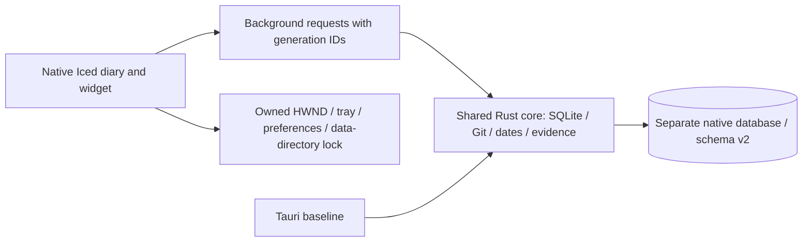
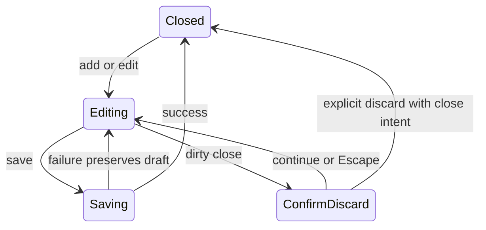

# Rust native port — cycle rust-native, specification v1

Owner and sole writer of this cycle record: main (/root). Repository: C:/LSH/TimeSchedule. Product branch: codex/rust-native-experiment; starting revision f4c5457cf8dfb1a4188e3fd301b441b454bf9243. Reuse this clean, task-specific branch and existing PR #2. Do not merge.

## Approved scope and authority

User explicitly requested “전체앱을 한번 이식해달라” after running the Rust prototype and discussing memory. Implement the existing complete PC app as a separate Rust/Iced native binary, based on the previously agreed Rust experiment spec/plan and the shipped Tauri feature set. This explicit request supersedes the prior plan's instruction to wait for prototype manual acceptance before implementation; manual acceptance remains required for declaring production readiness and merge. Original app/source and user data remain available. Iced is the existing prototype baseline; no unrequested framework switch. Preserve paper-diary layout and Korean UI.

Product write set: new root Cargo workspace, crates/timeschedule-core, crates/timeschedule-desktop, apps/timeschedule-native, src-tauri adapters/manifests as needed for shared core, build/verification scripts, existing experiment references only as necessary. Main owns docs and this record; workers own all product code/tests/config. Git commit/push/PR updates are authorized by AGENTS.md; main handles them after review. No merge, no automatic real DB import/migration, no user process termination, no Explorer restart or external window restyling. No new cloud sync, AI integration, mobile app or Notion block editor. Native default data folder is separate; explicitly supplied TIMESCHEDULE_DATA_DIR remains supported. SQLite schema v2 and CRUD contracts remain compatible.

## Acceptance

Existing implemented features have a real native path: month/day/week navigation and Sunday selector; 4x2 week and independent day scroll; event/entry/task/note/project CRUD; links; paginated records; debounced bounded search; Git import; evidence/portfolio drafts; safe dirty editor/confirmation/save failures; widget calendar/date activation, opacity/lock/position/show/hide/recover; tray and manager close/reopen; persistent settings; separate persistent data and per-directory instance lock. No placeholder-only controls reported complete. DB/Git/search run off the UI event loop and stale responses cannot overwrite current screens or edits. Preserve original Tauri build. Windows UI automation may be unavailable; distinguish code/tests/runtime smoke from actual visual/IME/desktop acceptance. Provide runnable EXE, feature parity table, test results and remaining limits. Performance conclusions require measurements and are not a prerequisite to implementing the requested port.

Retry policy: routine compile/test corrections within this approved scope may continue; do not weaken checks. After three consecutive failures with the same external blocker, record it and continue independent work; no bypassing permissions, data protection or OS ownership checks. Stop only affected work on destructive/out-of-scope actions. Every revised artifact must refresh affected checks and independent review.

## Architecture

## Assignment A — core and platform

| Field | Value |
|---|---|
| cycle | rust-native |
| task | A: shared core, native Windows platform and compatibility |
| spec version | v1 |
| owner | implementation worker core_platform; executor assigned by main |
| allowed files | Cargo.toml/Cargo.lock, crates/**, src-tauri/Cargo.toml/Cargo.lock/src/storage.rs/src/diary.rs/src/desktop.rs/src/lib.rs as needed; experiments/rust-ui-spike build/platform/dependency adapter only if shared-platform extraction otherwise breaks its build; .gitignore for new build output; no apps/** or docs |
| deps | Current storage/diary/desktop sources and approved Rust experiment spec. Coordinate API with B immediately. Root workspace members crates/timeschedule-core, crates/timeschedule-desktop, apps/timeschedule-native; exclude src-tauri and experiments/rust-ui-spike. |
| acceptance | Shared Storage and model APIs preserve existing signatures/schema; native crate has no Tauri runtime. Date/evidence contracts tested. Owned HWND desktop adapter, preferences, separate data path, instance lock, tray action bridge. Original tests/build compatible. No invented successful desktop acceptance. |
| evidence | Commands, test results, API signatures, files, failures/limits, final STOP; source baseline f4c5457 |
| requested decisions | none; resolve routine implementation with B and report substantive API changes to main |
| return limit | concise handoff <=1500 words; no commit/push, no redelegation |

## Assignment B — full native UI and executable

| Field | Value |
|---|---|
| cycle | rust-native |
| task | B: full Iced app, worker requests, tests and native build |
| spec version | v1 |
| owner | implementation worker native_app; executor assigned by main |
| allowed files | apps/timeschedule-native/**, scripts/build-native.ps1 and scripts/tests/native*; no crates/**, root Cargo, src-tauri or docs |
| deps | A supplies unchanged Storage APIs and platform adapter. Read actual src/lib/Diary.svelte, DiaryEditor.svelte, App.svelte/api and existing Rust core. Use Iced 0.14/tiny-skia prototype as starting reference. |
| acceptance | All existing implemented app features listed above have functional UI, asynchronous persistence/search/Git, safe editor, week/month/date semantics, saved preferences, tray/widget integration. Build separate artifacts/TimeSchedule-native.exe. Tests cover meaningful state/failure/data contracts. No actual-user DB reads or overwrites. |
| evidence | Commands/build/test results and feature-by-feature actual coverage/limits; final STOP |
| requested decisions | none; coordinate crate interfaces with A |
| return limit | concise handoff <=2000 words; no commit/push, no redelegation |

## Assignment R — independent review (after fixed implementation target)

| Field | Value |
|---|---|
| cycle | rust-native |
| task | R: independent full port review |
| spec version | v1 |
| owner | separate reviewer native_review; executor assigned by main after implementation |
| allowed files | read-only product/code/test/logs; report to main |
| deps | Fixed diff/hash, latest A/B handoff and exact verification logs supplied by main |
| acceptance | Assess feature completeness, save/cancel/stale operations, schema/data integrity, worker behavior, HWND ownership/lifetime, tray shutdown, API coupling and evidence. Identify blockers by concrete path/behavior. Do not equate code completion with unperformed manual QA. |
| evidence | Independent findings or explicit no-findings, inspected scope and limitations |
| requested decisions | none |
| return limit | <=2000 words; no edits/commit/merge/redelegation |

## Checkpoint

Specification v1 approved by latest user request. A/A2 executor /root/core_platform and B2 executor /root/native_app STOPPED. R2 executor /root/native_review STOPPED with no additional blockers in fixed correction scope. Final B2 executable smoke passed startup/storage/attachment checks; actual UI manual acceptance and performance comparison remain unverified. Main is completing commit/push/PR handoff, no merge.

### Assignment A2 — authorized integration correction

| Field | Value |
|---|---|
| cycle | rust-native |
| task | A2: bounded Git execution and physical widget position restoration |
| spec version | v1 (implementation corrections within existing scope) |
| owner | /root/core_platform, resumed after explicit A STOP |
| allowed files | crates/timeschedule-core/src/diary.rs and focused core tests; crates/timeschedule-desktop/src/windows.rs and focused platform tests only |
| deps | Reviewer /root/native_review confirmed original A fixed hashes. Existing native shutdown now waits for imports, making inherited unlimited Git execution a blocking integration risk. B persists physical coordinates while Iced creation positions are logical. |
| acceptance | Bound Git child wall time and stdout/stderr capture, kill/reap on timeout/overflow without modifying user's repository, preserve all-or-nothing import and existing tests. Add windows::restore_position(&NativeWindow,x:i32,y:i32) in physical screen coordinates, owned HWND/UI-thread validation, safe offscreen recovery, usable before attach; no external window writes. |
| evidence | Focused failing→passing tests; updated affected test logs and source hashes, exact limits/API, final STOP |
| requested decisions | none; suggested Git command timeout 30 seconds, stdout 8MiB / bounded stderr; communicate any practical alternative to main |
| return limit | <=1200 words; no edits outside allowed set, no commits/redelegation |

A initial verification: 22 core +4 platform +1 Windows fixture, legacy 3 preference +1 Windows fixture, spike 10 tests pass. Main ran full scripts/build.ps1 successfully (.cache/legacy-native-port-build.log). Reviewer independently reran fixed A binaries and reported bounded Git as required correction. Review R executor is /root/native_review; B/full target review follows after implementation STOP. Original A source hashes and first review remain evidence only for unchanged portions.

A2 complete and STOPPED. Final diary SHA256 9A7B5B5C260B4D219FB0B781941963F55F333398410265DDD833C633456CECDF; windows SHA256 EA6AAC0CF169A1CD2502FA001382264A43FED01F91BB4D779B5BA5680650ECEB. Git shares a 30s command budget and captures <=8MiB stdout /64KiB stderr; timeout/overflow kills/reaps its own child. Physical position restoration validates own UI-thread HWND and clamps to surviving monitor work area. RED evidence .cache/a2-git-red.log and a2-position-red.log; GREEN .cache/a2-final-tests.log:25 core +6 platform +1 Windows fixture pass. One ignored test is a child-process fixture explicitly invoked by bounded-runner tests, not a skipped acceptance case. Final legacy release rebuild passed (.cache/legacy-native-port-final-build.log).

B fixed app.rs SHA256252EE8AD869A48622CDA8585A8ED8C516E1FF196623417F41E799E14A1998BC8; views.rs21EE306E931E1A1B0474B25FB40F571FD905C82D3287FA02DAB3256F2E84FCED; editor.rs0ABA8BB58C3A2BD54AA49450B4F5D0684C5E823AFF1C5E7737696808C163669F; worker.rs1EBC78AE4AAEFB7BE7D9608FCB82EE039D74B1932A9553234854F7B929B7AE64; main.rsAE0DED055F4CDC7CF7513D659B4D2D34540819A2DF6DA73A35D09A6850ACD849. Native tests16 passed (.cache/native-test.log), including all-five forms CRUD/search/delete in isolated SQLite, evidence source contracts and stale response/save/close state protection. Initial native release passed (.cache/native-release.log). Author noticed duplicate overflow +N in widget 46px date cells; hold until combined B correction pass. R initial B review is independent of this author observation.

## Completion assessment

Implementation, required automated checks, fixed-target independent review and startup smoke are complete. Main compared R2 with B2 tests and source hashes: original four findings and duplicate overflow line are resolved at code level. Final executable is 5,545,984 bytes, SHA256 30EE5BFB0BD7A9FFB4814DA18F31E4507FB74A46E7DDE2BE4339B303B17096BD. Native tests21 + core/platform/fixture32 pass; preserved legacy4, prototype10, frontend3 tests and legacy full build pass. Main fmt/diff checks pass. Final .test-data/native-port-final-smoke/native.log reports storage=true, manager/widget ready, attached=true visible=true position=(30,40), preferences created, process responding. .cache/native-port-final-observation.json records empty-DB working set28,549,120 and private commit12,365,824 bytes, not a comparative benchmark. Own final smoke process was stopped after observation. Baseline EXE SHA256 remains 2C109E6C8D09A904C480B7B111B763824B3C47C42F54D879925E1FF92DCB5047. No user DB/process modified. Commit/push/PR handoff remains; no merge authorized. Keep this record until explicit user acceptance of final target.

### Needs and friction

The shared-core extraction preserved the original application build and removed the prototype's generated string-rewrite adapter. Independent review exposed an inherited unbounded Git child and four native integration/state defects; corrections are required before handoff. Window lifecycle reuses the hidden manager and the tray polls every 500ms, so memory/idle-performance optimization remains a measured follow-up rather than a proven benefit. Future cloud/AI/mobile remains outside this port.

### Harness

Actual native/core/platform tests and original frontend/build checks supply code-level evidence. CUA window inventory works, but screenshot capture timed out and minimized-window recovery failed; this prevents visual/IME acceptance. Sandbox cannot see Explorer; a normal Windows-session isolated smoke confirms attachment. PowerShell Stop-Process failed for an owned sandbox test process; exact path/start-time-checked Process.Kill cleaned only that test process. No bypass/UI automation helper was added. Clippy unavailable; not a passed check. No new harness installation or permanent agent automation proposed.

### Agent memory management and close assessment

One canonical cycle file carries spec v1, ownership, fixed hashes and STOP boundaries. Main reloaded this file/skill after compaction; old prototype gate/status was stale and is now explicitly superseded by the user's full-port request in the existing spec/plan. No personal memory store was read or created. File indexing uses existing README and full-port.md; gui-spike.md is explicitly historical. Dependencies are core + Windows platform reused by Tauri/native, with no Tauri/WebView in the native dependency tree (.cache/native-dependencies.txt). Independent review and regression tests demonstrated value for extraction/UI state; no extra agent runner/hooks are needed for this cycle. Code quality findings are concrete A2/B2 corrections, not a claim of exhaustive defect absence. Actual UI accessibility and cross-monitor behavior remain unverified.

## Assignment B2 — final review corrections

| Field | Value |
|---|---|
| cycle | rust-native |
| task | B2: correct four independent review findings and redundant widget overflow line |
| spec version | v1, corrections within approved behavior |
| owner | /root/native_app, resumed after B source/build STOP |
| allowed files | apps/timeschedule-native/** and focused native tests only; no shared crates or docs |
| deps | R final fixed-B review found first-run high-DPI geometry failure, stale-scope paging, lost editor widget state on confirmation, and missing today events outside browsed month. Initial artifact SHA256 CE8B198CE17C2453C49CC4CC786C847C77298EC6AB1200A2D68FFC9169BD0B5D. A2 fixed target stays unchanged. |
| acceptance | Always clamp initial physical widget geometry before attach even without saved coordinates; minimum size permits monitor fit and recovery can work after failed attach. Block More until first page of current scope is loaded, including failed refresh. Keep editor mounted behind confirmation to preserve widget state and prevent click-through. Query today independently of browsed month. Remove duplicate +N line. Meaningful regression tests for changed failure paths; native tests/fmt/release refresh. No weaker HWND guards. |
| evidence | Commands/results, exact final hashes and artifact; explain widget-state retention and geometry recovery; final STOP |
| requested decisions | none; ask main if shared API changes prove necessary |
| return limit | <=1500 words, no commit/push/redelegation |

R completed initial B review and STOPPED with four concrete findings above; 16 existing tests passed but did not cover them. Main agrees fixes are required. Initial release succeeded (5,541,888 bytes). Final legacy build after A2 succeeded (.cache/legacy-native-port-final-build.log). B2 implementation and refreshed R review are next; runtime smoke uses only a new workspace data folder.

Main smoke on initial release: separate .test-data/native-port-smoke. Sandbox launch could not see Explorer; this is environment-specific, not a passed desktop check. Normal Windows session launch at 21:37:12 produced storage=true, manager/widget ready, widget attached=true visible=true position=(30,40); process responds. CUA listed manager and read window chrome but screenshot timed out, then minimized-window recovery failed; visual/IME interaction remains unverified. Own test processes only are tracked by exact executable path/start time; original app/prototypes are untouched. Original npm tests3 pass. Final B2 artifact requires refreshed smoke.

## Assignment R2 — corrected native target review

| Field | Value |
|---|---|
| cycle | rust-native |
| task | R2: independently verify B2 corrections and final evidence |
| spec version | v1 |
| owner | /root/native_review, resumed after R STOP once B2 source STOP is confirmed |
| allowed files | read-only product/source/tests/logs/docs; report only |
| deps | B2 fixed source hashes supplied in current checkpoint after STOP; A2 shared hashes remain fixed and review valid. Original R four findings and B2 acceptance apply. |
| acceptance | Verify each of four fixes, overflow line correction, regression test relevance, no state/input/geometry regressions. Assess changed wrapper with Iced tree retention and modal input isolation. Keep actual high-DPI/visual/IME acceptance unverified. No unrelated broad audit or duplicate builds without new evidence need. |
| evidence | Fixed hashes, source inspection, decisive test logs and runtime limits, unresolved blockers or no-blockers within scope, final STOP |
| requested decisions | none |
| return limit | <=1200 words; no edits/commit/merge/redelegation |

B2 source STOP confirmed. Fixed SHA256: app.rs B306DA69ECF58BA92A45BC78D8C059ECF7B82DFED6E331B7BD4D3FEB1D9AA980; views.rs 6492B2A59A1008A1B91636CB2932BD4AB10C823BCEEF8B90A3FC2FD8DE7AD5A9; frozen.rs 0B1FDBD15A8E1ED6A47777A8779908FD07222AE932C522AC17645FC792A82010; worker.rs 35E208BE6AB854A0CD9071CD2C6E47D4D5E864B51934CB44F8C02A4966FB3745; main.rs 78232A0BEEF1DAB09CD3246FEC20DC607F6166D3A23523998145DBA1D6FEF626; editor.rs unchanged from B. Native tests21 pass (.cache/native-b2-test.log), RED .cache/native-b2-red.log, fmt check pass. Final release succeeded (.cache/native-b2-release.log); R2 accepted fixed corrections with no further blockers. Final artifact smoke completed without source changes; see completion assessment.

## Assignment B3 — staged whitespace check

| Field | Value |
|---|---|
| cycle | rust-native |
| task | B3: remove extra blank line at manifest EOF reported by staged diff check |
| spec version | v1 |
| owner | /root/native_app after B2 STOP |
| allowed files | apps/timeschedule-native/Cargo.toml only |
| deps | git diff --cached --check reports line14 new blank line at EOF; source and artifact hashes remain fixed |
| acceptance | Remove only redundant terminal blank line; preserve valid final newline and every manifest value. No product behavior changes. |
| evidence | Exact diff and git diff --check; final STOP. No new build needed if bytes differ only in trailing blank line. |
| requested decisions | none |
| return limit | <=150 words, no stage/commit/redelegation |

Main unstaged diff check previously passed because new files were untracked; staged check exposed this formatting-only defect. Refresh staged check and inspect whitespace-only change before commit.

B3 STOP: only one redundant empty EOF line removed; all manifest values/final newline unchanged. R2 supplemental verification is limited to this manifest whitespace diff and final docs/evidence consistency. B2 Rust source/artifact hashes and prior automated/runtime evidence remain valid; no rebuild warranted for an empty manifest line.

R2 supplemental review STOP: manifest SHA256 C87567D9602148638FCA3D976E734E35FA0CE663C5C631F8A046FDF76C40E760 matches, whitespace-only change confirmed. Final artifact size/hash and isolated smoke logs match full-port.md, and manual UI/performance limits are stated accurately. No additional blockers. Main staged diff check now passes. All implementers/reviewer STOPPED; final authorized publication goes to codex/rust-native-experiment and existing draft PR #2, with merge held for user testing.
