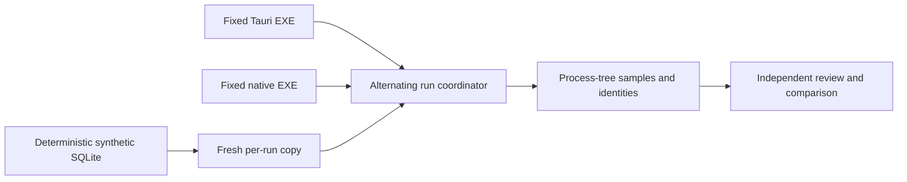
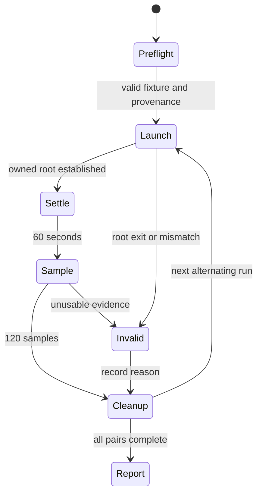
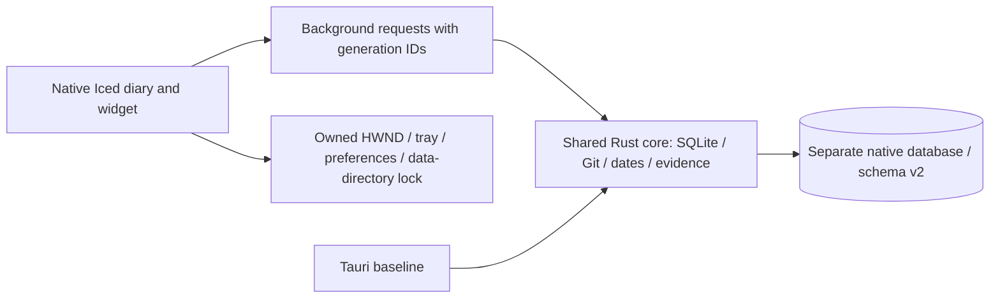
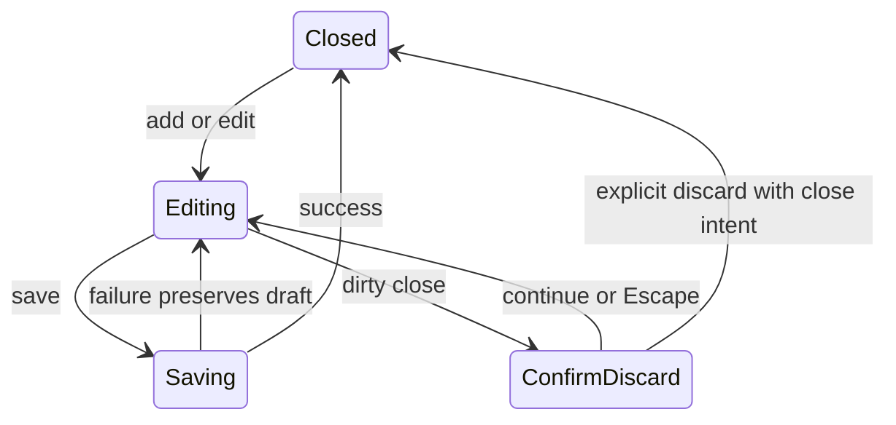

# Rust native port — cycle rust-native, specification v1

## Benchmark continuation — specification v2

### Final assessment — benchmark scope technically complete, user review pending

BR /root/native_review independently compared all2400 CSV rows to raw JSONL, recomputed sums/continuous CPU deltas/run and group statistics, checked provenance/profile isolation/order/cadence/exclusions/window and background-load limits, and STOPPED with no publication blockers. Fixed narrative SHA2563037C55204200F9BF930BF27BB0F94CDFF23DB65813F82725B3B83096302D46C; JSON B98BE59CFAE8FBD3EE6AA35FACC234E75016E853AA15AB582523D7B3BB49B936; CSV2A7C0DF98F1C430DF2FD7E2CFF17E0120D3AAC81B63273CF3B470656BD40CDC2; final README E44C7712BEC9EC15B2100BC9698C021B94B896668BFF33FCC0968794D23CE5DA. These are working-file hashes before Git newline normalization. Main accepts reviewed evidence for the scoped idle comparison: private resident memory90.82%/89.62%lower, CPU median3.09x/10.17xhigher for small/large. No source optimization or binary change; no whole-app responsiveness, UI parity, IME, widget-only or long-run acceptance claim. Prior full-port manual acceptance remains pending. User must test/approve latest PR before merge; retain this record.

Close checklist assessment: context distinguishes historical prototype snapshots from current measured scope; fixture/measurement/review roles yielded reusable scripts without a daemon or new automation; no product dependency changes, only an example using existing core dependencies; README/full-port/baseline/plan link the canonical benchmark report and mandatory CLI path argument; independent source/fixture tests and raw-evidence review found no current scoped blocker. Documentation/static review does not prove UI behavior. No need for unrelated repository audit or repeat timed runs.

Needs and friction: preflight caught invalid synthetic IDs and WebView's appended EBWebView directory; corrected and retested before fixed measurements. Final data includes three explicit child-exit exclusions. Higher native idle CPU warrants optional profiling next; its cause is unverified and no optimization is authorized by this result alone.

Harness: fixed process-identity cleanup, fresh profiles/data, deterministic fixtures and repeat runner are now reusable. Actual counter collection averaged0.6855s and background system CPU ranged0–40%at endpoints; results retain these limits. No arbitrary timing reduction. No new installation, hooks, schedules or user setting changes.

Agent memory management: long-run checkpoint/resumption used this cycle file and raw progress/results. A truncated tool output required bounded rereads of final cadence/hashes/cleanup rather than rerunning the benchmark. Historical checkpoints below are chronological evidence superseded by this final assessment. No persistent personal memory read or activation was needed. Main owns commit/push/PR update and user handoff; all workers/reviewer STOPPED.

Final measurement checkpoint: all20 runs completed exit0 on2026-10-29 about14:12Z;2400 samples,2397 valid private/memory and2394 valid CPU. Fixed binaries/fixture hashes unchanged. Raw .test-data/benchmark/runs/comparison-final; published docs/rust-native/benchmark-results.json and benchmark-samples.csv; narrative benchmark.md. Memory aggregation: median of per-run medians; CPU: median of interval-weighted per-run means. Reports and README/full-port/baseline/plan updated for scoped completion. Actual interval mean1.0056756s,0.6109473–6.6280494; collection mean0.6854796s; background CPU before/after0–40%. All20 completed; cleanup results56 stopped,0errors; read-only postcheck found0 matching measured roots alive. Three child-exit samples and following CPU intervals excluded, never zero-filled. No product code or artifact changed. BR final evidence review pending; no merge/user acceptance implied.

User now explicitly requests comparison benchmark. Continue same Rust-experiment branch at 198494913caf74d54e3de4a6819199e47fa31066, clean starting tree, existing PR #2; no merge. Main owns this record and docs. Existing Task1 measurement plan is authorized by this request: synthetic small (1000 events/2000 entries/10 projects) and large (10000/20000/50) databases; fixed dates/IDs/content including Korean, links and100000-character body; logical content hashes; same independent DB copy for each run. Benchmark fixed baseline EXE2C109E6C8D09A904C480B7B111B763824B3C47C42F54D879925E1FF92DCB5047 against native30EE5BFB0BD7A9FFB4814DA18F31E4507FB74A46E7DDE2BE4339B303B17096BD. Preserve shipped artifacts and user data/processes. No product UI modifications/optimization in measurement task.

Protocol: each dataset,5 alternating paired runs;60s settle then120 samples at1s target cadence. Sequential apps, never measure both concurrently. Include all descendant WebView processes with PID+creation identity, read resident private working set, working set sum (shared double counting caveat), private commit, CPU core-equivalent and machine-normalized percentage. Record unavailable counters as missing, invalid samples excluded with reason, elapsed cadence and process churn. Root identity must match exact expected path/start. Root exit invalidates run; safe cleanup only owned process identities. Startup readiness reports must use equivalent observable definitions or remain non-comparable. Record default window geometry/visibility, OS/hardware/runtime versions; no silent same-layout claim. Existing app names/window sizes may differ. Read-only native telemetry allowed; UI interactions must use CUA. No user setting changes or closing user processes. Save raw synthetic measurement artifacts under .test-data/benchmark, publish compact sanitized evidence/summary under docs/rust-native. Compare default monthly startup-idle first; attempt widget-only/search/note/reopen only through available supported UI, otherwise explicitly unverified, never fabricate scenarios.

Retry/STOP: same3 consecutive external blocker rule. Fail preflight before spending full runs on invalid protocol. Fix harness defects under assigned ownership; refresh review after changes. No arbitrary shortening of5x60+120 protocol. Main runs long measurements with progress updates and performs final commit/push/PR update. Stable completion requires independent measurement/harness review plus honest limits; no user acceptance/merge implied.

### Assignment M — measurement harness
| Field | Value |
|---|---|
| cycle | rust-native benchmark continuation |
| task | M: safe process-tree metrics and serial comparison runner |
| spec version | v2 |
| owner | implementation worker benchmark_harness, actual executor assigned by main |
| allowed files | scripts/measure-memory.ps1, scripts/benchmark-ui.ps1, scripts/tests/measure-memory.tests.ps1 and focused benchmark harness tests/helpers under scripts only |
| deps | Read original measurement plan Task1, fixed artifact paths/hashes above, fixture worker will supply schedule.db + metadata in .test-data/benchmark/fixtures/small and large. No product source edits. |
| acceptance | ExpectedExecutablePath/PID/start identity; full descendant tree private WS/commit/CPU with missing/churn handling, efficient cadence, safe owned cleanup, fresh DB folder per run, raw JSON/CSV,5 alternating pairs/dataset60+120. Quick preflight mode supported and labeled. Read-only window/OS geometry metadata, no shell UI actions. Tests for wrong path/dead root/missing counters/identity and aggregation. Optional snapshot backward compatibility. Do not launch full hour benchmark yet. |
| evidence | Tests/commands, exact CLI invocation and schema, final hashes, STOP before main runs; no unknown counters converted to0 |
| requested decisions | none; report runtime telemetry limitations before full run |
| return limit | <=1500 words, no commit/redelegation/product edits |

### Assignment F — deterministic fixture
| Field | Value |
|---|---|
| cycle | rust-native benchmark continuation |
| task | F: deterministic synthetic DB generation and compatibility verification |
| spec version | v2 |
| owner | implementation worker benchmark_fixture, actual executor assigned by main |
| allowed files | crates/timeschedule-core/examples/seed_benchmark.rs; scripts/tests/benchmark-fixtures.tests.ps1; no shared library or Cargo dependency changes; generated isolated files under .test-data/benchmark/fixtures and .cache |
| deps | Existing Storage/schema v2 and rusqlite/serde_json/chrono already in core dependencies; schema contains triggers/FTS. Baseline source a8f47a1 and native1984949. |
| acceptance | Fixed IDs/timestamps/date anchor2026-10-29, correct small/large counts, Korean/search markers/links and100000-char body, tasks/notes bounded representative counts documented. Use existing schema initialization and transaction inserts with valid values and FTS triggers. Generate logical content SHA256 via existing shell hashing if no Rust dependency. Refuse overwrite existing target DB. Reopen/integrity/count/Korean-search checks and deterministic logical dump hashes across two generations. Checkpoint WAL before finalized copy. No real user DB. |
| evidence | Generator CLI, paths, metadata/counts/hashes/tests, build actual example, final STOP |
| requested decisions | none; ordinary fixture distributions delegated |
| return limit | <=1200 words, no commit/redelegation |

### Assignment BR — independent benchmark review
| Field | Value |
|---|---|
| cycle | rust-native benchmark continuation |
| task | BR: independent harness/fixture then result review |
| spec version | v2 |
| owner | reviewer native_review, separate from M/F executors |
| allowed files | read-only relevant scripts/core example/raw results/docs |
| deps | Fixed M/F hashes and handoffs after STOP; main supplies final evidence |
| acceptance | Check measurement validity, process identity/ownership cleanup, CPU units/WS distinctions/missing samples, fixture equality, deterministic hashes, defaults/confounders,5pair cadence and conclusions. Catch blockers before full runs. Actual UI validation remains separate. |
| evidence | Findings with concrete path and data or no blockers within scope; final STOP per review phase |
| requested decisions | none |
| return limit | <=1500 words, no edits/commit/redelegation |

Benchmark checkpoint: /root/benchmark_harness owns M and is implementing; /root/benchmark_fixture completed F and STOPPED. /root/native_review assigned BR first fixture review while M completes. Main coordinates then runs measurements. Prior native implementation below remains fixed; prior manual QA limitations carry forward.

F fixed generator SHA256 7C688B54296BC14C6584B1E841EC22FFB130EF32A8A0DD4020438648FE35EE46; tests2FB5EC9B28F68F9D295E9416B7E7C28966746579818C2AF99D0960AB497811A1. .cache/benchmark-fixtures-test.log passed counts, integrity/foreign keys, FTS, Storage reopen, long body, deterministic logical dump across two generations, refuse-existing DB. Small logical3F194DC2376D5A6A61B362B0CF0CAC6BA9A6745B7A2C058F8119F7E87E7FCD33, DB F9BB28365BF8BA605A8B5B33F04E99DC4063F1878C3846D101304D2F86217FD2,9,560,064bytes. Large logical69941896E3C1B064503550050631E091F988B3FAC86367041E311880795FC4CE, DB CF946BFDCB9484742F00ECDBBC2C5CA7F5002097F020EB811E03C9215466DA2E,68,509,696bytes. Tasks100/1000 and notes20/100;365day distribution. Initial non-UUID fixture failed compatibility before measurement; retained isolated failed-small-invalid-id, corrected fixtures only are accepted for runs.

BR fixture phase /root/native_review STOP: independently read-only/immutable inspected both DBs, exact counts/schema/integrity/foreign keys/FTS1 long-body match and metadata hashes/deterministic copies pass. Date range2026-04-30..2027-04-29,100000-character record on2026-10-29. No fixture blockers. Per-run copy/provenance awaits fixed M review.

M source STOP confirmed. Fixed scripts SHA256: benchmark-support.ps1 9117279BC10D77F662FEAA4030157E3EB3AE92B066A1FA4195DE8DABED4F909C; benchmark-ui.ps1 071472DEB29FF232D17403C3292C95873BBDD11DA8F41921C6CD66071B8405EE; measure-memory.ps1 D499A2A8B9862D66C68B42D55615ADAFA140C847D8F9FFFB69C6DC9B01EDB5D7; tests/measure-memory.tests.ps1 D3CE56366A5D0DC0C2296E9A5CB864745E97EE5E98CD9176B2DF013ECFB974CB. Final short preflight3 used3ssettle/3samples/1pair small, both complete=true with3privateWS/3CPUvalid; separate output .test-data/benchmark/harness-preflight-3. Preflight1 failed exact profile match because WebView appends EBWebView; safe cleanup succeeded and containment check corrected. Preflight2/3 passed; no full run launched. BR now reviews fixed M prior to fullhour run.

BR M review /root/native_review STOP: fixed4hashes match, tests independently pass, raw preflight sums/CPU recalculated. No blocker for default monthly idle full protocol. WebView version156.0.4314.50. Limits: snapshots can miss very short-lived children; startup window polling is coarse and not content-ready; complete=true alone is insufficient, main must audit all120 per-counter counts/cadence/churn/missing; widget geometry differs900x560 vs500x620; system background load measured only before/after. F remains valid. Main now executes scripts/benchmark-ui.ps1 -OutputDirectory .test-data/benchmark/runs/comparison-final with unchanged defaults, no concurrent builds/tests. Final results require BR review before conclusions/publication.

Full run execution reference: exec session42769, started2026-10-29T13:12:03Z; output .test-data/benchmark/runs/comparison-final. Main polls progress.json/runs.json and session output without launching builds. First Tauri run120samples,119privateWS/118CPU valid; sample59 child exited during capture, sample60 CPU excluded due prior missing. First native120/120valid. This is expected explicit exclusion, not zero substitution; final report must carry all exclusions. No comparative conclusion from the first pair. All workers/reviewer STOP while timed runs execute.

Runtime checkpoint13:42Z: all10 small runs completed; native5runs each120privateWS/120CPUvalid. Tauri runs1/4 each119privateWS/118CPU due exited-child capture, remaining runs120/120. Large first Tauri started; same exec session42769. Half protocol completed, results not final reviewed. No product/harness modifications during full run.

M integration requirement: process-local WEBVIEW2_USER_DATA_FOLDER must isolate baseline's profile in each run, restoring parent environment afterwards. Do not set global environment/registry or debugger flags. Preflight verifies observed WebView user-data-dir belongs to that run; fail if ignored/shared. Microsoft official API documents this override (https://learn.microsoft.com/en-us/microsoft-edge/webview2/reference/win32/webview2-idl?view=webview2-1.0.3967.48). This preserves user profiles and avoids shared browser processes. Main verified fixed EXE hashes and Win10Pro19045/Ryzen5600X6C12T/~32GB host.

Owner and sole writer of this cycle record: main (/root). Repository: C:/LSH/TimeSchedule. Product branch: codex/rust-native-experiment; starting revision f4c5457cf8dfb1a4188e3fd301b441b454bf9243. Reuse this clean, task-specific branch and existing PR #2. Do not merge.

## Approved scope and authority

User explicitly requested “전체앱을 한번 이식해달라” after running the Rust prototype and discussing memory. Implement the existing complete PC app as a separate Rust/Iced native binary, based on the previously agreed Rust experiment spec/plan and the shipped Tauri feature set. This explicit request supersedes the prior plan's instruction to wait for prototype manual acceptance before implementation; manual acceptance remains required for declaring production readiness and merge. Original app/source and user data remain available. Iced is the existing prototype baseline; no unrequested framework switch. Preserve paper-diary layout and Korean UI.

Product write set: new root Cargo workspace, crates/timeschedule-core, crates/timeschedule-desktop, apps/timeschedule-native, src-tauri adapters/manifests as needed for shared core, build/verification scripts, existing experiment references only as necessary. Main owns docs and this record; workers own all product code/tests/config. Git commit/push/PR updates are authorized by AGENTS.md; main handles them after review. No merge, no automatic real DB import/migration, no user process termination, no Explorer restart or external window restyling. No new cloud sync, AI integration, mobile app or Notion block editor. Native default data folder is separate; explicitly supplied TIMESCHEDULE_DATA_DIR remains supported. SQLite schema v2 and CRUD contracts remain compatible.

## Acceptance

Existing implemented features have a real native path: month/day/week navigation and Sunday selector; 4x2 week and independent day scroll; event/entry/task/note/project CRUD; links; paginated records; debounced bounded search; Git import; evidence/portfolio drafts; safe dirty editor/confirmation/save failures; widget calendar/date activation, opacity/lock/position/show/hide/recover; tray and manager close/reopen; persistent settings; separate persistent data and per-directory instance lock. No placeholder-only controls reported complete. DB/Git/search run off the UI event loop and stale responses cannot overwrite current screens or edits. Preserve original Tauri build. Windows UI automation may be unavailable; distinguish code/tests/runtime smoke from actual visual/IME/desktop acceptance. Provide runnable EXE, feature parity table, test results and remaining limits. Performance conclusions require measurements and are not a prerequisite to implementing the requested port.

Retry policy: routine compile/test corrections within this approved scope may continue; do not weaken checks. After three consecutive failures with the same external blocker, record it and continue independent work; no bypassing permissions, data protection or OS ownership checks. Stop only affected work on destructive/out-of-scope actions. Every revised artifact must refresh affected checks and independent review.

## Architecture

## Assignment A — core and platform

| Field | Value |
|---|---|
| cycle | rust-native |
| task | A: shared core, native Windows platform and compatibility |
| spec version | v1 |
| owner | implementation worker core_platform; executor assigned by main |
| allowed files | Cargo.toml/Cargo.lock, crates/**, src-tauri/Cargo.toml/Cargo.lock/src/storage.rs/src/diary.rs/src/desktop.rs/src/lib.rs as needed; experiments/rust-ui-spike build/platform/dependency adapter only if shared-platform extraction otherwise breaks its build; .gitignore for new build output; no apps/** or docs |
| deps | Current storage/diary/desktop sources and approved Rust experiment spec. Coordinate API with B immediately. Root workspace members crates/timeschedule-core, crates/timeschedule-desktop, apps/timeschedule-native; exclude src-tauri and experiments/rust-ui-spike. |
| acceptance | Shared Storage and model APIs preserve existing signatures/schema; native crate has no Tauri runtime. Date/evidence contracts tested. Owned HWND desktop adapter, preferences, separate data path, instance lock, tray action bridge. Original tests/build compatible. No invented successful desktop acceptance. |
| evidence | Commands, test results, API signatures, files, failures/limits, final STOP; source baseline f4c5457 |
| requested decisions | none; resolve routine implementation with B and report substantive API changes to main |
| return limit | concise handoff <=1500 words; no commit/push, no redelegation |

## Assignment B — full native UI and executable

| Field | Value |
|---|---|
| cycle | rust-native |
| task | B: full Iced app, worker requests, tests and native build |
| spec version | v1 |
| owner | implementation worker native_app; executor assigned by main |
| allowed files | apps/timeschedule-native/**, scripts/build-native.ps1 and scripts/tests/native*; no crates/**, root Cargo, src-tauri or docs |
| deps | A supplies unchanged Storage APIs and platform adapter. Read actual src/lib/Diary.svelte, DiaryEditor.svelte, App.svelte/api and existing Rust core. Use Iced 0.14/tiny-skia prototype as starting reference. |
| acceptance | All existing implemented app features listed above have functional UI, asynchronous persistence/search/Git, safe editor, week/month/date semantics, saved preferences, tray/widget integration. Build separate artifacts/TimeSchedule-native.exe. Tests cover meaningful state/failure/data contracts. No actual-user DB reads or overwrites. |
| evidence | Commands/build/test results and feature-by-feature actual coverage/limits; final STOP |
| requested decisions | none; coordinate crate interfaces with A |
| return limit | concise handoff <=2000 words; no commit/push, no redelegation |

## Assignment R — independent review (after fixed implementation target)

| Field | Value |
|---|---|
| cycle | rust-native |
| task | R: independent full port review |
| spec version | v1 |
| owner | separate reviewer native_review; executor assigned by main after implementation |
| allowed files | read-only product/code/test/logs; report to main |
| deps | Fixed diff/hash, latest A/B handoff and exact verification logs supplied by main |
| acceptance | Assess feature completeness, save/cancel/stale operations, schema/data integrity, worker behavior, HWND ownership/lifetime, tray shutdown, API coupling and evidence. Identify blockers by concrete path/behavior. Do not equate code completion with unperformed manual QA. |
| evidence | Independent findings or explicit no-findings, inspected scope and limitations |
| requested decisions | none |
| return limit | <=2000 words; no edits/commit/merge/redelegation |

## Checkpoint

Specification v1 approved by latest user request. A/A2 executor /root/core_platform and B2 executor /root/native_app STOPPED. R2 executor /root/native_review STOPPED with no additional blockers in fixed correction scope. Final B2 executable smoke passed startup/storage/attachment checks; actual UI manual acceptance and performance comparison remain unverified. Main is completing commit/push/PR handoff, no merge.

### Assignment A2 — authorized integration correction

| Field | Value |
|---|---|
| cycle | rust-native |
| task | A2: bounded Git execution and physical widget position restoration |
| spec version | v1 (implementation corrections within existing scope) |
| owner | /root/core_platform, resumed after explicit A STOP |
| allowed files | crates/timeschedule-core/src/diary.rs and focused core tests; crates/timeschedule-desktop/src/windows.rs and focused platform tests only |
| deps | Reviewer /root/native_review confirmed original A fixed hashes. Existing native shutdown now waits for imports, making inherited unlimited Git execution a blocking integration risk. B persists physical coordinates while Iced creation positions are logical. |
| acceptance | Bound Git child wall time and stdout/stderr capture, kill/reap on timeout/overflow without modifying user's repository, preserve all-or-nothing import and existing tests. Add windows::restore_position(&NativeWindow,x:i32,y:i32) in physical screen coordinates, owned HWND/UI-thread validation, safe offscreen recovery, usable before attach; no external window writes. |
| evidence | Focused failing→passing tests; updated affected test logs and source hashes, exact limits/API, final STOP |
| requested decisions | none; suggested Git command timeout 30 seconds, stdout 8MiB / bounded stderr; communicate any practical alternative to main |
| return limit | <=1200 words; no edits outside allowed set, no commits/redelegation |

A initial verification: 22 core +4 platform +1 Windows fixture, legacy 3 preference +1 Windows fixture, spike 10 tests pass. Main ran full scripts/build.ps1 successfully (.cache/legacy-native-port-build.log). Reviewer independently reran fixed A binaries and reported bounded Git as required correction. Review R executor is /root/native_review; B/full target review follows after implementation STOP. Original A source hashes and first review remain evidence only for unchanged portions.

A2 complete and STOPPED. Final diary SHA256 9A7B5B5C260B4D219FB0B781941963F55F333398410265DDD833C633456CECDF; windows SHA256 EA6AAC0CF169A1CD2502FA001382264A43FED01F91BB4D779B5BA5680650ECEB. Git shares a 30s command budget and captures <=8MiB stdout /64KiB stderr; timeout/overflow kills/reaps its own child. Physical position restoration validates own UI-thread HWND and clamps to surviving monitor work area. RED evidence .cache/a2-git-red.log and a2-position-red.log; GREEN .cache/a2-final-tests.log:25 core +6 platform +1 Windows fixture pass. One ignored test is a child-process fixture explicitly invoked by bounded-runner tests, not a skipped acceptance case. Final legacy release rebuild passed (.cache/legacy-native-port-final-build.log).

B fixed app.rs SHA256252EE8AD869A48622CDA8585A8ED8C516E1FF196623417F41E799E14A1998BC8; views.rs21EE306E931E1A1B0474B25FB40F571FD905C82D3287FA02DAB3256F2E84FCED; editor.rs0ABA8BB58C3A2BD54AA49450B4F5D0684C5E823AFF1C5E7737696808C163669F; worker.rs1EBC78AE4AAEFB7BE7D9608FCB82EE039D74B1932A9553234854F7B929B7AE64; main.rsAE0DED055F4CDC7CF7513D659B4D2D34540819A2DF6DA73A35D09A6850ACD849. Native tests16 passed (.cache/native-test.log), including all-five forms CRUD/search/delete in isolated SQLite, evidence source contracts and stale response/save/close state protection. Initial native release passed (.cache/native-release.log). Author noticed duplicate overflow +N in widget 46px date cells; hold until combined B correction pass. R initial B review is independent of this author observation.

## Completion assessment

Implementation, required automated checks, fixed-target independent review and startup smoke are complete. Main compared R2 with B2 tests and source hashes: original four findings and duplicate overflow line are resolved at code level. Final executable is 5,545,984 bytes, SHA256 30EE5BFB0BD7A9FFB4814DA18F31E4507FB74A46E7DDE2BE4339B303B17096BD. Native tests21 + core/platform/fixture32 pass; preserved legacy4, prototype10, frontend3 tests and legacy full build pass. Main fmt/diff checks pass. Final .test-data/native-port-final-smoke/native.log reports storage=true, manager/widget ready, attached=true visible=true position=(30,40), preferences created, process responding. .cache/native-port-final-observation.json records empty-DB working set28,549,120 and private commit12,365,824 bytes, not a comparative benchmark. Own final smoke process was stopped after observation. Baseline EXE SHA256 remains 2C109E6C8D09A904C480B7B111B763824B3C47C42F54D879925E1FF92DCB5047. No user DB/process modified. Commit/push/PR handoff remains; no merge authorized. Keep this record until explicit user acceptance of final target.

### Needs and friction

The shared-core extraction preserved the original application build and removed the prototype's generated string-rewrite adapter. Independent review exposed an inherited unbounded Git child and four native integration/state defects; corrections are required before handoff. Window lifecycle reuses the hidden manager and the tray polls every 500ms, so memory/idle-performance optimization remains a measured follow-up rather than a proven benefit. Future cloud/AI/mobile remains outside this port.

### Harness

Actual native/core/platform tests and original frontend/build checks supply code-level evidence. CUA window inventory works, but screenshot capture timed out and minimized-window recovery failed; this prevents visual/IME acceptance. Sandbox cannot see Explorer; a normal Windows-session isolated smoke confirms attachment. PowerShell Stop-Process failed for an owned sandbox test process; exact path/start-time-checked Process.Kill cleaned only that test process. No bypass/UI automation helper was added. Clippy unavailable; not a passed check. No new harness installation or permanent agent automation proposed.

### Agent memory management and close assessment

One canonical cycle file carries spec v1, ownership, fixed hashes and STOP boundaries. Main reloaded this file/skill after compaction; old prototype gate/status was stale and is now explicitly superseded by the user's full-port request in the existing spec/plan. No personal memory store was read or created. File indexing uses existing README and full-port.md; gui-spike.md is explicitly historical. Dependencies are core + Windows platform reused by Tauri/native, with no Tauri/WebView in the native dependency tree (.cache/native-dependencies.txt). Independent review and regression tests demonstrated value for extraction/UI state; no extra agent runner/hooks are needed for this cycle. Code quality findings are concrete A2/B2 corrections, not a claim of exhaustive defect absence. Actual UI accessibility and cross-monitor behavior remain unverified.

## Assignment B2 — final review corrections

| Field | Value |
|---|---|
| cycle | rust-native |
| task | B2: correct four independent review findings and redundant widget overflow line |
| spec version | v1, corrections within approved behavior |
| owner | /root/native_app, resumed after B source/build STOP |
| allowed files | apps/timeschedule-native/** and focused native tests only; no shared crates or docs |
| deps | R final fixed-B review found first-run high-DPI geometry failure, stale-scope paging, lost editor widget state on confirmation, and missing today events outside browsed month. Initial artifact SHA256 CE8B198CE17C2453C49CC4CC786C847C77298EC6AB1200A2D68FFC9169BD0B5D. A2 fixed target stays unchanged. |
| acceptance | Always clamp initial physical widget geometry before attach even without saved coordinates; minimum size permits monitor fit and recovery can work after failed attach. Block More until first page of current scope is loaded, including failed refresh. Keep editor mounted behind confirmation to preserve widget state and prevent click-through. Query today independently of browsed month. Remove duplicate +N line. Meaningful regression tests for changed failure paths; native tests/fmt/release refresh. No weaker HWND guards. |
| evidence | Commands/results, exact final hashes and artifact; explain widget-state retention and geometry recovery; final STOP |
| requested decisions | none; ask main if shared API changes prove necessary |
| return limit | <=1500 words, no commit/push/redelegation |

R completed initial B review and STOPPED with four concrete findings above; 16 existing tests passed but did not cover them. Main agrees fixes are required. Initial release succeeded (5,541,888 bytes). Final legacy build after A2 succeeded (.cache/legacy-native-port-final-build.log). B2 implementation and refreshed R review are next; runtime smoke uses only a new workspace data folder.

Main smoke on initial release: separate .test-data/native-port-smoke. Sandbox launch could not see Explorer; this is environment-specific, not a passed desktop check. Normal Windows session launch at 21:37:12 produced storage=true, manager/widget ready, widget attached=true visible=true position=(30,40); process responds. CUA listed manager and read window chrome but screenshot timed out, then minimized-window recovery failed; visual/IME interaction remains unverified. Own test processes only are tracked by exact executable path/start time; original app/prototypes are untouched. Original npm tests3 pass. Final B2 artifact requires refreshed smoke.

## Assignment R2 — corrected native target review

| Field | Value |
|---|---|
| cycle | rust-native |
| task | R2: independently verify B2 corrections and final evidence |
| spec version | v1 |
| owner | /root/native_review, resumed after R STOP once B2 source STOP is confirmed |
| allowed files | read-only product/source/tests/logs/docs; report only |
| deps | B2 fixed source hashes supplied in current checkpoint after STOP; A2 shared hashes remain fixed and review valid. Original R four findings and B2 acceptance apply. |
| acceptance | Verify each of four fixes, overflow line correction, regression test relevance, no state/input/geometry regressions. Assess changed wrapper with Iced tree retention and modal input isolation. Keep actual high-DPI/visual/IME acceptance unverified. No unrelated broad audit or duplicate builds without new evidence need. |
| evidence | Fixed hashes, source inspection, decisive test logs and runtime limits, unresolved blockers or no-blockers within scope, final STOP |
| requested decisions | none |
| return limit | <=1200 words; no edits/commit/merge/redelegation |

B2 source STOP confirmed. Fixed SHA256: app.rs B306DA69ECF58BA92A45BC78D8C059ECF7B82DFED6E331B7BD4D3FEB1D9AA980; views.rs 6492B2A59A1008A1B91636CB2932BD4AB10C823BCEEF8B90A3FC2FD8DE7AD5A9; frozen.rs 0B1FDBD15A8E1ED6A47777A8779908FD07222AE932C522AC17645FC792A82010; worker.rs 35E208BE6AB854A0CD9071CD2C6E47D4D5E864B51934CB44F8C02A4966FB3745; main.rs 78232A0BEEF1DAB09CD3246FEC20DC607F6166D3A23523998145DBA1D6FEF626; editor.rs unchanged from B. Native tests21 pass (.cache/native-b2-test.log), RED .cache/native-b2-red.log, fmt check pass. Final release succeeded (.cache/native-b2-release.log); R2 accepted fixed corrections with no further blockers. Final artifact smoke completed without source changes; see completion assessment.

## Assignment B3 — staged whitespace check

| Field | Value |
|---|---|
| cycle | rust-native |
| task | B3: remove extra blank line at manifest EOF reported by staged diff check |
| spec version | v1 |
| owner | /root/native_app after B2 STOP |
| allowed files | apps/timeschedule-native/Cargo.toml only |
| deps | git diff --cached --check reports line14 new blank line at EOF; source and artifact hashes remain fixed |
| acceptance | Remove only redundant terminal blank line; preserve valid final newline and every manifest value. No product behavior changes. |
| evidence | Exact diff and git diff --check; final STOP. No new build needed if bytes differ only in trailing blank line. |
| requested decisions | none |
| return limit | <=150 words, no stage/commit/redelegation |

Main unstaged diff check previously passed because new files were untracked; staged check exposed this formatting-only defect. Refresh staged check and inspect whitespace-only change before commit.

B3 STOP: only one redundant empty EOF line removed; all manifest values/final newline unchanged. R2 supplemental verification is limited to this manifest whitespace diff and final docs/evidence consistency. B2 Rust source/artifact hashes and prior automated/runtime evidence remain valid; no rebuild warranted for an empty manifest line.

R2 supplemental review STOP: manifest SHA256 C87567D9602148638FCA3D976E734E35FA0CE663C5C631F8A046FDF76C40E760 matches, whitespace-only change confirmed. Final artifact size/hash and isolated smoke logs match full-port.md, and manual UI/performance limits are stated accurately. No additional blockers. Main staged diff check now passes. All implementers/reviewer STOPPED; final authorized publication goes to codex/rust-native-experiment and existing draft PR #2, with merge held for user testing.
