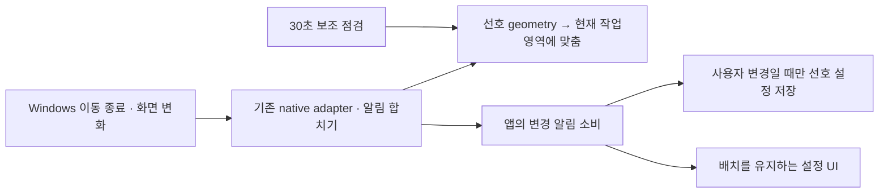
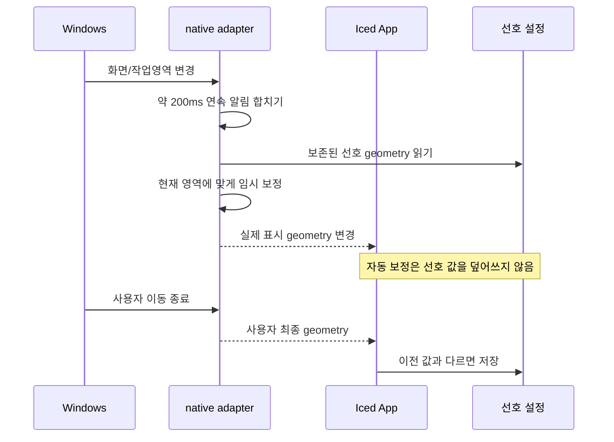

# Widget layout events — cycle / spec v1

유일 작성자: main(`/root`). 이 파일은 승인 범위·설계·실행 패킷·검증 근거를 유지한다. 작업자는 읽기만 한다.

## 승인과 현재 상태

- 2026-11-02 사용자가 앞선 비교표(정지 시 불필요 조회 축소, 이동 종료 저장, 설정 배치 유지, 화면 변경 알림과 보조 점검)를 직접 선택하고 “이 변경사항 수정해주고 … 먼저 분석하고 … 확인부터 하고 해결해달라”라고 지시했다. 앞선 제안에서 설명한 자동 보정과 선호 위치/크기 보존을 포함해 실행한다. 이미 선택한 방향의 재승인을 요구하지 않는다.
- 사용자 문제: 설정의 “Windows 작업 중…”이 반복되어 버튼·슬라이더 영역과 스크롤 배치가 움찔한다. 이전 검증은 실제 반복 상태의 배치를 확인하지 못했다.
- 시작 SHA `32edca33524329c9619873fff0f59635ddc82921`, clean tree 확인. 작업 브랜치 `codex/widget-layout-events`. PR #10은 open·미병합이며 해당 작업을 보존한다. 이번 PR은 우선 `codex/local-calendar-mcp`를 base로 하여 이번 변경만 검토할 수 있게 한다. 머지 승인 없음.
- 대표 Rust/Iced 버전 0.9.0→0.9.1. 대표 EXE는 `artifacts/TimeSchedule.exe` 하나이며 사용자 앱을 강제 종료하지 않는다.

## 조사와 선택

- Rainmeter `Skin.cpp`의 OnSysCommand는 이동 종료 후 위치를 저장한다. OnDelayedMove는 임시 해상도/작업영역 변경으로 원본 설정을 덮어쓰지 않고, authored 설정에서 새 모니터의 위치·크기를 계산하고 화면 안으로 제한한다. https://github.com/rainmeter/rainmeter/blob/master/Library/Skin.cpp#L5648-L5677
- PowerToys FancyZones는 WM_DISPLAYCHANGE와 WM_SETTINGCHANGE/SPI_SETWORKAREA를 받아 화면 영역을 다시 계산한다. https://github.com/microsoft/PowerToys/blob/main/src/modules/fancyzones/FancyZonesLib/FancyZones.cpp#L846-L860
- Windows는 이동 종료 WM_EXITSIZEMOVE 및 위치/크기 변경 WM_WINDOWPOSCHANGED를 제공한다. 현재 TimeSchedule도 native subclass에서 이동 시작/종료를 받고 있으나 저장은 1초 Position poll에 의존한다. 별도 native 복구 타이머도 1초마다 실행된다.
- Anthropic의 공개 실험은 단위/API 테스트 후 완료라고 판단하면서 실제 사용자 흐름의 실패를 놓친 사례와 실제 앱 조작 검증의 개선을 보고했다. Playwright 문서는 동일 환경에서의 이미지 비교를 설명한다. 이 앱은 Rust/Iced이므로 기존 실제 Iced 레이아웃·렌더 테스트와 소유한 Win32 fixture에 원리를 적용한다. 웹 테스트 도구를 제품에 추가하지 않는다.
  - https://www.anthropic.com/research/effective-harnesses-for-long-running-agents
  - https://playwright.dev/docs/test-snapshots
- 접근 비교: 간격만 늘리는 것은 배치 흔들림을 남긴다. 모든 보조 점검을 즉시 제거하면 바탕화면 자식 창의 화면/Explorer 변화 누락에 취약하다. 선택한 방향은 이벤트 우선 처리 + 드문 보조 점검 + 고정 UI 배치다. 실제 native 적용과 실패 테스트로 검증하고 성능 향상 수치를 미리 단정하지 않는다.

## 요구사항과 경계

1. 설정 버튼·불투명도 슬라이더와 상태 영역은 native 작업 전/중/후 같은 레이아웃을 유지한다. 자동 위치/상태 조회는 사용자 작업 중 표시를 켜지 않는다. 사용자 조작은 필요한 컨트롤만 잠시 비활성화하고 고정 높이 상태 영역에 표시한다. 오류를 숨기지 않는다.
2. 1초 Position 조회를 없애고 이동/크기 변경 알림을 소비한다. 사용자 이동·크기 조절 종료 시 최종 값만 저장하며 같은 값은 재저장하지 않는다. 이동 중 여러 이벤트와 자동 보정 이벤트는 묶고, UI-thread callback에서 DB 저장이나 긴 작업을 하지 않는다.
3. 해상도·작업영역·모니터/DPI 변화는 알림을 받아 처리한다. 중간 상태를 무작정 적용하지 않고 짧게 합쳐 보정한다(구현 기본값 200ms, 변경 이후 작업 실행; 의도적으로 30초 보조 주기를 기다리지 않음). 기존 main/소유 observer 등 알림을 실제 수신하는 경로를 확인한다. 위젯 자식 창만의 알림 수신을 무검증 가정하지 않는다.
4. 작은 화면/모니터 제거 시 위젯을 살아 있는 화면의 작업영역과 바탕화면 부모의 표시 영역 안으로 이동·축소한다. 사용자 지정 선호 위치(물리 좌표)·크기(기존 논리 크기)를 임시 보정과 분리해 원래 화면 영역이 다시 사용 가능하면 복원한다. 작업표시줄 제외, 음수 모니터 좌표, 배율, 잠금 상태에서도 화면 밖 복구를 유지한다. 사용자가 실제로 새 위치/크기를 정하면 그것이 새 선호 값이다.
5. native 복구 보조 타이머는 30초로 낮춘다. 앱 시작/위젯 표시/수동 복구/화면 변경 알림에는 즉시 또는 위의 짧은 합치기 후 확인한다. 숨김/잠금과 무관하게 필요한 화면 복구는 유지하되 동일 결과로 불필요 저장·로그·표시를 반복하지 않는다.
6. 별도 상주 프로세스/전역 키보드·마우스 감시/새 서버·모델 호출을 추가하지 않는다. 기존 500ms Tick의 다른 기능(MCP 변경·트레이·개발기록 등)은 보존한다. 별도 프로젝트/다이어리 기능 수정은 범위 밖이다.
7. 임시 보정이 사용자의 선호 값을 덮어쓰지 않는 재시작 경로까지 검증한다. 새 설정 필드가 필요하면 기존 저장 데이터와 호환되는 기본값을 사용한다. 기존 Tauri 경로를 보존하며 공용 native adapter 변경의 회귀를 검사한다.
8. 범위별 실패 재현을 먼저 만든다: 실제 설정 layout의 크기/위치·스크롤 상태 반복, native 이동 종료/화면 알림, 축소→복원, 설정 보존, idle poll 제거. 안정된 한 장의 이미지나 구현만 따라 하는 테스트로 시간에 따른 흔들림을 통과 처리하지 않는다.

## 구현 패킷

1. cycle: widget-layout-events
2. task: 설정 배치 안정화 및 이벤트 기반 geometry 저장/화면 보정
3. spec version: v1; 계획 `docs/superpowers/plans/2026-11-02-widget-layout-events.md`
4. owner: 구현 worker, 실제 executor `/root/implement_widget_events` (collaboration.spawn_agent 반환)
5. allowed files: `apps/timeschedule-native/**`, `crates/timeschedule-desktop/**`, 필요한 `Cargo.lock`, `README.md`, `CHANGELOG.md`, 관련 `tests/*widget*`, `scripts/*widget*`, `docs/widget-layout-events-verification.md`, 무시되는 `.cache/` 및 빌드 산출물. 이 cycle/plan 및 기존 MCP 기록은 읽기만. 전역 설정·사용자 데이터 수정 금지.
6. deps: 현재 AGENTS.md, 이 승인 spec, 시작 SHA, 기존 actual-renderer visual tests와 Win32 test_support
7. acceptance: 위 1–8, workspace Rust/Node 테스트·fmt·diff 검사·release build, 고정 변경의 별도 검토. 실제 사용자 모니터 설정을 바꾸거나 사용자 앱 종료 금지. 격리 fixture로 증거를 만들고 실제 화면/다중 모니터 검증 한계를 구분한다.
8. evidence: 원래 증상을 잡는 RED→GREEN, native 알림과 실제 geometry 경로 검증, 실행 명령·로그·생성 이미지·변경 파일 해시 manifest. 전체 raw logs/개인 데이터는 보고하지 않는다.
9. requested decisions: none. 계약/범위 변경이나 외부 차단은 main에게 보고. 같은 환경 차단이 2회 반복되면 무의미한 재시도를 중지하고 증거를 전달한다.
10. return limit: 1500단어. 완료·실패·미확인, 구현 인터페이스, 실행파일, needs/friction/harness/memory 관찰 후 제품 쓰기와 관련 실행 STOP. 커밋/푸시/PR/개발 기록은 main이 담당한다. 재위임 금지.

## 독립 검토 패킷

1. cycle: widget-layout-events
2. task: 고정 변경의 배치·이벤트·geometry 무결성·경량성 검토
3. spec version: v1
4. owner: 독립 검토, 실제 executor `/root/review_local_mcp` (기존 완료된 별도 실행자를 고정 대상 수신 후 새 패킷으로 재개한다)
5. allowed files: 읽기만; 필요 시 `.cache/`에만 검증 산출물. 제품/cycle/plan 수정 금지.
6. deps: 위 승인 spec, main의 고정 manifest/커밋, raw decisive test evidence
7. acceptance: 요구사항 1–8, 재진입/죽은 HWND/모니터 제거/DPI/임시 보정의 설정 오염/정지 상태 반복 작업/설정 레이아웃 회귀를 확인한다. 이미 유효한 검증은 불필요하게 반복하지 않는다.
8. evidence: 경로/줄/재현 조건/영향과 실제 증거, 미확인 한계. 최초 독립 평가 전 다른 검토자 의견이나 구현자의 자기 평가로 유도하지 않는다.
9. requested decisions: none. 구현과 동일한 외부 상태 확인·중지 정책을 따른다.
10. return limit: 1200단어, 완료 후 실행 STOP. 새 결함은 main을 통해 구현자에게 돌린다. 5개 완료 평가 관찰 포함.

## 체크포인트 / 완료 평가

- main이 선행 연구와 코드 구조 확인을 마쳤다. 사용자 선택과 명시 구현 지시를 승인 근거로 한다.
- 구현자에게 spec v1과 전체 패킷/계획을 전달했다. 기존 설정 UI의 native_busy 조건부 교체, 두 1초 점검, 선호 값과 실제 geometry의 혼용을 검증 대상으로 고정했다. 이전 reviewer의 제품 쓰기·실행은 중지된 상태이며, 새 고정 대상 이후 별도 패킷으로 재개한다.
- RED 재현: `.cache/widget-layout-events/layout-red.log`. 실제 `views::settings`와 retained Iced Tree/scroll 이벤트를 사용한 Midnight 620×480 검사에서 busy 전환 시 전체 내용 높이가 1411.0001→1331.5로 79.5만큼 줄고 후속 컨트롤 위치가 바뀌었다. 정상→작업 중→정상 반복 및 두 테마/크기를 대상으로 한다.
- 구현 인터페이스 결정: 기존 native adapter에 WidgetGeometry(물리 위치/논리 크기), configure_geometry, manager top-level HWND의 observe_display_changes, take_geometry_events를 최소 추가한다. 기존 500ms Tick은 HWND를 조회하지 않고 합쳐진 알림만 소비한다. 사용자 geometry와 실제 표시 크기·오류를 구분하며 큐는 소유 HWND별로 합치고 수명/동일성을 검사한다. main이 승인 범위 내 선택임을 확인했다.
- 0.9.0 기준 EXE SHA는 `5318A00196333AD681636C3F69CBE43E7C6665DEC6FDB3D58254ED8FB5BE881D`. 원본 대표 앱을 보존하고 무시되는 캐시에 복사해 합성 DB fixture로 실행했다. Computer Use 캡처 timeout은 원인 수정/렌더러 검증과 구분한다.
- 중간 검증: 실제 Iced retained tree의 정상/작업 중/완료 상태와 두 테마·두 창 크기 검사를 GREEN으로 확인했다. main은 생성된 Midnight 정상/작업 중 및 Porcelain 작업 중 이미지를 직접 열어 버튼·슬라이더·아래 크기 입력란의 배치가 유지되는 것을 확인했다. 실행 중 사용자 창 캡처와 동일한 증거로 표현하지 않는다.
- native fixture는 테스트가 소유한 숨김 top-level HWND에 화면/작업영역/DPI 메시지를 전달하고 실제 posted message·timer를 펌프했다. 200ms 합치기, 영역 축소→복원, 잠금, 최종 이동 저장, 자동 축소 중 사용자 이동, 선호 설정 재시작, 파괴된 HWND 알림 제거를 검사한다. 실제 모니터 분리·화면 배율 변경·Explorer 재시작은 미검증이다.
- 중간 전체 검증 로그 `.cache/widget-layout-events/workspace-tests.log`: core 38 + desktop 13 + native 83 = 134 통과, 기존 보조 fixture/수동 preview 2개 ignored. Node 33 통과. 릴리스 고정 manifest 및 독립 검토는 아직 대기 중이다.
- 고정 검토 대상(2026-11-02 14:25 UTC): worker `/root/implement_widget_events`가 제품 쓰기·관련 실행 STOP을 반환했다. `.cache/widget-layout-events/manifest.json` SHA256 `80871D11620EAEA81B268AAC801E3E99FF27882DDBF1D197AA9D489789C8DBA1`에 제품/문서 9개 경로와 결정적 로그·8개 renderer 이미지를 고정했다. 시작 SHA 이후의 해당 경로 diff를 독립 검토한다. main 소유 cycle/plan의 후속 진행 갱신은 제품 고정 대상에 포함되지 않는다.
- 릴리스 EXE: `target/release/timeschedule-native.exe`, 0.9.1, 8,264,704bytes, SHA256 `06935AADAAB9A647AA4D204B4E0E09722640547BA27B84657DA3F983E891AD4D`. build-native가 native83 테스트와 release 컴파일을 마쳤으나 사용자 대표 앱 실행으로 교체만 보류했다. 실제 설치 완료와 구분한다.
- 독립 검토의 실행 제약: main의 격리 A/B CPU·메모리 측정 중에는 소스/기존 결정적 로그 중심으로 검토한다. 추가 컴파일·실행 검증이 필요하면 먼저 main에게 알려 측정과 겹치지 않도록 한다. 검토 범위/합격 기준을 줄이는 제약이 아니다.
- A/B 측정 완료: `.cache/widget-events-perf-2b84baca-b3f4-434f-b25f-59dd4bb73e78/result.json`. 같은 합성 DB, MCP 켬, 15초 안정화 뒤 약59초씩 before/after/after/before. 표시된 메인 창1176×859 및 위젯960×640,96DPI·최소화 없음이 각 측정 전후와 버전 간 동일했다. 0.9.0 작업집합34.52/34.94MiB·1코어 CPU3.19/4.48%, 첫 0.9.1 후보34.87/34.66MiB·CPU2.31/2.06%(12논리코어 전체 기준 기존0.266/0.373%, 후보0.193/0.172%). 사용자 다른 작업을 통제하지 않은 짧은2회 측정이므로 일정한 절감률·장기 성능으로 일반화하지 않는다. 측정에 생성한4개 fixture 프로세스만 확인 후 종료했다. 후속 변경이 있으면 적용 가능 범위를 구분하고 필요한 검증만 갱신한다.
- 첫 독립 검토 `/root/review_local_mcp`: 고정39개 항목 해시 일치와 원본 로그/renderer를 확인한 뒤 P2 1건을 반환하고 STOP했다. apply_geometry_event/NativeDone(Err)가 app.error를 채우면 shell.rs의 가변 높이 경고가 설정 상단에 추가된다. 기존 테스트는 views::settings 내부만 검사해 전체 화면 이동을 놓쳤다. main은 해당 소스 경로를 확인해 수정을 채택했다. 추가로 geometry 오류 이후 정상 이벤트가 와도 실패 문구가 남는 경로를 같은 오류 상태 회귀 범위에서 확인한다. 정상 UI·native adapter의 나머지 검토 결과와 검증 한계는 유지한다.
- 영향 수정의 RED: `.cache/widget-layout-events/full-shell-red.log`. 실제 app.view(manager) retained shell에 geometry 오류를 전달한800×620 Midnight에서 설정 viewport y125.0→184.2, 높이477.0→417.8(59.2px 이동)로 실패했다. 독립 리뷰의 소스 근거를 실행 재현으로 확인했다.
- v2 고정 인계: 구현 worker가 제품 쓰기·실행 STOP을 반환했다. `.cache/widget-layout-events/manifest-v2.json` SHA256 `D298DD1D99C5B753A82A7FF921B264BD400B1B1A73CCE090E8A89897A4D3D0EF`, 제품/검증 문서11개 경로. main이 파일 해시 일치를 확인했다. 최종 EXE0.9.1,8,271,360bytes,SHA256 `98A810C5D9272BAA9083F3C6AF0D8F9188710F3D99058BAAE5A3D5370C1E91C7`. native adapter는 최초 고정 해시와 같고, 변화는 앱 오류 상태·shell 표시·전체 화면 테스트와 검증 문서다.
- v2 증거: workspace136 통과·2 ignored, native85 통과·1 ignored, fmt/diff 및 release1m26s 성공. Node33은 관련 경로 변경이 없어 기존 증거를 재사용한다. full-shell RED→GREEN은 두 테마/두 창 크기·geometry/native/observer 오류·기존 별도 앱 오류 유무에서 위치·스크롤 유지와 오류 출처별 해제를 검증했다. main이 images-v2의 Midnight 정상/오류/복구3장을 직접 열어 같은 배치를 확인했다. 대표 EXE 교체는 여전히 사용자 앱 실행으로 보류 중이다.
- 독립 재검토 패킷 갱신: 위 독립 검토10항 패킷의 고정 대상은 manifest-v2로 대체한다. 이전 native adapter·정상 UI 평가는 같은 해시에 대해 재사용하고, P2 수정·오류 복구·추가 테스트/문서를 중심으로 영향 범위를 재검토한다. reviewer는 `/root/review_local_mcp`, 제품·cycle 쓰기 금지와1200단어/STOP 조건 유지. 현재 최종 EXE idle1회 측정은 약1분 내 종료되므로 추가 런타임 검증이 필요하면 main과 조율한다.
- v2 EXE 실측 완료: `.cache/widget-events-perf-4ac8ec86-768f-4639-9ef2-6bc3a4eebe97/result.json`. EXE 해시98A810C5…C1E91C7,15초 안정화/58.86초 관측, 작업집합34.87MiB·private working set15.57MiB·private commit16.76MiB·1코어CPU2.150%/12논리코어전체0.179%. 표시된 메인 창·위젯의 위치/크기/96DPI/최소화 상태가 이전 비교 및 측정 전후와 같았다. 사용자 다른 작업은 통제하지 않았으며 fixture만 종료했다. 후속 v3 검색 가시성 조건은 이 유휴 측정 경로를 변경하지 않으므로 전체 A/B를 반복하지 않고 측정 아티팩트 해시를 명시해 재사용한다.
- 사용자 저장·종료 응답 후 main이 실행 프로세스 부재를 확인하고 build-native를 실행해 v2 EXE를 대표 경로에 설치했다. `.cache/widget-layout-events/publish-final.log`에 테스트85 통과/1ignored·release cache·동일 EXE 해시·이전 EXE archive를 확인했다. 이후 검색 오류 수정 v3를 같은 스크립트로 최종 설치 예정이며, v2 설치가 최종 승인·머지를 뜻하지 않는다.

## 영향 수정 패킷 — 전체 설정 오류 전환

1. cycle: widget-layout-events
2. task: 독립 검토 P2의 실제 오류→전체 shell 배치 경로 수정, 복구된 geometry 오류의 오래된 표시 제거
3. spec version: v1 유지; 기존 요구1·8의 충족 수정이며 범위 확장 아님
4. owner: 구현 worker `/root/implement_widget_events` 재개. reviewer `/root/review_local_mcp`는 첫 평가 후 STOP
5. allowed files: 기존 구현 패킷의 앱 소스·테스트·검증 문서 및 무시되는 `.cache/`/빌드 산출물. cycle/plan은 main만 작성. 사용자 데이터·디스플레이·실행 앱 조작 금지
6. deps: 최초 manifest SHA80871D11…C8DBA1, 위 P2 소스 근거와 기존 유효 테스트; 네이티브 adapter 변경은 원인상 필요하지 않으면 유지
7. acceptance: 실제 geometry 오류·NativeDone 실패(필요하면 observer 실패)를 앱 상태로 전달한 뒤 `app.view(manager)` 전체 shell retained tree/스크롤/컨트롤 좌표가 유지되어야 한다. 오류 내용은 고정된 상태 영역에서 읽을 수 있고 자동 복구 시 stale geometry 실패 표시가 남지 않는다. 다른 기능의 오류를 지우거나 숨기지 않는다. 기존 실패 제한/STOP 정책을 그대로 적용한다
8. evidence: 수정 전 full-shell RED→GREEN, 오류→정상·반복 상태 및 두 테마/크기, 관련 앱 테스트·fmt/diff·release build. 기존 변경 없는 Node/native adapter 증거는 재사용할 수 있다. 최종 파일·EXE 해시 manifest-v2와 실제 실행 결과/한계 제공
9. requested decisions: none. 외부 차단/계약 변경은 main 보고. A/B는 종료되어 추가 컴파일 가능
10. return limit: 1000단어. 완료 후 제품 쓰기·실행 STOP. main이 고정 v2의 영향 범위 독립 재검토·필요한 실측·대표 EXE 전달·PR/기록을 진행한다. 커밋/푸시/PR/기록 및 재위임 금지

## 영향 수정 패킷 — 설정 검색 중 오류 가시성

- v2 독립 재검토는 최초59.2px 이동 P2의 해소를 확인했다. 다만 page==Settings일 때 native 배너를 생략하는 조건과 search가 비어 있어야 실제 settings를 그리는 조건이 달라, 설정에서 검색한 동안 위젯 오류가 어느 영역에도 표시되지 않는 P2를 반환했다. main이 소스 경로를 확인해 수정 채택했다. reviewer `/root/review_local_mcp`는 v2 평가 후 STOP했다. 사용자 저장·완전 종료 응답은 받았으며, 머지 승인을 의미하지 않는다.
1. cycle: widget-layout-events
2. task: 실제 설정 표시 조건과 native 오류 배너 생략 조건을 일치시켜 검색 중 오류 가시성 보존
3. spec version: v1 유지, 기존 요구1의 오류를 숨기지 않는 경로 충족
4. owner: 구현 worker `/root/implement_widget_events` 재개; reviewer `/root/review_local_mcp` STOP 상태
5. allowed files: 기존 앱 소스/회귀 테스트/검증 문서/무시되는 캐시·빌드 산출물. cycle/plan은 main만 작성. unrelated 변경·native adapter 확장·사용자 데이터 변경 금지
6. deps: manifest-v2, shell.rs의 page/search 분기와 실제 Message::Search·geometry/native/observer 오류 경로, 이전 고정 검증
7. acceptance: Settings→실제 Search→세 오류 출처 수신 시 전체 view에 오류 텍스트가 보이고, 검색을 비우면 고정 설정 영역에서 보인다. 정상 설정 레이아웃은 안정적이어야 하며 다른 앱 오류를 보존한다. 검색 결과 기능 자체를 변경하지 않는다
8. evidence: 검색 오류 가시성 RED→GREEN, 관련 앱 테스트·fmt/diff·release 및 manifest-v3. 변경 없는 adapter/Node와 타 검증은 재사용. 새로운 원인 없는 넓은 검증 추가는 하지 않는다
9. requested decisions: none. 기존 외부 차단/STOP 정책 유지. 사용자 앱이 다시 실행 중이면 교체를 보류하고 main에게 알린다
10. return limit: 700단어; 완료 후 제품 쓰기·실행 STOP. 커밋/푸시/PR/기록은 main 담당, 재위임 금지. main은 v3의 영향 범위를 같은 독립 reviewer에게 재검토한다

## 최종 고정 체크포인트

- v3 구현자 STOP. `.cache/widget-layout-events/manifest-v3.json` SHA256 `B21C44230623FD0277B5EA7065C555E8D6867E2DD62A74C5993A831EB6B3D451`. 제품 추가 수정은 실제 settings 내용 표시 조건과 배너 생략 조건의 일치 한 곳이며 검색 오류 가시성 회귀 테스트/검증 문서를 함께 갱신했다.
- 실제 Search→오류→전체 view에서 오류 텍스트0개(기대1) RED 후 GREEN. 두 테마/세 오류 출처/검색중·완료/빈·공백으로복귀/별도 app.error 보존을 검사했다. 네이티브86통과·1ignored, fmt/diff 통과. 변경 없는 core38·desktop13·Node33 증거를 재사용한다(전체 Rust 합산137통과·2ignored, v3에서 workspace 전체를 다시 실행했다는 뜻은 아니다).
- build-native-v3.log: release1m38s 성공, 사용자 앱 미실행 확인 후 대표 `artifacts/TimeSchedule.exe` 교체 완료. 0.9.1,8,271,360bytes,SHA256 `DAD40AA622D11BFDFD49EDB283C56AB66F564F4382F81A16C7E5075112A4BA5E`. 이전 실행 파일은 archive에 보관했다. 사용자 앱/개인 데이터·디스플레이 조작 없음.
- 독립 재검토 고정 대상은 manifest-v3로 갱신한다. 동일 reviewer/원래10항권한·STOP조건을 유지하고 v2 대비 표시 조건·추가 회귀·문서/산출물 일치에 집중한다. 이전 변경 없는 범위 평가는 유지한다. 머지 승인·사용자 실제 모니터 QA는 여전히 대기다.
- 최종 독립 재검토 `/root/review_local_mcp`: v3의62개 항목 해시 일치, v2 대비 지정된 shell/테스트/문서3개만 변경, 대표 EXE와 원본 일치를 확인했다. 두 P2는 해소됐고 영향 범위에서 추가 확정 결함은 없음을 반환한 뒤 STOP했다. main은 실제 RED/GREEN 로그·renderer·파일해시와 비교해 승인 요구 충족을 확인했다. 실제 하드웨어 QA 한계를 남긴 채 사용자 검토용 전달로 진행하며 자동 머지하지 않는다.

## 완료 평가 — 최종 v3 대상

| 항목 | 관찰과 판단 |
|---|---|
| Context | 이 cycle/spec v1과 고정 manifest로 구현·검토를 연결했다. 이전 MCP 작업은 기반으로 보존하고 새 기능 평가에 섞지 않았다. 중간 요약 뒤에도 실패·STOP·미검증 상태를 유지했다. |
| 반복 역할 | 별도 실제 reviewer가 설정 내부 검사에서 빠진 전체 shell 오류·검색 가시성2건을 발견했다. 기존 worker가 RED→GREEN으로 수정했다. 새 자동화·상주 runner를 추가할 필요는 관찰되지 않았다. |
| Dependencies | 기존 native adapter와 Iced 상태/renderer를 사용한다. 새 라이브러리·상주 프로세스·전역 입력 감시·설정 마이그레이션은 없다. UI 상태와 자동 geometry의 저장 책임을 분리했다. |
| File indexing | README/CHANGELOG에서 검증 문서로 연결하며, 이 cycle/실행 계획/최종 manifest가 승인·구현·증거의 기준이다. 실제 경로와 해시를 확인했다. 새 영구 인덱스는 만들지 않았다. |
| Code quality | 배치79.5px, 전체 shell59.2px, 검색오류0회 표시를 각각 재현해 수정했다. 최종 native86 및 미변경 core38/desktop13/Node33 증거, release/설치 일치, 독립 재검토를 확보했다. 물리 모니터·배율·Explorer 재시작·사용자 전체 드래그·접근성은 미검증으로 남긴다. |

### Needs and friction

기존 캡처 도구가 사용자/격리 앱 창에서 timeout되어 실행 창의 시각 확인을 주장할 수 없었다. 실제 Iced renderer와 retained 전체 화면·소유 Win32 메시지 fixture로 필요한 자동 증거를 확보하고 수동 QA 범위를 따로 남겼다. 사용자 앱 실행 중 교체가 보류됐으나 저장·완전 종료 응답 이후 동일 빌드 스크립트로 안전하게 설치했다.

### Harness

부분 view 검사만으로 전체 앱 상태 전환을 통과 처리하는 누락을 실제 full-shell와 Search 메시지 회귀로 보완했다. 두 테마/좁은 창/스크롤/오류 출처별 복구가 코드에 남는다. 미변경 범위 검증은 재사용하고 최종 수정 영향 범위만 갱신했다. 이 결과가 모든 실사용 모니터 조합이나 접근성 검증을 대신하지 않는다.

### Agent memory management

main만 이 cycle/plan을 작성하고 worker/reviewer의 고정 인계·STOP을 기록했다. v1/v2/v3 파일해시와 결정적 실패를 무시되는 캐시에 보존했으며 오래된 후보를 최종본으로 표현하지 않는다. 전역 기억/설정·정기 자동화는 추가하지 않았다. 개인 기록 전달 ID·Space 링크·인증정보는 이 추적 문서에 넣지 않는다. 사용자 최종 수락 전 이 cycle은 유지한다.
- Needs and friction: 실제 화면의 반복 상태를 확인하지 못했던 검증 누락을 이번 회귀 테스트의 대상으로 삼는다.
- Harness: 네이티브 앱에 웹 E2E를 억지로 추가하지 않고 기존 Iced renderer와 소유 Win32 fixture를 활용한다. 기존 Computer Use 창 캡처 timeout 이력이 있으므로 자동 캡처 실패를 시각 검증 성공으로 취급하지 않는다.
- Agent memory management: 이번 승인/계획/검증은 이 파일에 유지한다. 기존 MCP 사이클/개인 기록 정보는 복제하지 않는다.
