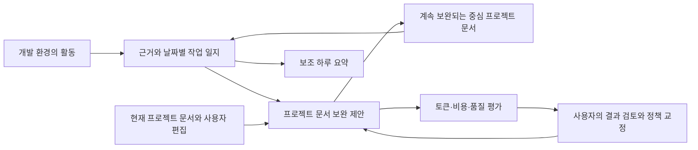

# TimeSchedule 제품 계획·요구사항 v0.2

작성일: 2026-11-17 · 기준 시간대: Asia/Seoul

문서 상태: v0.1을 보존하고 사용자 정정을 반영한 요구사항 초안.
사용자가 직접 밝힌 요구와 작성자의 설계·우선순위 제안을 구분한다.
이 문서는 구현 완료 보고나 개별 도구의 도입 확정 문서가 아니다.

v0.2에서 사용자가 확정한 방향은 **프로젝트 문서 하나를 중심으로 계속 보완하고, 날짜별 작업·고민·실패·검증 기록은 그 설명의 근거로 함께 남기는 것**이다. 단순히 날짜별 일지를 한 화면에 모으는 것으로 이 요구를 충족했다고 보지 않는다. 구현 후 실제 토큰·비용·품질 시험 결과를 사용자가 확인하며 갱신 방식·모델·빈도·예산을 교정해야 한다는 점도 사용자 요구다. 구체적인 구현 방식과 수치 기준은 아직 확정하지 않았다.

후속 결정: 사용자는 **A안 — Windows 로컬 Codex 앱과 Claude Code부터 지원**하기로 확정했다. 클라우드 실행의 자동 수집은 첫 지원 범위에서 제외한다. 로컬은 개발 작업의 실행 위치를 뜻하며 모델의 오프라인 실행이나 자료의 외부 전송 허용을 뜻하지 않는다. 실제 설치 버전의 연결 가능 범위는 M0에서 검증한다.

후속 결정: 새 프로젝트 연결도 **A안 — 새 작업 경로를 처음 한 번 확인하고 이후 자동 연결**로 확정했다. 수집 연결이 활성화된 개발 환경에서 발견한 경로에 대해 새 프로젝트/기존 프로젝트 연결/제외를 선택한다. 확인한 경로는 이후 반복 확인 없이 연결하며 새 경로는 기존 등록을 이름만으로 상속하지 않는다. 확인 전에는 후보에 필요한 최소 경로 정보만 다루고 대화·코드 본문은 자동 저장하지 않는다. 이는 원문 보관 기간이나 외부 모델 전송 범위까지 확정한 것이 아니다.

후속 결정: 원문 보관은 **B안 — 핵심 근거를 유지하고, 나머지 허용된 원문은 일정 기간 로컬 보관**으로 확정했다. 보관 기간은 실제 사용 중 용량 증가·과거 자료 재조회·누락 교정 필요를 보고 사용자가 정한다. 30일은 오래된 원문의 압축 전환을 검토하는 예시일 뿐 확정된 압축·삭제 기한이 아니다. 압축 방식과 전환 기준은 검토안의 제안이다.

후속 결정: 문서 보완용 외부 모델 전송은 **A안 — 허용한 문서·구조화 일지와 필요한 근거 발췌까지 자동 전송, 추가 원문은 범위를 사용자에게 확인**으로 확정했다. 허용 범위 안의 매번 전송마다 재확인하지 않는다. 추가 원문이 필요하면 대상과 이유를 제시하고 확인 전에는 전송하지 않는다. 발췌 분량과 모델은 실제 토큰·비용·품질 시험 결과를 보고 교정한다. 원문 선별에 외부 모델을 사용하는 경우에도 같은 전송 경계를 적용한다. 이번 정책 확정은 실제 모델 호출이나 비용 시험 실행을 시작한다는 뜻이 아니다.

후속 결정: 중심 문서 편집은 **A안 — 앱 안에서 편집하고 Markdown으로 내보내기**로 확정했다. 내보낸 파일은 출력 시점의 사본이며 외부에서 수정해도 앱에 자동 반영하지 않는다. 외부 파일 편집의 자동 반영은 나중에 필요하면 검토한다. 사용자 정정 보존 요구는 유지하며 기존 문서함 파일의 편집 정책을 소급 변경하지 않는다.

후속 결정: 첫 시범 배포는 **A안 — 수집·저장부터 시험하고 중심 문서 보완과 비용·품질 비교를 단계적으로 추가**하기로 확정했다. 각 단계의 확인 범위와 미구현 기능을 구분하고 모델 호출을 도입하는 첫 호출부터 사용량을 기록한다. 수집 시범만으로 개편 완료를 선언하지 않으며 실제 시험 결과에 따른 사용자 교정까지 이어간다.

후속 결정: 기존 기록은 **A안 — 과거 글을 그대로 근거로 연결하고 새 작업과 함께 중심 문서를 보완**하기로 확정했다. 필요한 과거 기록만 나중에 선택해 재분석한다. 과거 글과 사용자 정정은 보존하며 새 결과가 이전 판단·실패를 지우지 않는다. 이는 프로젝트 설명 문서의 연속성을 뜻하며 개발 에이전트가 과거 대화를 자동으로 읽고 코드 작업을 재개하는 기능을 뜻하지 않는다.

후속 결정: 하루 경계는 **A안 — 한국 시간(Asia/Seoul) 자정을 기준으로 날짜별 일지를 구분**하기로 확정했다. 실제 발생 시각을 보존하고, 자정을 넘겨 이어진 작업은 중심 문서와 근거 연결로 묶는다. 날짜가 바뀌어도 프로젝트 중심 문서는 계속 이어지며 이 결정은 자정의 모델 호출이나 요약 실행을 뜻하지 않는다.

후속 결정: AI 보완 결과는 **A안 — 초기에는 사용자가 제안을 확인한 뒤 본문에 반영**하기로 확정했다. 실제 품질과 확인 부담을 보고 자동 반영 범위를 나중에 검토한다. 대기 중에도 새 활동은 수집하며 현재 본문에 미반영된 근거와 제안 상태를 표시한다. 제안 생성의 모델·분량·빈도는 실측 교정 대상으로 유지한다.

용어는 [프로젝트 기록 용어집](../GLOSSARY.md), 현재 구현과 제안의 차이는 [v0.2 검토안](TimeSchedule_Requirements_Review_v0.2_2026-11-17.md)을 따른다. 이번 교정은 문서 작업이며 앱 구현, 실제 비용 측정, 자동화 활성화를 포함하지 않는다.

## 1. 만들려는 것

**Codex 앱과 Claude Code로 진행하는 여러 개발 프로젝트마다 하나의 중심 프로젝트 문서를 계속 보완해 무엇을 만들었고 왜 바꾸었는지 설명하고, 날짜별 작업·고민·실패·검증 기록을 그 설명의 근거로 보존하는 TimeSchedule 기능.**

기록을 위해 개발 흐름을 자주 끊지 않아야 한다. 나중에 “무엇을 만들었는지”뿐 아니라 “왜 그렇게 만들었고, 어떤 실패를 거쳐 무엇이 개선되었는지”를 설명할 수 있어야 한다.

### 핵심 결과물

1. 프로젝트 목적·주요 기능·현재 상태·주요 변화와 그 이유를 설명하며 계속 보완되는 프로젝트 문서 하나.
2. 그 문서의 설명과 연결되는 날짜·시각별 작업 일지, 그리고 해당 날짜를 정리한 보조 하루 요약.
3. 중요한 결정, 실패한 접근, 트러블슈팅, 검증 결과와 원래 근거의 연결.
4. 초기 상태에서 현재 상태까지의 변화와 개선을 설명할 자료.
5. 프로젝트 종료 또는 사용자가 원하는 시점의 회고·포트폴리오 초안.
6. 기록과 문서의 품질·누락, 실제 토큰·비용, 사용자 수정 부담을 측정해 결과를 보여 주고 운영 방식을 교정하는 기능.

최종 포트폴리오 생성은 장기 목표다. **프로젝트 문서의 지속 보완은 초기 제품의 중심 기능이며 프로젝트 종료까지 미루지 않는다.** 수집 기반을 먼저 시범 배포할 수 있지만 그것만으로 중심 문서 요구를 구현 완료했다고 보지 않는다.

## 2. 사용자 요구와 설계 제안의 구분

### 2.1 대화에서 확인한 사용자 요구

| ID | 요구 | 해석과 범위 |
| --- | --- | --- |
| UR-01 | Codex 앱과 Claude Code에서 진행하는 여러 프로젝트를 기록 | 현재 TimeSchedule 저장소 하나에 한정된 방식을 확장한다. 일반 소비자용 채팅 전체 수집은 요청 범위에 포함하지 않는다. |
| UR-02 | 프로젝트 문서 하나를 중심으로 계속 보완하고 날짜별 기록도 근거로 유지 | 중심 문서는 무엇을 만들었고 왜 바꾸었는지를 설명한다. 날짜별 작업·고민·실패·검증 기록은 그 설명의 근거이며 단순한 시간순 목록으로 중심 문서를 대체하지 않는다. 물리적으로 파일 하나 또는 DB 행 하나여야 한다는 요구는 아니다. |
| UR-03 | 날짜·시간순 작업 기록과 하루 요약 | 그날 무엇을 했는지 일정·다이어리에서 확인하고, 하루가 끝나면 핵심을 정리한다. 정확한 마감 시각은 미정이다. |
| UR-04 | 프로젝트 소개와 핵심 특징 설명 | 해결하려는 문제, 대상 사용자, 주요 기능, 기술적 특징을 축적한 근거로 설명한다. |
| UR-05 | 고민·개선·트러블슈팅을 보존 | 초기 구현에서 무엇을 왜 바꿨는지, 실패와 해결 과정을 남긴다. 수치가 없으면 개선량을 꾸며내지 않는다. |
| UR-06 | 최종 회고·포트폴리오는 프로젝트 종료 후여도 됨 | 진행 중인 프로젝트 문서의 지속 보완은 초기 요구다. 목적에 맞게 다시 구성하는 최종 포트폴리오는 MVP의 필수 완료 조건이 아니다. |
| UR-07 | 구현 후 실제 토큰·비용·품질 시험으로 기록 효율을 조정 | 프로젝트 문서 갱신을 포함한 단계별 실측 결과와 한계를 사용자에게 보여 준다. 추정만으로 저비용·고효율을 확정하지 않는다. |
| UR-08 | 결과를 보면서 사용자가 운영 방식을 지속 교정 | 갱신 범위·빈도·모델·예산을 비교 가능한 실험으로 조정하고, 결과·사용자 판단·변경 이유를 남긴다. 시험 전 후보를 최종 기본값으로 확정하지 않는다. |

### 2.2 이 문서에서 제안하는 기본 방향

- 기존 Windows 네이티브 앱과 저장 기반을 확장한다.
- 프로젝트별로 등록·허용된 개발 환경과 자료를 수집 대상으로 삼는다.
- MCP, 환경별 훅, 작업 에이전트의 짧은 기록, 접근 가능한 로그의 재수집을 조합한다.
- 프로젝트 문서를 기본 진입점으로 두고 문서의 설명에서 날짜별 작업 일지·근거로 이동하게 한다. 내부에서는 문서 수정본, 활동, 근거를 구분해 저장한다.
- 소스 변경과 커밋 외에도 의미 있는 설계 결정·조사·실패·검증을 기록할 수 있게 한다.
- 저장·중복 제거·전달은 코드가 처리하고, 요약·분석은 필요할 때 모델을 사용한다.
- 생성된 내용과 사용자가 고친 내용을 구분한다.
- 문서 전체 재작성·부분 갱신과 즉시·묶음 처리의 비용·품질을 구현 후 비교한다. 정확한 모델명, 갱신 시점, 하루 마감 시간, 원문 보관 기간, 호출 예산은 사용자 결과 검토를 거쳐 조정한다.

중심 프로젝트 문서와 근거 일지를 함께 둔다는 목표, 실측 결과를 보고 교정한다는 절차는 사용자 확인 사항이다. 나머지 기술 방식과 기본값은 목적을 달성하기 위한 제안이며 확정으로 취급하지 않는다.

## 3. 현재 출발점과 바꿔야 할 방향

기존 코드 검토 기준: TimeSchedule main의 864bac194384acb0d7c5aceea6613cde1bec9979.
사용자의 Windows 실행 환경과 로컬 기록 건수는 이번 문서 작성에서 다시 검사하지 않았다.

| 항목 | 현재 확인된 기반 | 이번 목표에서의 확장 |
| --- | --- | --- |
| 앱 | Rust/Iced 네이티브 앱과 SQLite | 기존 일정·다이어리 경험을 유지하며 프로젝트 기록 화면 확장 |
| 자동 개발 기록 | 작업 에이전트가 내용을 작성하고 Node·Rust 경로가 검사·저장 | 여러 환경의 활동 수신과 누락 확인, 이후 분석 단계 추가 |
| 기록 판정 | 실제 개발 파일 변경과 커밋 근거 중심 | 기록 가치와 구현·검증 상태를 분리; 커밋 없는 결정과 실패도 표현 |
| 프로젝트 연결 | 저장소 경로 중심 | 경로 변경·복수 작업 공간을 고려한 프로젝트 식별 |
| MCP | 일정용 도구와 로컬 서버 | 프로젝트 활동 기록·조회용 계약 추가 |
| 전달·충돌 | 로컬 문서, 수신함, 영수증, 사용자 편집 충돌 보호 | 재사용 가능한 부분을 유지하며 활동 단위 수신·수정으로 확장 |
| 중심 프로젝트 문서 | 프로젝트 설명과 개별 작업 원문은 있으나 지속 보완 문서의 갱신 계약은 없음 | 현재 상태와 변화 이유를 근거에 연결하는 중심 문서, 수정본·갱신 필요·사용자 편집 관리 |
| 포트폴리오 | 기존 근거 발췌·정렬 기반 초안 | 긴 기간의 결정·개선·사례를 근거와 연결하는 회고로 확장 |

근거: [기록 처리][R1], [Git 판정][R2], [현재 MCP][R3], [저장·수신 계약][R4], [근거 처리][R5], [네이티브 앱 구성][R6].

“별도 요약 모델을 부르지 않는다”와 “기록에 모델이 전혀 관여하지 않는다”는 구분해야 한다. 현재도 작업 에이전트가 원문을 작성하는 단계에는 그 에이전트의 모델이 관여한다.

## 4. 범위와 사용 흐름

### 4.1 1차 대상

- 사용자 본인의 개발 프로젝트.
- 사용자 확정 범위인 Windows 로컬 Codex 앱의 개발 작업과 Claude Code 세션. 실제 설치 환경에서 연결·이벤트 지원을 확인한다.
- 기존 TimeSchedule Windows 앱, 로컬 저장, 등록된 작업 경로.
- 수집 가능한 Git 자료, 실행 결과, 작업 에이전트가 명시적으로 작성한 기록, 선택한 원문 발췌.

지원 여부는 앱 이름만으로 판단하지 않는다. 앱·에이전트 버전, 운영체제, 로컬/클라우드 실행 모드, 훅과 로그 접근 범위를 함께 기록한다.

### 4.2 후속 확장

- 필요가 확인된 클라우드 개발 실행의 기록 수집. 원격 전달·인증·근거 접근 범위를 별도 검증한다.
- 종료된 프로젝트의 과거 자료 가져오기.
- 프로젝트 전체 회고와 포트폴리오 출력.
- 원문 의미 검색, 고급 트러블슈팅 사례 연결.
- 필요한 경우 원격 접근·여러 기기 동기화.

### 4.3 기본 사용 흐름

1. 수집할 개발 환경을 연결한다. 새 작업 경로를 발견하면 처음 한 번 새 프로젝트/기존 프로젝트 연결/제외를 확인한다. 등록한 경로의 이후 활동은 해당 프로젝트로 자동 연결한다.
2. 사용자는 평소처럼 개발한다. 시스템은 수집 가능한 활동을 기록하고, 작업 에이전트는 중요한 변경 시점에 짧은 구조화 기록을 남긴다.
3. 프로젝트를 열면 중심 문서에서 무엇을 만들고 있는지, 현재 무엇이 구현됐는지, 무엇을 왜 바꿨는지 읽는다. 문장의 근거를 선택하면 관련 날짜의 작업·고민·실패·검증을 확인한다.
4. 새 활동·정정이 들어오면 관련 문서의 갱신 필요 상태를 표시한다. 승인한 실행 정책에 따라 현재 문서를 보완하거나 사용자 편집본과 비교할 갱신 제안을 만든다. 매 활동마다 전체 문서를 다시 쓰는 것은 필수 요구가 아니다.
5. 날짜별 일지와 하루 요약도 별도로 읽을 수 있다. 하루 마감 또는 “오늘 정리” 요청으로 보조 요약을 만들고, 실행하지 못한 날짜는 다음 실행 때 처리한다.
6. 사용자는 잘못된 연결·빠진 근거·문서 표현을 고치고, 단계별 토큰·비용·품질 결과를 보면서 갱신 범위·빈도·모델·예산을 교정한다.
7. 프로젝트 종료·마일스톤·회고 요청 시 중심 문서와 원래 근거를 다시 조회해 목적별 정리본을 생성한다.

작업 에이전트의 체크포인트는 사용자에게 매번 일지를 직접 작성하게 하는 기능을 뜻하지 않는다. 사용자의 개입은 잘못 연결된 자료, 빠진 중요한 맥락, 공개할 문장의 확인처럼 자동화가 해결하지 못한 부분에 집중한다.

### 4.4 화면 예시 — 설명을 위한 가상 기록

프로젝트 A를 열면 다음과 같은 중심 문서를 먼저 읽는다. 아래 내용은 설명용이며 실제 구현·검증 결과가 아니다.

> 프로젝트 A는 어떤 문제를 해결하기 위해 만든 앱이다. 현재 구현한 핵심 기능은 …이며, 다음 범위까지 검증했다. 처음에는 파일에 직접 저장했으나 두 작업이 겹칠 때 충돌을 관측해 저장 방식을 바꾸었다. 변경 근거는 해당 날짜의 실패·대안 검토·수정·검증 기록에서 확인할 수 있다. 장시간 사용은 아직 확인하지 않았다.

문서에는 목적·주요 기능·현재 상태·주요 변화와 이유·문제 해결·검증 범위·남은 과제 등의 구획을 둘 수 있다. 구획 구성은 제안이며, 근거가 없는 내용은 임의로 채우지 않는다. 연결된 날짜별 일지에서는 다음을 확인한다.

| 시각 | 활동 | 표시할 내용 |
| --- | --- | --- |
| 10:10 | 기능 구현 | 무엇을 구현했는지, 관련 변경, 현재 검증 상태 |
| 14:20 | 문제 발견 | 재현 조건, 관찰된 오류, 아직 확인하지 못한 원인 |
| 15:05 | 대안 검토 | 시도한 방식, 실패한 이유 또는 확인한 한계 |
| 16:30 | 수정·검증 | 변경한 내용, 실행한 검증과 결과, 남은 문제 |
| 하루 요약 | 그날의 변화 | 진행한 일, 중요한 판단, 해결·미해결 문제, 다음 작업 |

캘린더는 해당 날짜의 근거 일지와 중심 프로젝트 문서로 연결한다. 문서가 보완되어도 이전의 선택·실패·검증 기록은 사라지지 않는다. 프로젝트 문서와 일지는 서로 다른 읽기 목적을 가지며, 하루 요약을 이어 붙이는 것만으로 중심 문서를 대신하지 않는다.

## 5. 기능 요구사항

우선순위는 작성자의 제안이다.

- **P0:** 1차 실사용 버전에 필요한 기능. 여러 작은 배포 단위로 나누어 구현한다.
- **P1:** 안정적인 기록이 쌓인 뒤 추가할 분석·포트폴리오 기능.
- **P2:** 사용 필요가 확인되면 확장할 기능.

### 5.1 대상 환경과 프로젝트

| ID | 우선순위 | 요구사항 | 수용 기준 |
| --- | --- | --- | --- |
| FR-01 | P0 | 환경별 수집 지원 범위를 표시한다. | Codex 앱과 Claude Code 각각에서 정상 작업·세션 재개·컨텍스트 축약·중단·오류·앱 종료 사례를 확인하고, 지원/부분 지원/미지원과 그 이유를 기록한다. 미지원 환경을 정상 수집 중으로 표시하지 않는다. |
| FR-02 | P0 | 프로젝트를 등록하고 여러 작업 경로·저장소·세션을 연결한다. | 이름이 같은 두 폴더가 별도 프로젝트로 유지된다. 등록한 다른 경로·worktree는 같은 프로젝트에 연결할 수 있다. 모호한 자료는 임의 연결하지 않고 미분류로 보존하며 이후 정정할 수 있다. |
| FR-03 | P0 | 프로젝트의 목적과 초기 상태를 남긴다. | 한 줄 소개, 해결할 문제, 핵심 기능, 초기 제약 또는 기준 상태를 선택적으로 기록한다. 이미 진행 중인 프로젝트는 확인 가능한 최초 상태와 자료 부족을 구분한다. 빈 필드 때문에 활동 수집을 막지 않는다. |

안정적인 projectId와 경로·remote 별칭은 FR-02를 구현하기 위한 권장 설계다. 저장소 이름 또는 폴더 마지막 이름만으로 프로젝트를 자동 합치지 않는다. 여러 저장소가 한 프로젝트에 속할 수 있다는 관계를 표현할 수 있게 한다.

### 5.2 수집과 기록 가치

| ID | 우선순위 | 요구사항 | 수용 기준 |
| --- | --- | --- | --- |
| FR-04 | P0 | 가능한 활동을 자동 수집하고 중요한 작업 시점에 구조화 기록을 남긴다. | 수집 경로가 정상일 때 사용자가 매번 복사·붙여넣기하지 않아도 기록된다. 기록에는 목적, 수행 내용, 판단 이유, 결과·남은 일, 가능한 근거가 포함된다. 자동 작성에 실패한 경우 수동 기록 경로와 실패 표시가 있다. |
| FR-05 | P0 | 기록 대상을 커밋 여부와 별개로 판단한다. | 의미 있는 조사·설계 결정·실패·테스트·범위 변경을 커밋 없이 기록할 수 있다. 반복 조회·같은 오류·사소한 변경은 묶거나 접고, 중요한 실패 근거를 잃지 않는다. 분류 기준을 바꾸거나 기록을 중요 항목으로 승격할 수 있다. |
| FR-06 | P0 | 저장 요청을 내구성 있게 처리하고 재전송 중복을 막는다. | 수신 확인된 기록은 재시작 후 남아 있다. 동일한 소스 이벤트 재전송은 중복 표시되지 않는다. 앱이 받지 못하면 송신 측의 보존 가능한 대기 자료를 재전송한다. 실패를 성공으로 응답하지 않는다. |
| FR-07 | P0 | 중단·누락 후보를 확인하고 가능한 원본으로 복구한다. | 마지막 처리 지점과 오류를 확인할 수 있다. 접근 가능한 미처리 로그가 있으면 재수집하며 기존 기록을 중복 생성하지 않는다. 삭제된 로그·지원하지 않는 원문·관측하지 못한 세션은 복구 불가 또는 확인 불가로 표시한다. |

FR-06의 “중복”은 같은 이벤트의 재전송을 뜻한다. 서로 다른 시각의 비슷한 실패나 재시도까지 자동 삭제하지 않는다. 훅·MCP·Git에서 같은 작업을 각각 관측한 자료는 출처 관계를 유지하면서 연결한다.

자동화가 기록기 자체의 출력과 요약 세션을 다시 수집해 무한히 기록하지 않도록 수집 출처와 제외 규칙이 필요하다.

### 5.3 근거와 문제 해결 맥락

| ID | 우선순위 | 요구사항 | 수용 기준 |
| --- | --- | --- | --- |
| FR-08 | P0 | 핵심 기록과 주장에서 원래 근거를 추적할 수 있게 한다. | 관련 커밋·변경 파일·실행 결과·대화 발췌·사용자 보고의 식별자와 위치를 저장한다. 존재하지 않는 근거를 정상 인용으로 표시하지 않는다. 근거가 제거되거나 접근 불가하면 그 상태를 드러낸다. |
| FR-09 | P0 | 결정과 트러블슈팅의 최소 맥락을 보존한다. | 결정에는 문제·선택·이유·고려한 대안·절충을, 문제 기록에는 증상·재현·시도·원인 판단·조치·검증·남은 일을 기록할 수 있다. 관측하지 못한 이유와 대안은 미기록으로 남긴다. |
| FR-10 | P0 | 작업·검증·전달·분석 상태를 구분한다. | 구현됨, 커밋됨, 테스트 실행됨, 테스트 통과 근거 있음, 사용자 확인됨을 하나의 완료 값으로 합치지 않는다. 모델이 보고한 결과와 수집기가 확인한 결과를 구별한다. 원인 추정을 이후 확정 사실로 몰래 바꾸지 않는다. |

중요한 결정·문제 해결에는 짧은 구조화 필드와 설명을 함께 둔다. P0는 맥락을 보존하는 단계이며, 여러 날의 관련 사례를 자동 병합·분석하는 고급 기능은 P1이다.

### 5.4 중심 프로젝트 문서, 근거 일지, 캘린더, 하루 요약

| ID | 우선순위 | 요구사항 | 수용 기준 |
| --- | --- | --- | --- |
| FR-11 | P0 | 프로젝트마다 계속 보완되는 중심 문서 하나를 제공한다. | 기본 진입점에서 목적·무엇을 만들었는지·현재 상태·주요 변화와 이유·검증 범위·남은 일을 설명한다. 설명에서 관련 일지·근거로 이동할 수 있다. 새 활동·정정 반영 시 같은 논리적 문서를 보완하며 변경 이유와 이전 수정본을 보존한다. 시간순 목록이나 하루 요약의 나열만으로 충족하지 않는다. |
| FR-12 | P0 | 당일 작업을 기존 일정·다이어리 경험과 중심 문서에 연결한다. | 날짜를 선택하면 그날 활동한 프로젝트와 근거 일지를 확인하고 관련 프로젝트 문서로 이동한다. 문서와 날짜별 일지는 동일한 근거를 참조한다. 시각이 없는 과거 자료에 임의의 실제 작업 시간을 붙이지 않는다. |
| FR-13 | P0 | 하루 마감 요약과 수동 정리를 제공한다. | 그날 한 일, 핵심 결정, 해결·미해결 문제, 다음 작업을 정리한다. 수집된 활동이 없는 날에는 불필요한 생성 호출을 하지 않으며, 이를 실제로 작업하지 않았다는 뜻으로 표시하지 않는다. 마감 시 실행하지 못했다면 다음 실행 때 처리 대상을 확인한다. |
| FR-14 | P0 | 중심 문서와 하루 요약의 최신성을 관리한다. | 활동 추가·정정·삭제·프로젝트 연결 변경 시 영향을 받는 문서와 날짜 요약을 갱신 필요로 표시한다. 사용한 근거의 내용·수정 버전, 문서 기준 수정본, 정책·모델·프롬프트 버전을 보존한다. 늦게 끝난 오래된 결과는 최신본을 덮어쓰지 않는다. 갱신을 미뤄도 입력 포함 범위와 미반영 상태를 확인할 수 있다. |
| FR-15 | P0 | 사용자 편집과 과거 근거를 보호하며 중심 문서·요약을 보완한다. | 자동 생성 부분과 사용자 수정본을 구별한다. 새 자동 내용은 사용자 편집을 덮어쓰지 않고 비교 가능한 제안으로 남긴다. 문서 변경과 참조 근거를 추적하고 기존 판단·실패의 일지를 유지한다. 문서 충돌 때문에 새 활동 수집이 중단되지 않는다. |
| FR-27 | P0 | 중심 문서의 근거인 날짜별 작업 일지를 함께 제공한다. | 여러 세션의 작업·고민·결정·실패·검증을 날짜·시각순으로 조회한다. 문서에서 근거로, 일지에서 관련 문서 설명으로 이동한다. 시각 미상은 그대로 표시하고 페이지 제한에 따른 누락을 드러낸다. 문서 갱신·재생성이 원래 일지를 삭제하거나 새로운 원본 사건으로 재수집하지 않는다. |

확정된 사용자 의도는 **“계속 보완되는 프로젝트 문서가 중심 + 날짜별 작업 일지와 근거가 이를 뒷받침”**이다. 하루 요약은 보조 결과물이다. 문서·요약의 수정본은 생성 당시 입력 범위를 나타내며 영구적으로 닫힌 최종 사실로 취급하지 않는다. FR-27·FR-28은 v0.2 추가 항목이며 기존 FR-01~26의 식별자는 유지한다.

### 5.5 모델 설정과 기록 효율

| ID | 우선순위 | 요구사항 | 수용 기준 |
| --- | --- | --- | --- |
| FR-16 | P0 | 문서 갱신·하루 요약·장기 분석의 모델과 실행 정책을 설정한다. | 지원되는 공급자·모델·실행 경로, 전체/부분 갱신, 실행 빈도·묶음 처리, 생성 비활성화와 입출력 제한을 구분한다. 일부 제공자의 reasoning 설정은 실제 지원할 때만 노출한다. 생성 실패·대기와 활동 수집을 분리한다. 세부 정책은 시험 후 사용자 교정 대상으로 남긴다. |
| FR-17 | P0 | 불필요한 문서 재작성과 분석 호출을 줄인다. | 같은 입력·문서 기준 수정본·정책이면 자동 재생성하지 않는다. 변경이 없는 날에는 자동 모델 호출이 발생하지 않는다. 활동별 전체 재작성, 관련 구획 갱신, 묶음 처리의 장단점을 시험한다. 재시도·동시 실행을 제한하고 예산 소진 시 문서 갱신은 대기하되 기록과 갱신 필요 상태는 보존한다. |
| FR-18 | P0 | 토큰·비용·품질·수정 부담을 실측해 사용자에게 보여 준다. | 단계·프로젝트·모델·실행 경로·정책별로 입력/출력 및 제공되는 캐시/추론 토큰, 호출·재시도·지연·실패를 기록한다. 가격표 기준 추정액, 공급자 보고 비용, 확인 가능한 실제 청구를 구분하고 미제공 값은 확인 불가로 표시한다. 변경 전후 문서·근거·품질 피드백과 같은 시험 결과에서 비교할 수 있다. |
| FR-28 | P0 | 실제 구현의 비용·품질 시험과 사용자 교정 절차를 제공한다. | 동일한 근거·문서 시작본의 재생 시험과 허용된 실제 프로젝트 시범에서 갱신 범위·빈도·모델을 비교한다. 짧은/누적 문서, 변경 없음, 정정·실패·재시도를 포함한다. 사용자에게 결과표·문서 변경 예시·측정 한계를 제시하고 유지/변경/보류 판단과 이유를 남긴다. 시험 전 제안을 최종 운영 기본값으로 확정하지 않는다. 상세 절차는 13.3절을 따른다. |

초기에는 모든 모델 공급자를 한 번에 구현할 필요가 없다. 수집 계약과 생성 계약을 분리하고 실제 이용할 실행 경로부터 지원한다. 모델 이름을 바꿀 수 있다는 이유만으로 앱 구독 인증과 임의의 API 호출이 호환된다고 가정하지 않는다.

### 5.6 통제, 운영, 내보내기

| ID | 우선순위 | 요구사항 | 수용 기준 |
| --- | --- | --- | --- |
| FR-19 | P0 | 수집·보존·외부 전송 범위를 사용자가 통제한다. | 프로젝트·경로별 수집 제외와 일시 중지가 가능하다. 비밀값과 민감자료의 필터 정책을 적용한다. 원문 보관과 모델 전송은 별도 설정이다. 삭제가 원문·인덱스·관련 파생 결과에 미치는 영향을 처리하고 표시한다. |
| FR-20 | P0 | 기록을 이동·복구할 수 있는 기본 출력과 백업을 제공한다. | 프로젝트 기록을 읽을 수 있는 Markdown과 구조화 자료로 내보낼 수 있다. 백업·복구 시 프로젝트 연결·근거·사용자 편집이 유지되는지 확인한다. 기존 자료의 가져오기 방식은 후속 설계에서 범위를 정한다. |
| FR-21 | P0 | 수집과 전달의 현재 상태를 볼 수 있다. | 환경·프로젝트별 마지막 수집, 대기·오류·지원 범위, 재시도·수동 복구 경로가 있다. 단순히 최근 이벤트가 없다는 사실을 누락 확정으로 표시하지 않는다. 인증·형식 오류를 원인 구분 없이 반복 재시도하지 않는다. |

기본 백업은 로컬 백업·복구를 뜻한다. 외부 서비스에 자동 업로드하는 기능은 별도 선택이다.

### 5.7 장기 분석과 포트폴리오

| ID | 우선순위 | 요구사항 | 수용 기준 |
| --- | --- | --- | --- |
| FR-22 | P1 | 프로젝트 기간 전체의 별도 회고를 생성한다. | P0의 중심 프로젝트 문서와 원래 일지·근거를 바탕으로 선택한 기간의 주요 결정·절충·변곡점·실패·교훈을 다시 구성한다. 초기·중간·최종 자료를 확인하며 최신 문서·요약만 반복 요약하지 않는다. 중심 문서의 지속 보완을 이 후속 기능으로 미루지 않는다. |
| FR-23 | P1 | 초기 대비 개선과 대표 문제 해결 사례를 구성한다. | 비교 가능한 기준 상태·변경·결과를 연결한다. 성능 수치에는 단위·측정 조건·측정 시점을 연결한다. 기준값이 없으면 정성 변화와 수치 확인 불가를 구분한다. |
| FR-24 | P1 | 검토 가능한 포트폴리오 초안을 생성·내보낸다. | 핵심 주장마다 근거를 추적한다. 개인 역할·팀 성과·에이전트 수행과 사용자 결정을 과장 없이 설명한다. 사용자가 사례를 선택하고 표현·민감정보를 편집한 뒤 Markdown, 이후 필요하면 HTML/PDF로 출력한다. |
| FR-25 | P1 | 과거 기록을 찾아 관련 맥락을 보충한다. | 날짜·프로젝트·키워드·문제별 기본 검색을 발전시킨다. 의미 검색 도입 여부는 실제 검색 필요와 비용으로 결정한다. 검색 결과 일부를 프로젝트 전체 자료로 간주하지 않는다. |
| FR-26 | P2 | 필요에 따라 원격 접근과 여러 기기를 지원한다. | 지원할 클라이언트·배포·인증을 별도 설계한다. 같은 자료의 복수 기기 전달, 오프라인 복귀, 사용자 편집 충돌을 다룬다. SQLite 파일을 서로 덮어쓰는 방식을 동기화 계약으로 삼지 않는다. |

프로젝트 종료는 커밋이 뜸해졌다는 이유만으로 확정하지 않는다. 사용자 요청 또는 명시한 프로젝트 상태·마일스톤을 정리본 생성 시점으로 사용한다. 초안 생성과 공개 게시를 구분한다.

## 6. 기록할 내용과 줄일 내용

| 분류 | 남길 내용 | 처리 방향 |
| --- | --- | --- |
| 목표·요구 변경 | 무엇을 해결하려 했는지, 범위가 왜 바뀌었는지 | 중요한 변경 시점에 보존 |
| 구현 | 기능·동작·설정의 실제 변화와 관련 근거 | 관련 활동끼리 묶어 짧게 표시 |
| 판단 | 선택한 방식, 대안, 제약, 절충 | 이유가 대화에 있을 때 포착; 없으면 추정하지 않음 |
| 문제·실패 | 증상, 재현, 시도한 해결법, 실패·성공 결과 | 같은 문제로 연결하되 다른 시도는 구분 |
| 검증 | 명령, 조건, 결과, 실패·미실행 여부 | 주장과 관측 근거를 구분 |
| 개선 | 이전 상태, 바뀐 부분, 비교 가능한 결과 | 수치 비교는 조건이 맞을 때만 |
| 반복·잡음 | 동일 조회, 파일 나열, 의미가 같은 중복 메시지 | 기본 화면·요약에서 접거나 제외 |
| 다음 작업 | 남은 문제, 검증 대기, 필요한 결정 | 완료로 바꾸지 않고 이어서 표시 |

중요도는 “오늘 많이 한 일”과 “포트폴리오에서 설명할 가치가 있는 일”을 모두 고려한다. 반복 구현의 양이 적더라도 중요한 설계 결정을 보존할 수 있어야 한다.

중요도가 낮다는 판단은 표시와 요약의 우선순위다. 원문 삭제는 별도 보존 정책으로 처리한다. 무제한 전체 원문 저장도 기본 요구가 아니다.

## 7. 최소 데이터 개념과 상태

다음은 구현 전 용어 합의를 위한 개념이며 확정 DB 스키마는 아니다.

| 개념 | 의미 | 최소 연결 |
| --- | --- | --- |
| 프로젝트 | 설명·회고·포트폴리오의 단위 | 식별자, 이름, 저장소·경로 별칭, 초기 소개 |
| 프로젝트 문서 | 무엇을 만들었고 왜 바꾸었는지를 계속 보완해 설명하는 중심 문서 | 같은 문서의 식별자, 수정본, 구획·주장별 활동/근거 연결, 입력 포함 범위, 사용자 편집, 갱신 필요 상태 |
| 세션 | 특정 개발 환경에서 수행한 작업 흐름 | 환경·버전·실행 모드, 프로젝트 후보, 원본 식별자 |
| 활동 | 한 번의 작업·결정·문제·검증 기록 | projectId, sessionId, 출처, 종류, 발생·수신 시각, 내용 |
| 근거 | 활동·주장을 뒷받침하는 자료 | 유형, 원본 위치·범위, 버전 또는 해시, 접근 상태 |
| 결정·문제 | 여러 활동이 이어질 수 있는 주제 | 원래 문제, 대안·시도, 판단 상태, 관련 활동 |
| 작업 일지 | 프로젝트 문서의 근거를 날짜·시각별로 읽는 기록 | 활동과 그 정정 이력, 관련 문서 설명, 원본 시각과 정확도 |
| 하루 요약 | 프로젝트와 날짜별 생성 결과 | 사용한 활동·근거·정책 버전, 생성 시각, 최신성 |
| 회고·초안 | 기간 전체를 설명한 파생 문서 | 범위, 인용 근거, 생성 버전, 사용자 편집 |
| 생성 실행 | 모델 호출과 결과의 운영 기록 | 모델·실행 경로·프롬프트 버전, 사용량, 실패·재시도 |
| 평가 실행·교정 결정 | 갱신 방식의 비용과 품질을 비교하고 사용자 판단을 남기는 자료 | 고정 입력·문서 시작본, 비교 정책, 단계별 실측, 결과 문서, 한계, 사용자 선택·이유, 적용 정책 버전 |

### 분리해야 하는 상태

- 작업 상태: 진행·완료·중단·후속 작업 있음.
- 검증 상태: 미실행·결과 보고됨·실행 근거 있음·실패·범위 제한.
- 전달 상태: 송신 측 대기·수신 완료·적용 완료·오류.
- 주장 성격: 사용자 보고·에이전트 보고·직접 관측·추론·정정/반박.
- 문서·요약 상태: 미생성·생성됨·갱신 필요·갱신 제안 있음·사용자 수정본 있음.
- 운영 정책 상태: 시험 후보·측정 완료·사용자 검토 대기·채택·보류·교정됨. 채택된 정책도 이후 실사용 결과에 따라 다시 교정할 수 있다.

“에이전트가 테스트 통과라고 적음”과 “해당 명령 결과에서 통과를 확인함”을 구분한다. 테스트 통과도 테스트가 실제 다룬 범위를 넘는 품질 보증은 아니다.

기본적으로 발생 시각과 수신 시각을 나눈다. 정렬이 같은 자료는 소스 순서와 안정된 보조 기준으로 처리한다. 원본의 시간대나 정확한 발생 시각을 모르면 그 불확실성을 유지한다. 작업 시각·세션 길이를 곧바로 실제 노동시간으로 계산하지 않는다.

## 8. 권장 구조와 대안

### 비교한 접근

| 방식 | 장점 | 한계 | 이 문서의 판단 |
| --- | --- | --- | --- |
| 작업 에이전트의 지침과 종료 기록만 사용 | 기존 구조와 가깝고 구현이 단순 | 지침 미준수·중단·누락을 독립적으로 알기 어려움 | 첫 기록 입력 경로로 활용 |
| 환경별 수집 + 짧은 체크포인트 + 가능한 로그 복구 | 실제 흔적과 판단 맥락을 함께 남길 수 있음 | 어댑터·중복·호환성·복구 설계 필요 | 권장 기본안 |
| 모든 원문을 계속 복제하고 별도 관찰 모델로 분석 | 나중에 재분석할 자료가 많음 | 데이터·비용·잡음·원문 접근 한계가 커짐 | 전면 도입을 보류하고 필요 범위만 평가 |

선정은 작성자의 권고이며 확정 의사결정이 아니다.

### 책임 분리

- 수집부: 환경별 이벤트·짧은 기록·가능한 원문을 공통 입력으로 바꾼다.
- 기록부: 프로젝트 연결, 내구성, 중복, 수정 버전, 근거 관계를 관리한다.
- 문서·분석부: 중심 문서의 생성·갱신 제안, 하루 요약·문제 정리·회고를 수행하고 사용한 근거와 기준 문서 수정본을 남긴다. 수집 경로와 별개로 실행한다.
- 표시부: 중심 프로젝트 문서를 먼저 보여 주고 설명에서 근거 일지·캘린더로 이동하게 한다. 하루 요약·포트폴리오는 별도 목적의 화면으로 제공한다.
- 운영·평가부: 연결 상태·대기·오류, 단계별 토큰·비용·품질, 정책 비교와 사용자 교정을 관리한다.

전체 문서를 매번 다시 작성할지, 관련 구획만 수정할지, 언제 묶어서 반영할지는 실험 대상이다. 부분 갱신도 관련 근거 검색·이전 문맥 읽기·검증·실패 재시도에 비용이 들며 문서의 다른 구획과 모순될 수 있다. 전체 재작성도 짧은 문서에서는 단순할 수 있지만 누적된 문서를 반복 입력하는 비용과 사용자 표현 변경 위험이 있다. 어느 쪽이 더 효율적인지 측정 전에 확정하지 않는다.

정확한 MCP 도구명, DB 테이블, 함수명, 파일 분할은 후속 구현 계획에서 결정한다. 기존 로컬 문서 보관·수신함·영수증·충돌 보호는 재사용 여부를 우선 검토한다.

## 9. 모델 운영 요구와 비용 원칙

| 단계 | 권장 수행 방식 | 생성 호출 시점 |
| --- | --- | --- |
| 수집·저장·중복 제거·재시도 | 코드 | 모델 불필요 |
| 당시의 판단 이유를 짧게 기록 | 작업 중인 에이전트 | 의미 있는 작업 경계 |
| 종류·중요도 정리 | 규칙 우선, 필요한 경우 모델 | 모호한 자료를 모아 처리 |
| 중심 프로젝트 문서 최초 작성·보완 | 근거를 연결하는 문서 생성 경로; 전체/부분 갱신 비교 | 수동 요청 또는 승인한 변경·마감·묶음 조건 |
| 하루 요약 | 규칙 기반 출력 또는 경량 모델부터 평가 | 변경된 날짜의 마감·수동 요청 |
| 여러 날의 문제·결정 분석 | 분석에 맞는 모델 | 관련 자료가 쌓였거나 사용자가 요청할 때 |
| 프로젝트 회고·포트폴리오 | 충분한 품질이 검증된 모델 | 마일스톤·종료·사용자 요청 |

“경량”과 “충분한 품질”은 역할 기준이다. 특정 모델명을 장기 요구사항에 고정하지 않는다.

### 설정할 항목

- 단계별 실행 활성화, 공급자·모델·지원되는 추론 설정, 프로젝트 문서의 갱신 범위와 빈도.
- 자동 처리와 수동 실행, 프로젝트별 외부 전송 허용 범위.
- 입력·출력 상한, 기간별 예산, 재시도·동시 실행 제한.
- 요약 마감 시간대와 시점, 원문 보존 정책.
- 모델·프롬프트·선별 정책의 버전.

MVP에서 설정 화면을 모든 항목으로 채울 필요는 없다. 동작에 영향을 주는 설정을 저장하고 확인 가능한 형태로 제공하며, 자주 바꾸는 항목부터 UI에 노출한다.

### 효율 판단

비용에는 별도 API 금액, 구독 사용량을 확인할 수 있는 범위, 저장·검색·로컬 실행 부담, 기록을 고치는 사용자 시간까지 포함한다. 사용량을 확인할 수 없는 실행 경로는 추정 또는 확인 불가로 표시한다.

요약 모델을 싸게 바꾸는 것만으로 효율을 판단하지 않는다. 중요한 이유가 사라져 사람이 다시 원문을 읽어야 한다면 사용자 부담이 커질 수 있다.

작업 모델의 체크포인트 작성도 토큰을 쓴다. 별도 요약 API를 부르지 않는다는 이유로 기록 비용을 0으로 계산하지 않는다. 반대로 개발 세션 전체 사용량을 기록 기능 비용으로 전부 돌리지 않는다. 분리 계측이 불가능한 항목은 분리 불가로 표시하고, 통제된 비교 실행에서 추정한 증분 비용은 그 방법과 한계를 함께 적는다. 과거 Fable 요구사항 검토 호출의 비용은 제품의 일일 문서 갱신 비용 표본이 아니다.

## 10. 비기능 요구사항

| ID | 요구 | 확인 방식 |
| --- | --- | --- |
| NFR-01 | 기록 수신과 분석 장애를 분리 | 분석 실패·인증 오류·예산 부족에서도 수집된 자료가 보존되는지 확인 |
| NFR-02 | 앱과 개발 흐름의 응답성 | 훅은 짧은 수신·큐 저장 후 끝내고 분석은 비동기로 처리; 실제 환경의 지연과 자원 사용 측정 |
| NFR-03 | 재현 가능한 파생 결과 | 입력 범위·버전·모델·정책을 남겨 어떤 자료로 작성했는지 설명 가능 |
| NFR-04 | 기존 자료와 사용자 편집의 보존 | 마이그레이션 전 백업, 기존 기록 조회, 실패 복구, 수정 충돌 시 원본 보존 확인 |
| NFR-05 | 수집 범위와 민감정보 경계 | 등록 범위 밖 자료 제외, 비밀값 필터, 외부 전송 선택과 삭제 처리 확인 |
| NFR-06 | 환경 변화에 대한 유지보수 | 어댑터 버전·원문 형식별 표본을 두고 미지원 형식을 조용히 건너뛰지 않음 |
| NFR-07 | 한국어 기록의 품질 | 한국어 날짜·단위·부정·추정·실패/성공 상태와 기술 용어를 보존하는지 평가 |
| NFR-08 | 사용자에게 검토 가능한 비용·품질 평가 | 프로젝트 문서의 변경 전후, 동일 입력 비교, 호출별·단계별 집계, 확인 불가 항목, 실패 비용, 정책 변경 이유가 연결되는지 확인 |

NFR-03은 같은 입력·정책·문서 수정본을 재구성할 수 있다는 의미다. 생성 모델을 재호출했을 때 완전히 같은 문장이 나오는 것을 보장하지 않는다.

정확한 지연·메모리·하루 비용 목표치는 아직 합의하지 않았다. 최초 사용 환경의 기준값을 측정한 뒤 수치 목표를 정한다. 임의의 성능 수치를 이미 달성한 기준처럼 쓰지 않는다.

로그와 대화에서 가져온 텍스트는 자료로 처리한다. 그 안의 명령문이 기록기의 권한·필터·전송 정책을 변경하도록 하지 않는다.

## 11. 자동화의 실제 한계와 대응

| 한계 | 제품에서 취할 대응 |
| --- | --- |
| MCP 연결만으로 모든 세션·프로젝트의 대화에 접근하지 못함 | 실제 지원 환경과 등록된 자료 범위를 표시하고 환경별 수집 경로를 검증 |
| 훅 누락·사용자 중단·원문 형식 변경이 발생할 수 있음 | 내구성 있는 대기 자료, 처리 지점, 가능한 원문 재수집, 누락 후보·확인 불가 표시 |
| 컴퓨터나 필요한 프로세스가 꺼지면 그때 처리할 수 없음 | 다음 실행 때 미완료 집계; 상시 서버는 후속 선택 |
| 대화에 표현하지 않은 고민은 나중에 정확히 복원할 수 없음 | 중요한 작업 시점에 짧은 이유를 포착; 없으면 미기록으로 남김 |
| 커밋·파일 변경만으로 원인·검증·성과를 입증할 수 없음 | 주장별 근거와 상태를 구분하고 부족한 수치는 생성하지 않음 |
| 초기 측정 자료가 없으면 개선량을 계산할 수 없음 | 초기 상태 기록과 비교 가능한 측정 권장; 과거 자료 부족을 표시 |
| 모델 평가도 틀릴 수 있음 | 규칙 검사와 표본 수동 검토, 사용자 정정으로 교정 |
| 전체 작업의 정확한 누락률을 알 수 없는 경우가 있음 | 관측 가능한 소스 대비 처리율과 사람이 선정한 표본의 포착률을 구분 |

MCP의 정보 접근은 호스트가 공유하는 범위에 제한된다. 훅·로그 지원도 실행 환경과 버전에 따라 검증해야 한다. [MCP 구조][O1], [Codex MCP][O2], [Codex 훅][O3], [Claude Code 훅][O4].

자동화 목표는 누락 없는 전지적 관찰을 약속하는 것이 아니라, 일상 작업에 필요한 기록을 최대한 자동으로 남기고 남기지 못한 범위를 가능한 만큼 드러내는 것이다.

## 12. 단계별 개발 계획

아래는 상대적 순서와 완료 기준이다. 일정과 공수 약속은 아니다.

### M0. 실제 환경과 연결 경로 확인

- 사용 중인 Codex 앱·Claude Code의 버전, 로컬/클라우드 모드, 로그·훅·MCP 접근을 확인한다.
- 환경별로 가져올 수 있는 항목, 수집 시점, 사용자 조작 필요 여부, 세션 종료 후 자료 접근 가능 여부, 실패 시 대체 경로를 표로 정리한다.
- 같은 작은 작업을 각 환경에서 수행해 입력과 빠지는 정보를 대조한다.
- 기존 기록·DB·수신함에서 재사용할 계약을 확인한다.
- 구현 첫 경로와 미지원 범위를 정리한다.

완료 기준: 두 환경의 지원 표와 실제 표본이 있으며, 어떤 자료를 자동 수집하고 어떤 자료를 에이전트 기록으로 보충해야 하는지 설명할 수 있다. 전체 설계의 가능한 부분과 검증이 필요한 부분이 구분된다.

### M1. 작동하는 최소 수집·저장 경로

- 프로젝트 등록과 기본 연결.
- 두 환경에서 접근 가능한 기록 입력.
- 출처·시각·기본 근거, 대기·수신 확인·중복 제거·오류 표시.
- 앱 종료와 재시작 후 보존·재전송.
- 최소 수집 제외·외부 전송 경계.

완료 기준: 두 환경에서 생성한 활동을 서로 다른 프로젝트와 같은 프로젝트에 각각 연결할 수 있다. 수신 완료된 기록이 재시작 뒤 유지되고, 재전송이 중복으로 보이지 않는다.

M1부터 제한된 실제 작업에 사용해 누락 조건을 수집한다. 포트폴리오 기능을 기다릴 필요가 없다.

### M2. 중심 프로젝트 문서와 근거 일지

- 프로젝트 문서를 기본 진입점으로 제공하고 설명에서 날짜·시각순 근거 일지와 캘린더로 연결.
- 프로젝트 목적·초기 상태, 결정·실패·검증의 최소 필드.
- 같은 중심 문서의 최초 작성·수동 보완 제안, 수정본·근거 연결·사용자 편집 보호.
- 기록 가치 분류와 접기, 일지 정정 시 문서 갱신 필요 표시.
- 기본 검색·Markdown/구조화 출력·백업 확인.
- 생성 호출을 도입할 때부터 토큰·비용·정책·입력 버전을 계측. 이 단계에 생성 모델을 아직 연결하지 않았다면 자동 보완은 미구현으로 표시.

완료 기준: 중심 문서로 무엇을 만들었고 왜 바꾸었는지 읽고, 그 설명에서 관련 날짜의 고민·실패·검증으로 이동할 수 있다. 새 근거를 반영한 문서 수정본이 원래 일지와 사용자 편집을 없애지 않는다. 목록만 제공한 상태는 이 단계 완료가 아니다.

### M3. 문서 보완·하루 요약의 실측과 사용자 교정 — 1차 실사용 버전

- 중심 문서 전체 재작성/부분 갱신과 즉시/묶음 처리의 후보 비교, 수동 정리와 설정에 따른 마감 처리.
- 늦은 기록·정정 반영, 문서와 요약 최신성, 사용자 편집 보호.
- 실제 사용할 생성 경로, 호출 제한, 입력·출력·제공되는 캐시/추론 토큰, 확인 가능한 비용과 품질 지표.
- 13.3절의 고정 표본 재생 시험과 허용된 실제 병행 프로젝트에서 결과 문서·사용량·실패·사용자 수정 부담을 비교.
- 결과를 사용자에게 제시하고 유지/변경/보류 선택과 이유를 반영한 정책을 적용·재측정.

완료 기준: 중심 문서가 근거를 유지하며 보완되고, 미확인 사실을 완료·성공으로 바꾸지 않으며, 사용자 수정이 보존된다. 구현된 경로의 실제 토큰·비용·품질 시험 결과와 한계를 사용자가 확인할 수 있고, 그 결과에 따른 정책 결정이 남는다. 추정치만 제시하거나 사용자 검토 없이 비용·품질 검증 완료로 판정하지 않는다. 실측 불가능 항목은 구체적으로 밝히고 사용자가 추가 계측·대체 경로·제한된 채택 중 판단할 수 있게 한다.

**M0~M3를 1차 실사용 범위로 제안한다.**

### M4. 회고와 포트폴리오

- 여러 날의 결정·문제 해결 사례 연결.
- 초기·최종 상태 비교와 주장별 근거 검사.
- 역할·성과·제약·교훈이 드러나는 프로젝트 정리본.
- 사용자가 검토한 자료의 출력.

완료 기준: 자료가 충분한 프로젝트에서 핵심 주장마다 근거를 따라갈 수 있다. 자료가 없는 수치·원인·개인 기여를 만들어 넣지 않는다.

### M5. 필요에 따른 확장과 지속 교정

- 과거 프로젝트 자료 가져오기, 의미 검색.
- 요구가 확인된 경우 여러 기기·원격 환경.
- 실제 피드백 표본으로 모델·프롬프트·선별 정책 비교.

자동 학습이나 모델 재학습은 현재 요구사항에 포함하지 않는다. 평가 자료와 정책 변경으로 품질을 개선하는 것부터 시작한다.

## 13. 수용 시험과 성공 지표

### 13.1 반드시 다룰 대표 시나리오

| 시나리오 | 기대 결과 |
| --- | --- |
| 두 환경이 같은 프로젝트에서 동시에 작업 | 출처와 활동이 유지되고 서로 덮어쓰지 않음 |
| 같은 이름의 다른 프로젝트 | 자동 병합하지 않음 |
| 같은 이벤트의 여러 번 전달 | 하나의 활동과 전달 이력으로 처리 |
| 비슷하지만 별개인 두 번의 실패 | 서로 다른 시도로 보존 |
| 앱이 꺼진 동안 기록 생성 | 가능한 송신 측 대기 자료를 보존하고 다음 실행 때 재전송; 불가한 구간은 표시 |
| 수신 처리 중 중단 | 수신 확인과 실제 저장 상태가 모순되지 않음 |
| 하루 요약 후 전날 로그 도착 | 전날 요약이 갱신 필요로 바뀌며 사용자 수정은 유지 |
| 요약 두 개가 다른 순서로 완료 | 오래된 입력의 결과가 최신 결과를 덮어쓰지 않음 |
| 실패한 테스트 뒤 수정·성공 | 실패와 수정 과정을 유지하고 최종 검증 범위를 정확히 표시 |
| 커밋 없는 중요한 결정 | 기록과 하루 요약에 포함할 수 있음 |
| 프로젝트를 처음 열기 | 중심 문서에서 목적·만든 기능·현재 상태·변경 이유를 읽고 관련 근거 일지로 이동 |
| 설계 변경과 실패 근거 추가 | 같은 프로젝트 문서의 해당 설명이 보완되고 이전 선택의 이유·실패 일지는 보존 |
| 중심 문서의 근거 정정·삭제·오연결 수정 | 영향받는 설명과 요약에 갱신 필요 또는 근거 접근 불가 상태가 표시됨 |
| 중심 문서 보완 두 개가 역순으로 완료 | 최신 문서 수정본·사용자 편집을 기준으로 오래된 제안의 적용을 거절하거나 재검토 |
| 문서와 근거 입력이 바뀌지 않음 | 자동 모델 호출·재작성 없음; 명시적 비교 시험은 별도 실행으로 구분 |
| 문서가 장기간 누적됨 | 전체/부분 갱신 비용과 문맥 유지 품질을 동일 입력 조건에서 비교하고 생략 범위를 표시 |
| 사용자가 시험 결과를 보고 정책 변경 | 변경 이유와 정책 버전을 남기고 이후 결과와 비교; 기존 사용자 문서와 일지 보존 |
| 개선 전 측정값 없음 | 개선율을 생성하지 않고 자료 부족 표시 |
| 모델 인증 오류·예산 소진 | 생성 상태를 알리고 원본 수집은 지속 |
| 세션 재개·컨텍스트 축약·원문 형식 변경 | 확보 가능한 새 자료를 이어 수집하고 재수신 중복을 막으며, 읽지 못한 범위를 표시 |
| 큰 원문과 입력 상한 초과 | 분할·별도 보관 또는 명시적 제한으로 처리하고, 분석에서 생략된 범위를 조용히 숨기지 않음 |
| 원문에 비밀값·기록기 제어 명령 포함 | 필터 정책을 적용하고 자료를 제어 명령으로 실행하지 않음 |
| 원문 삭제 또는 근거 링크 만료 | 관련 기록·요약의 근거 상태와 재생성 필요를 표시 |
| 타임존 변경·자정 경계·시각 없는 자료 | 시간 의미를 보존하고 정한 날짜 정책에 따라 일관되게 표시 |

### 13.2 평가 지표

| 지표 | 측정 정의 | 해석 주의 |
| --- | --- | --- |
| 관측된 소스의 처리율 | 수집 대상으로 발견된 자료 중 적용 또는 명시적으로 제외된 자료 비율 | 아예 관측하지 못한 세션까지 포함하는 전체 수집률은 아님 |
| 중요한 사건 포착률 | 사람이 표본에서 선정한 중요한 사건 중 기록에 남은 비율 | 표본·프로젝트 범위를 함께 보고 |
| 중복·잘못된 프로젝트 연결 | 표본 또는 알려진 재전송 시험에서 발생한 건수 | 비슷한 재시도를 중복으로 오판한 건수도 확인 |
| 근거 추적 가능성 | 핵심 주장 중 실제 자료로 이동 가능한 비율 | 인용 존재가 주장 전체의 참을 보장하지 않음 |
| 상태·수치·원인 왜곡 | 원문과 달라진 완료/실패/추정/수치·원인 주장 | 단순 문장 품질 점수와 분리 |
| 사용자 수정 부담 | 하루 기록의 누락 보완·연결 수정·요약 교정 시간 | 사용자가 받아들일 수 있는 수준은 시범 운영에서 결정 |
| 비용과 실행 부담 | 프로젝트·단계·문서 길이·정책별 호출, 입출력·제공되는 캐시/추론 토큰, 지연·저장·재시도 | 실측·가격표 추정·실청구·확인 불가를 구분; 개발 전체 사용량을 기록 비용으로 오인하지 않음 |
| 중심 문서의 설명력과 보존 | 무엇을 만들었고 왜 바꿨는지, 현재 상태와 변화 이력, 근거 연결, 사용자 편집 보존을 표본 검토 | 매끄러운 문장만으로 성공 판정하지 않음; 비용과 같은 결과표에서 확인 |
| 회고 재사용성 | 축적 기록으로 대표 사례를 설명할 수 있는지 | 충분한 기간이 쌓인 뒤 평가 |

정상·중단·실패·늦은 수신·사용자 수정·근거 부족 사례를 고정 평가 묶음으로 관리한다. 모델 출력의 구조와 인용은 규칙으로 검사하고, 의미 보존과 유용성은 표본 검토로 보완한다.

시범 운영은 예를 들어 성격이 다른 두 프로젝트를 약 2주간 병행하는 방식으로 시작할 수 있다. 이는 제안이며 확정 일정이 아니다. 수치 목표는 초기 측정 후 정한다.

### 13.3 프로젝트 문서 갱신의 토큰·비용·품질 시험과 사용자 교정

이 절차는 사용자 요구다. **지금 측정했다는 뜻이 아니며 구현 후 실제 실행으로 확인해야 한다.** 시험 전에는 후보 정책·사용할 자료·실행 경로·호출 또는 비용 상한을 정한다. 결과를 모르는 상태에서 무제한 모델 호출이나 실자료 외부 전송을 허용한다는 뜻은 아니다.

1. **비교 입력 고정:** 시작 문서 수정본, 활동·근거의 내용/수정 버전, 문서 길이, 입력량, 모델·실행 경로·추론 설정, 프롬프트·정책 버전을 고정한다. 실제 자료와 합성·재생 표본을 구분한다.
2. **비교 변수 분리:** 동일한 갱신 시점에서 전체 재작성과 관련 구획 갱신을 비교한다. 갱신 범위를 고정한 뒤 즉시 처리와 묶음 처리를 비교한다. 모델 비교도 다른 조건을 유지한다. 모든 조합을 한 번에 시험할 필요는 없지만 어떤 변수를 바꿨는지 기록한다. 부분 갱신·묶음 처리가 항상 더 싸거나 품질이 같다고 가정하지 않는다.
3. **성장·장애 표본 포함:** 짧은 신규 문서와 여러 날 누적된 문서, 변경 없음, 소규모 기능 추가, 큰 설계 전환, 과거 실패의 정정, 사용자 편집, 뒤늦은 근거, 재시도·취소·인증/한도 오류를 다룬다. 일수·분량·반복 횟수는 시험 계획에 명시한다.
4. **호출 단위 계측:** 체크포인트 작성, 선별·추출, 문서 최초 작성/갱신, 하루 요약, 모델을 쓰는 검증, 재시도별로 구분한다. 공급자가 제공하는 입력/출력·캐시 읽기/쓰기·추론 토큰과 사용량 필드의 포함 관계를 남겨 중복 합산을 막는다. 규칙 검사처럼 모델 없는 작업과 구분한다. 실패·취소 실행도 확인 가능한 사용량에 포함하고 누락값은 0으로 만들지 않는다.
5. **비용의 성격 명시:** 실측 토큰, 가격표 기준 예상 비용, 공급자 보고 비용, 실제 확인된 청구를 구분한다. 단가·가격 확인일·통화와 적용 모델을 기록한다. 구독 경로의 가상 비용은 실제 추가 청구액이 아니다. 일일·월간 예상은 실측 표본의 프로젝트 수·활동량·문서 길이·캐시 조건·실패율을 함께 적고 외삽값이라고 표시한다.
6. **품질과 부담 비교:** 변경 전후 문서, 보존/누락된 판단 이유, 실패·추정·검증 제한의 왜곡, 잘못된 인용·근거, 사용자 표현 변경, 수동 수정 시간과 지연을 같은 시험 결과로 보여 준다. 캐시가 없는 실행과 재사용 실행을 구분하고, 반복 횟수·흔들림을 표시한다. 표본이 적은데 안정된 평균·백분위 성능이라고 주장하지 않는다.
7. **사용자 확인과 교정:** 비교표와 실제 변경 예시를 보여 주고 유지/변경/보류 판단을 남긴다. 사용자가 변경한 갱신 범위·빈도·모델·입력 상한·예산은 정책 버전과 이유를 기록하고 영향을 받는 표본을 다시 시험한다. 자동으로 가장 싼 모델을 최종 채택하지 않는다. 모델·하네스 버전이나 문서 규모가 달라지면 기존 결과의 적용 가능성을 재검토한다.

사용자에게 제공할 결과표는 최소 다음 항목을 포함한다. 값이 없는 아래 표는 양식이며 실제 측정 결과가 아니다.

| 시험/입력 버전 | 문서·근거 규모 | 모델·실행 경로·정책 | 호출·실패·재시도 | 토큰(입출력/캐시/추론) | 비용과 측정 성격 | 문서 품질·왜곡·근거 | 사용자 수정 시간·지연 | 사용자 결정·이유 |
| --- | --- | --- | --- | --- | --- | --- | --- | --- |
| 미측정 | 미측정 | 미확정 | 미측정 | 미측정 | 미측정/확인 불가 항목 명시 | 미평가 | 미측정 | 검토 전 |

‘갱신 범위’와 ‘실행 빈도’는 별도 설정이다. 예를 들어 기능이 바뀔 때마다 해당 구획만 갱신하는 방식과 하루 동안 바뀐 구획을 모아 갱신하는 방식은 둘 다 부분 갱신이지만 호출 수·최신성·문맥 손실이 다르다. 사용자에게는 비용뿐 아니라 그 시간 동안 문서가 얼마나 뒤처졌는지도 보여 준다.

## 14. 기존 기록과의 이행

- 기존 기록을 삭제하거나 새 기준으로 일괄 탈락시키지 않는다.
- 예전 기록과 새 활동 기록에 형식·정책 버전을 구분한다.
- 과거 기록은 확인 가능한 날짜·출처·근거 수준으로 연결한다.
- 없던 시각, 판단 이유, 초기 성능, 테스트 결과를 보충 생성하지 않는다.
- 기존 사용자 편집과 전달 대기·충돌 상태를 보존한다.
- 시범 환경의 백업과 복구를 확인한 뒤 실제 기록에 적용한다.
- 기록 스크립트·앱·MCP가 같은 입력 계약을 공유할지, 호환 변환 계층을 둘지는 구현 설계에서 결정한다.

## 15. 도구와 스킬의 역할

아래는 이전 조사 결과에서 추린 후보다. 요구사항의 필수 의존성이나 설치 확정 목록은 아니다.

| 구분 | 후보 | 활용할 부분 |
| --- | --- | --- |
| 개발 중 설계·계획 | Matt Pocock skills 또는 Superpowers | 용어·요구·결정·검증 기준 정리; 겹치는 절차를 중복 실행하지 않음 |
| 개발 중 문서 확인 | Context7와 공식 문서 | 실제 고정 버전에 맞는 API 확인 |
| 개발 중 연결 시험 | MCP Inspector | 연결·도구 목록·기록·조회·재전송 검증 |
| 개발 중 모델 비교 | promptfoo | 동일 표본의 상태 보존·근거·수치·비용 비교 |
| 제품 수집부 후보 | Entire transcript | 지원되는 원문 형식을 공통 자료로 변환하는 파서 평가 |
| 제품 입력 양식 참고 | Worklog, Claude Diary | 짧은 작업 기록, 이유·실패·해결의 추출 구조 |
| 제품 근거 검사 참고 | BragDoc Local | 인용 식별자·출처 연결·직접 인용 일치 검사 |
| 후속 검색 후보 | Episodic Memory | 원문을 찾아 맥락을 보충; 공식 기록 원장을 대체하지 않음 |
| 화면·출력 설계 참고 | Engineering Notebook, phubbard/portfolio | 날짜·프로젝트 일지, 편집 가능한 소개와 출력 분리 |

도입 전 실제 앱 원문, Windows 실행, 버전·라이선스, 의존성, 오류 처리, 한국어 품질을 확인한다. 도구가 제공하는 범위를 넘는 완전 수집·사실 검증을 가정하지 않는다.

정본 링크: [Matt Pocock][T1], [Superpowers][T2], [Context7][T3], [MCP Inspector][T4], [promptfoo][T5], [Entire][T6], [Worklog][T7], [Claude Diary][T8], [BragDoc Local][T9], [Episodic Memory][T10], [Engineering Notebook][T11], [portfolio][T12].

TimeSchedule 전용 체크포인트·문제 회고·포트폴리오 스킬은 필요하면 새로 설계할 산출물이다. 이미 존재하거나 설치되어 있다고 전제하지 않는다.

## 16. 남은 결정과 권장 출발값

이 결정들은 문서 정리를 막는 질문 목록이 아니다. 구현 계획을 구체화할 때 확정할 사항과 현재 권고를 함께 적는다.

| 결정 | 권장 출발값 | 달라지면 바뀌는 부분 |
| --- | --- | --- |
| 1차 지원 실행 환경 | **사용자 확정: Windows 로컬 Codex 앱·Claude Code부터 지원** | 클라우드 실행 수집은 후속 범위. M0는 이 결정을 다시 묻는 단계가 아니라 실제 설치 환경의 지원을 검증하는 단계 |
| 새 프로젝트 연결 | **사용자 확정: 처음 한 번 새 프로젝트/기존 연결/제외 확인, 이후 등록된 경로는 자동 연결** | 확인 전 본문 자동 저장 없음. 새 경로·worktree는 새 연결 후보이며 이름·remote만으로 합치지 않음 |
| 기록 형태 | **사용자 확인: 중심 프로젝트 문서 + 근거인 날짜별 작업 일지** | 물리 저장 구조와 외부 Markdown 직접 편집 여부는 별도 결정; 단순 시간순 화면으로 대체하지 않음 |
| 문서 갱신 범위·시점 | 전체/부분 갱신과 즉시/묶음 처리를 실측 비교 후 사용자 교정 | 비용·최신성·설명 일관성·사용자 편집 보존에 영향 |
| 하루 경계 | **사용자 확정 A: 한국 시간(Asia/Seoul) 자정 기준으로 날짜별 일지 구분** | 실제 발생 시각 보존. 이어진 작업은 중심 문서와 근거 연결로 묶으며 요약 실행 시각은 별도 |
| AI 보완 결과의 본문 반영 | **사용자 확정 A: 초기에는 제안을 확인한 뒤 본문 반영** | 실제 품질·확인 부담을 보고 자동 반영 범위를 후속 검토. 사용자 정정 보호는 유지하며 제안 생성 빈도·모델·분량은 실측 후 교정 |
| 문서 생성 실행 경로 | **다음 결정, 미정:** 기존 로그인된 공식 CLI 경로의 호환성을 먼저 검증하는 안 권장 | 수집 지원 환경과 생성 경로는 별개. CLI 인증·한도·허용 사용과 비용 관측 가능성을 확인하며 API 직접 연결은 별도 인증·과금 경로 |
| 자동 마감 | 실행 가능한 상태에서 처리하고 놓친 날짜는 다음 실행에 보충 | 항상 정시에 처리하려면 상시 실행 기반 필요 |
| 원문 보관 | **사용자 확정 B: 핵심 근거 유지, 나머지 허용 원문은 기간 한정 로컬 보관. 기간은 실사용 후 결정** | 중심 문서·일지·핵심 근거에 일반 원문 만료를 일괄 적용하지 않음. 삭제 기한 확정 전 자동 만료 삭제하지 않으며 용량·재조회·누락 교정 필요를 표시 |
| 오래된 원문 압축 | **제안:** 변경이 끝난 원문을 프로젝트·월별 등 제한된 묶음의 ZIP(Deflate)으로 보관 | 30일 전환·형식 모두 아직 미확정. 압축 전후 동일성·근거 링크 복원·개별 읽기 지연을 시험. 압축 보관도 보관 기간에 포함하며 만료 기산일을 초기화하지 않음 |
| 문서 생성용 외부 전송 | **사용자 확정 A: 허용된 문서·구조화 일지와 필요한 근거 발췌까지 자동 전송. 추가 원문은 범위 확인** | 발췌 분량·모델은 실제 비용·품질 시험 후 교정. 범위 확대를 무응답만으로 승인 처리하지 않으며 근거 부족 상태를 표시 |
| 중심 문서 편집 위치 | **사용자 확정 A: 앱 안 편집 + Markdown 내보내기로 시작** | 외부 파일 수정의 자동 반영은 후속 필요 시 검토. 내보낸 사본의 수정은 앱에 자동 반영하지 않으며 사용자 편집본을 자동 덮어쓰지 않음 |
| 첫 시범 배포 범위 | **사용자 확정 A: 수집·저장부터 시험하고 중심 문서 보완과 비용·품질 비교를 단계적으로 추가** | 중간 배포마다 사용자가 확인한 범위와 미구현 기능을 구분. 최초 모델 호출부터 계측하며 중심 문서·근거 연결·실측 교정이 남았다면 개편 완료로 보지 않음 |
| 기존 기록 연결 | **사용자 확정 A: 과거 글을 그대로 근거로 연결하고 새 작업과 함께 중심 문서를 보완. 필요한 과거 기록만 나중에 재분석** | 과거 글·사용자 정정 보존. 날짜·프로젝트가 불명확하면 확인 필요로 남기고 없던 순서·시각·근거를 생성하지 않음 |
| 모델 | 현재 작업 모델로 짧은 기록; 문서 갱신·요약 모델은 동일 입력으로 실제 비교 | 모델명을 미리 최종 고정하지 않음; 단계별 계측 필요 |
| 예산과 품질 | 시험 실행 상한을 정하고 실측 결과·변경 예시를 사용자가 검토한 뒤 운영 정책 교정 | 실제 청구 확인 불가 항목과 추정 조건 표시; 사용자 선택·변경 이유 보존 |
| 정리본 생성 | 사용자 요청 또는 명시한 프로젝트 종료·마일스톤 | 주기 생성이 필요하면 별도 실행 정책 추가 |
| 최종 출력 | 편집 가능한 Markdown부터 | 웹사이트·PDF·공개 게시 연결은 별도 기능 |

## 17. 첫 구현 묶음의 정의

첫 구현에서 확인할 결과는 다음과 같다.

> 등록한 프로젝트에서 Codex 앱 또는 Claude Code가 만든 중요한 작업 기록이 출처와 함께 TimeSchedule에 들어오고, 앱을 다시 열어도 남아 있으며, 같은 자료를 재전송해도 중복되지 않고, 사용자가 날짜별로 찾아볼 수 있다.

위 결과는 **첫 수집 기반 배포의 범위**이며 프로젝트 문서 중심 개편의 완료 기준은 아니다. 이어서 같은 프로젝트 문서가 새 근거에 따라 보완되고, 문서의 설명에서 날짜별 고민·실패·검증으로 이동하며, 사용자 편집과 이전 근거가 보존되어야 한다. 프로젝트 종료까지 문서 작성을 미루지 않는다.

1차 실사용 버전은 문서 보완의 토큰·비용·품질을 실제 시험하고 결과를 사용자가 확인·교정할 수 있어야 한다. 현재 확정한 것은 이 제품 방향과 평가 절차이며, 전체/부분 갱신·빈도·모델·예산은 그 절차로 결정할 대상이다.

## 출처와 문서의 성격

사용자의 목표와 기능 요구는 이 대화를 바탕으로 정리했다. v0.2의 중심 프로젝트 문서와 근거 일지 관계, 구현 후 실측 결과를 보고 사용자 교정하는 절차는 2026-11-17의 명시적 정정을 반영했다. 나머지 우선순위·단계 구분·데이터 구조·기본값은 설계 제안이며 이번 교정이 전체 구현·모델 호출·예산 승인을 뜻하지 않는다.

현재 구현 관련 내용은 앞서 조회한 동일 커밋의 코드 검토를 재사용했다. 외부 도구는 이전 조사에서 확인한 후보를 정리했으며 이 문서 작성 중 설치·실행 검증하지 않았다.

### TimeSchedule 근거

[R1]: https://github.com/NotoriEarth/TimeSchedule/blob/864bac194384acb0d7c5aceea6613cde1bec9979/scripts/project-records.mjs
[R2]: https://github.com/NotoriEarth/TimeSchedule/blob/864bac194384acb0d7c5aceea6613cde1bec9979/scripts/project-records-git.mjs
[R3]: https://github.com/NotoriEarth/TimeSchedule/blob/864bac194384acb0d7c5aceea6613cde1bec9979/docs/local-mcp.md
[R4]: https://github.com/NotoriEarth/TimeSchedule/blob/864bac194384acb0d7c5aceea6613cde1bec9979/crates/timeschedule-core/src/project_records.rs
[R5]: https://github.com/NotoriEarth/TimeSchedule/blob/864bac194384acb0d7c5aceea6613cde1bec9979/crates/timeschedule-core/src/evidence.rs
[R6]: https://github.com/NotoriEarth/TimeSchedule/blob/864bac194384acb0d7c5aceea6613cde1bec9979/apps/timeschedule-native/Cargo.toml

### 연결과 자동화의 경계

[O1]: https://modelcontextprotocol.io/specification/2026-07-28/architecture
[O2]: https://learn.chatgpt.com/docs/extend/mcp.md
[O3]: https://learn.chatgpt.com/docs/hooks.md
[O4]: https://code.claude.com/docs/en/hooks

### 도구 정본

[T1]: https://github.com/mattpocock/skills
[T2]: https://github.com/obra/superpowers
[T3]: https://github.com/upstash/context7
[T4]: https://github.com/modelcontextprotocol/inspector
[T5]: https://github.com/promptfoo/promptfoo
[T6]: https://github.com/entireio/cli/tree/main/transcript
[T7]: https://github.com/cathrynlavery/worklog
[T8]: https://github.com/rlancemartin/claude-diary/blob/main/commands/diary.md
[T9]: https://github.com/edspencer/bragdoc-ai/tree/next/shared/ai
[T10]: https://github.com/obra/episodic-memory
[T11]: https://github.com/prime-radiant-inc/engineering-notebook
[T12]: https://github.com/phubbard/portfolio
