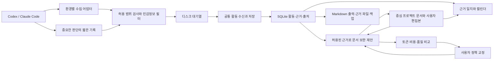

# TimeSchedule 개편 요구사항 검토와 결정 안내 v0.2

검토·교정일: 2026-11-17, Asia/Seoul. 사용자가 확인한 목표는 **중심 프로젝트 문서를 계속 보완하고 날짜별 작업·고민·실패·검증을 근거로 함께 남기는 것**이다. 구현 후 실제 토큰·비용·품질 결과를 보며 사용자가 운영 방식을 교정한다. 이 방향과 평가 절차를 반영했으며 세부 구현·모델·예산은 확정하지 않았다.

대상: [제품 요구사항 v0.2](TimeSchedule_Product_Requirements_v0.2_2026-11-17.md). 용어는 [용어집](../GLOSSARY.md)을 따른다. 기존 PRD v0.1과 이전 검토본은 보존했다. v0.1의 원본 SHA-256은 `1BCFEB9C400C4F267DEE199F86A08587EEDC35662B1DF81EF3F7E8FA654D0115`이다.

현재 코드 기준: `ad679cdb5ef2e2e0b752b6580c940fc5b577402d`, 네이티브 앱 소스 버전 `0.18.0`. PRD가 인용한 기준 커밋 `864bac1…`과 현재 코드를 구분했다. 설치된 EXE의 버전·실행 동작을 확인했다는 뜻은 아니다.

이전 독립 분석: Claude Code `2.1.325`에서 `claude-fable-5-2`를 `--effort high`로 실행해 v0.1과 코드를 비교했고 Codex가 근거를 재검토했다. **이번 v0.2는 이후 사용자 정정을 Codex가 반영한 것으로 Fable의 재검토 결과가 아니다.** 새 모델 호출이나 제품 비용 시험을 실행하지 않았다. 이전 원문은 로컬 `artifacts/requirements-review/2026-11-17/Fable_5.2_Analysis.md`에 그대로 보존한다.

**먼저 읽을 결론**

요구사항의 방향은 현재 제품에서 확장할 수 있다. Rust/Iced 앱, SQLite, 프로젝트 ID, 기록 수신함, 재전송 확인, 사용자 편집 보호를 유지할 가치가 있다. 다만 기존 완료 기록에 항목 몇 개를 추가하는 수준은 아니다. 여러 환경에서 발생하는 개별 활동과 그 근거를 다루는 저장 구조, 수집 어댑터, 요약 생성 관리가 필요하다.

사용자가 원하는 중심은 **현재 프로젝트를 설명하며 계속 보완되는 문서**다. 그 아래에 날짜별 일지와 근거가 있고, 하루 요약은 보조 결과물이다. 권장 개발 순서는 **근거 수집 → 중심 문서와 근거 일지 연결 → 문서 보완·하루 요약의 실측과 사용자 교정 → 장기 회고**다. 기반 수집을 먼저 배포할 수 있지만 시간순 일지만으로 개편 완료라고 표시하지 않는다.

여기서 가장 중요한 구분은 다음과 같다.

- 기록되었다는 것은 그 내용이 사실로 입증되었다는 뜻이 아니다.
- 프로젝트 문서 하나가 설명을 계속 보완하는 것과 날짜별 일지를 한 화면에 모으는 것은 다르다. 사용자는 전자를 중심으로 후자를 근거로 두는 형태를 확인했다.
- 수집 프로그램이 보았던 자료의 처리율과 전체 작업의 누락률은 다르다.
- 현재 개발 모델이 남기는 설명과 별도 요약 모델의 분석은 서로 다른 단계다.

**1. 현재 구현에서 가져갈 것과 새로 만들 것**

현재 자동 기록은 개발 에이전트가 작성한 작업 단위 JSON을 `prepare → sync`로 전달한다. `prepare`는 이 저장소의 커밋·변경 파일 근거를 요구한다. 통과한 원문을 로컬 문서함에 먼저 저장한 다음 네이티브 앱에 반영하며, Space를 켠 경우에만 별도 모델을 이용해 원문을 게시한다. 이 경로를 그대로 전체 프로젝트 수집기로 확대하면 저장소 제한과 커밋 필수 조건, 작업 전체 수정본이라는 계약에 부딪힌다. [기록 처리](https://github.com/NotoriEarth/TimeSchedule/blob/ad679cdb5ef2e2e0b752b6580c940fc5b577402d/scripts/project-records.mjs#L21), [Git 판정](https://github.com/NotoriEarth/TimeSchedule/blob/ad679cdb5ef2e2e0b752b6580c940fc5b577402d/scripts/project-records-git.mjs#L43)

프로젝트 ID는 이미 있다. 필요한 것은 ID를 새로 발명하는 일이 아니라, 기존 ID에 여러 폴더·worktree·저장소·세션을 안전하게 연결하는 기능이다. 현재 `projects`는 `id`, 제목, 설명, 하나의 `repo_path`를 저장한다. 자동 기록은 경로로 프로젝트를 찾아 연결한다. [현재 스키마](https://github.com/NotoriEarth/TimeSchedule/blob/ad679cdb5ef2e2e0b752b6580c940fc5b577402d/crates/timeschedule-core/src/storage.rs#L531), [프로젝트 연결](https://github.com/NotoriEarth/TimeSchedule/blob/ad679cdb5ef2e2e0b752b6580c940fc5b577402d/crates/timeschedule-core/src/project_records.rs#L207)

수신함과 영수증은 재사용할 기반이다. 현재도 파일을 온전히 저장한 뒤 `queued`를 반환하고, SQLite 반영과 결과 파일 보존을 끝낸 뒤 수신함 파일을 지운다. 다만 `queued`는 다이어리 반영 완료가 아니다. 새 기능에도 ‘송신 측 보관 / 수신 측 보관 / 화면에 적용’ 상태를 구분해야 한다. [수신함](https://github.com/NotoriEarth/TimeSchedule/blob/ad679cdb5ef2e2e0b752b6580c940fc5b577402d/apps/timeschedule-native/src/record_inbox.rs#L63), [앱이 닫혔을 때의 CLI 경로](https://github.com/NotoriEarth/TimeSchedule/blob/ad679cdb5ef2e2e0b752b6580c940fc5b577402d/apps/timeschedule-native/src/record_cli.rs#L49)

현재 MCP는 일정 조회·상세 조회·생성·수정 도구 네 개다. 활동 기록·근거 조회·프로젝트 연결 도구는 새로 필요하다. 일정 도구를 억지로 개발 기록 저장에 사용하는 방식은 권하지 않는다. [도구 구현](https://github.com/NotoriEarth/TimeSchedule/blob/ad679cdb5ef2e2e0b752b6580c940fc5b577402d/apps/timeschedule-native/src/mcp.rs#L127)

| 요구사항 | 현재 상태 | 필요한 변화 |
| --- | --- | --- |
| FR-01 환경 지원 범위 | MCP 연결 상태 기반은 있음 | 수집 환경·버전·실행 모드별 시험과 지원 표 필요 |
| FR-02 여러 경로와 프로젝트 | 프로젝트 ID·단일 경로 있음 | 경로 별칭, worktree, 여러 저장소, 미분류 자료 처리 |
| FR-03 목적·초기 상태 | 제목·설명 있음 | 초기 상태와 근거·작성 시점 보완 |
| FR-04 자동 활동 수집 | 작업 에이전트의 종료 기록 있음 | 환경별 훅·활동 수신·체크포인트·실패 표시 |
| FR-05 커밋 없는 기록 | 현 자동 기록에서는 제외 | 새 활동 계약에서 결정·실패·조사를 허용 |
| FR-06 내구성과 중복 방지 | 작업 ID·수정본 단위 기반 있음 | 이벤트 단위 식별, 송신 대기열, 출처 간 연결 |
| FR-07 누락 확인·복구 | 준비된 기록의 재시도만 있음 | 소스 처리 지점·파일 변경 감지·가능한 원문 재수집 |
| FR-08 근거 추적 | 커밋·경로·링크·원문 일부 있음 | 근거 ID, 범위, 버전·해시, 접근 상태 |
| FR-09 판단·문제 맥락 | 자유 본문에 기록 가능 | 결정·실패·원인 추정·검증의 최소 구조 |
| FR-10 상태 분리 | 작업 상태와 전달 상태 일부 있음 | 주장 출처와 실제 관측, 검증 범위를 별도 저장 |
| FR-11 중심 프로젝트 문서 | 프로젝트 설명·개별 작업 원문만 있음 | 지속 보완 문서의 식별자·수정본·변경 이유·근거 연결과 기본 진입 화면 |
| FR-12 캘린더 연결 | 일정·다이어리 UI 있음 | 날짜별 근거와 중심 문서 사이의 연결 |
| FR-13 하루 정리 | 수동 근거 초안 기반 있음 | 하루 집계·생성 실행·놓친 날짜 처리 |
| FR-14 늦은 기록과 최신성 | 전달 revision 기반 있음 | 중심 문서 기준 수정본·근거 버전과 요약 입력의 최신성 관리 |
| FR-15 사용자 편집 보호 | 충돌 시 보존함 | 문서와 요약의 새 제안·사용자본·이전 근거 보존 |
| FR-16 모델 정책 | Space 게시 모델만 고정 | 문서 보완·요약의 실행 경로·모델·갱신 범위·빈도 설정 |
| FR-17 중복 분석·예산 | 동일 작업 내용 해시·재시도 기반 있음 | 문서 입력 지문, 전체/부분·즉시/묶음 비교, 호출 제한 |
| FR-18 품질·비용 | 게시 시도 횟수 일부 있음 | 호출별·단계별 토큰·비용 성격·오류·수정 부담·정책 버전 |
| FR-19 수집·보존·전송 통제 | Space on/off, 수동 편집 보호 있음 | 경로 허용 목록, 민감정보 필터, 삭제 파급 처리 |
| FR-20 출력·백업 | Markdown 보관·DB 이행 전 백업 기반 있음 | 프로젝트 단위 출력과 일관된 전체 복구 시험 |
| FR-21 운영 상태 | MCP 상태·기록 전달 상태 있음 | 수집기·프로젝트별 처리 지점·오류·복구 안내 |
| FR-22 전체 회고 | 발췌·정렬 초안 있음 | 기간 전체 자료 선택, 근거 연결 분석 |
| FR-23 개선 비교 | 별도 구조 없음 | 비교 가능한 측정 조건·기준 상태·결과 연결 |
| FR-24 포트폴리오 | 편집 가능한 근거 초안 있음 | 주장별 인용, 역할 구분, 검토 후 출력 |
| FR-25 맥락 검색 | FTS5 기반 검색 있음 | 활동·근거 검색 확장; 의미 검색은 필요 확인 후 |
| FR-26 여러 기기 | 현재 범위 밖 | 충돌·인증·원격 전달 계약을 별도로 설계 |
| FR-27 근거인 작업 일지 | 프로젝트별 기록·추가 읽기 기반 있음 | 중심 문서에서 관련 작업·고민·실패·검증으로 이동, 과거 활동·정정 보존 |
| FR-28 실측과 사용자 교정 | 제품 문서 갱신 시험·결정 경로 없음 | 동일 입력 비교·누적 문서·실패 비용·결과 공개·사용자 정책 교정 절차 |

현재 일반 기록 목록에는 200개 단위의 추가 읽기가 있다. 반면 기존 요약 초안은 제한된 수의 자료를 발췌하고 제한을 표시한다. 따라서 ‘현재 일지가 200개에서 무조건 끊긴다’고 말하면 부정확하다. 새 하루 요약과 회고가 전체 입력 범위를 정확히 관리하는 것은 별도 과제다. [추가 읽기](https://github.com/NotoriEarth/TimeSchedule/blob/ad679cdb5ef2e2e0b752b6580c940fc5b577402d/apps/timeschedule-native/src/app.rs#L1309), [현재 초안 생성](https://github.com/NotoriEarth/TimeSchedule/blob/ad679cdb5ef2e2e0b752b6580c940fc5b577402d/apps/timeschedule-native/src/worker.rs#L132)

사용자 요구 UR-01~08은 다중 환경 수집, 중심 프로젝트 문서와 근거 일지, 날짜 집계, 프로젝트 소개, 결정·실패 맥락, 최종 회고의 후순위화, 실측 비용·품질과 사용자 교정으로 연결된다. UR-06의 ‘최종 포트폴리오는 나중’은 중심 문서의 지속 보완을 나중으로 미룬다는 뜻이 아니다. 현재 기반만으로 이 전체를 충족했다고 판정할 수 없다.

비기능 요구도 재검증해야 한다. NFR-01의 ‘모델 실패와 로컬 저장 분리’와 NFR-04의 이행 전 백업·편집 보호는 기존 기반이다. NFR-02의 훅 지연, NFR-03의 생성 입력 추적, NFR-05의 수집·전송 필터, NFR-06의 어댑터 호환성, NFR-07의 한국어 문서 품질, NFR-08의 사용자에게 검토 가능한 비용·품질 평가는 새 기능에 맞는 구현·시험이 필요하다.

**2. 권장 구현 구조와 그 이유**

어댑터는 Codex와 Claude Code의 서로 다른 입력을 같은 형식으로 바꾸는 작은 변환기다. 훅은 작업 중 특정 순간에 실행되는 짧은 프로그램이며, MCP는 에이전트가 TimeSchedule의 도구를 호출하는 통로다. 훅이 모든 대화를 이해하거나 MCP가 대화를 자동으로 읽는다고 가정하지 않는다.

첫 구현에서는 공식 훅의 이벤트 정보와 명시적 체크포인트를 주 입력으로 삼고, 원문 로그 재수집은 실제 확인한 형식만 지원하는 복구 경로로 둔다. 체크포인트는 ‘이 방식을 선택한 이유, 시도 결과, 다음 작업’을 당시 작업 에이전트가 짧게 남기는 설명이다. 숨은 내부 추론을 요구하거나 저장하는 기능이 아니다.

공식 Codex 문서는 데스크톱 훅 검토 경로와 `transcript_path`를 설명하지만, transcript 형식은 안정된 인터페이스가 아니라고 명시한다. 로컬 도구 훅으로 관측되지 않는 도구 경로도 있다. 따라서 수집기 버전과 시험 표본이 필요하다. [Codex 공식 훅 문서](https://learn.chatgpt.com/docs/hooks.md)

Claude Code의 `Stop`은 사용자 중단 시 실행되지 않으며 API 오류에는 별도 이벤트가 있다. 또 비대화형 실행의 종료 시 미완료 비동기 훅이 취소될 수 있다. 짧은 훅이 디스크에 자료를 남긴 뒤 종료하고, 후속 처리가 대기열을 읽도록 설계하는 이유다. 지원되는 종료·오류 이벤트의 조합은 실제 설치 버전에서 확인해야 한다. [Claude Code 공식 훅 문서](https://code.claude.com/docs/en/hooks)

MCP 서버는 호스트가 전달하는 맥락만 받는다. MCP 연결은 다른 채팅 전체를 읽는 권한이 아니다. 원문 접근이 없는 환경에서는 명시적 기록을 제공하고, 그 환경의 수집 수준을 ‘부분 지원’으로 표시해야 한다. [MCP 공식 구조](https://modelcontextprotocol.io/specification/2026-07-28/architecture)

구현에서 특히 다음 계약을 고정해야 한다.

1. **프로젝트 연결:** 기존 projectId를 유지한다. 기기·등록 경로·worktree 등의 별칭을 추가한다. 같은 remote는 연결 후보를 찾는 단서로만 쓰고 자동 병합의 유일한 근거로 삼지 않는다. 폴더 이동과 별도 실험용 clone은 다를 수 있기 때문이다.
2. **이벤트 식별:** 수집기 인스턴스·원본 세션·원본 이벤트 ID로 같은 전달을 알아본다. 같은 ID와 같은 내용이면 이미 받았다고 응답한다. 같은 ID인데 내용이 다르면 충돌로 보관한다. ‘문장이 비슷하다’는 이유로 서로 다른 실패를 삭제하지 않는다.
3. **여러 출처:** 훅이 관측한 테스트 결과와 에이전트의 설명을 연결하되 원래 자료 둘을 유지한다. 연결 실패는 자료 삭제 이유가 아니다. 활동과 출처가 항상 일대일이라고 가정하지 않는다.
4. **시각:** 발생 시각, 수신 시각, 원본 시간대와 정확도를 나눈다. 과거 일지만 있고 시각이 없으면 날짜만 유지한다. 수신 시각을 실제 작업 시각으로 바꾸지 않는다.
5. **사실과 주장:** ‘테스트가 통과했다고 에이전트가 보고함’과 ‘명령 출력·종료 코드·코드 버전에서 확인함’을 구분한다. 직접 수집한 출력도 해당 테스트 범위만 뒷받침한다. 에이전트가 입력에 ‘직접 관측됨’을 적었다는 이유만으로 검증 등급을 올리지 않는다. 등록된 수집 경로와 실제 근거 검사 결과가 관측 등급을 결정한다. 출력이 잘렸거나 코드 버전을 연결하지 못한 경우 그 한계도 남긴다.
6. **수신 확인:** 큐 파일이나 DB에 내구성 있게 저장한 뒤 접수를 응답한다. 화면 반영은 별도 상태다. 응답만 잃어버리면 같은 ID로 재전송한다. 송신자는 보존이 확인되기 전 대기 자료를 삭제하지 않는다.
7. **문서·요약 입력 버전:** 활동의 추가·정정·삭제·연결 정정을 관련 문서와 날짜 요약에 반영한다. 문서 갱신은 근거 버전과 기준 문서 수정본을 고정해 실행한다. 완료 시 현재 버전과 다르면 옛 결과로 보관하고 최신본을 교체하지 않는다. 모델·프롬프트·선별 정책도 지문에 포함한다.
8. **편집 보호:** 활동 수집과 문서 편집을 분리한다. 사용자가 수정한 중심 문서·요약은 유지하고 새 생성문은 비교 가능한 제안으로 둔다. 편집 충돌 때문에 새 활동 수신을 막지 않는다. 같은 논리적 문서의 수정본 이력과 각 설명의 근거 연결을 유지한다.
9. **갱신 정책:** 문서의 물리적 저장 형태와 모델에 넣을 입력 범위는 별개다. 전체 재작성, 구획별 갱신, 실행 빈도와 묶음 처리는 비용·품질 시험 대상으로 둔다. 갱신 대기 중에는 현재 문서가 어느 입력까지 반영했는지 표시한다.

예를 들어 중심 문서의 ‘저장 방식’에는 “처음에는 파일 저장을 선택했지만 동시 저장 충돌을 관측해 SQLite로 전환했다. 해당 재현 시험은 통과했고 장시간 사용은 미확인”이라고 설명한다. 이 문장에서 날짜별 결정·실패 출력·수정·검증 기록으로 이동한다. 다음 날 실패 원인이 정정되면 해당 구획과 관련 하루 요약에 갱신 필요를 표시한다. 사용자 표현은 유지하고 보완안을 제시하며, 과거 일지 자체를 새 문장으로 덮지 않는다. 중심 문서는 현재 설명을 보완하고 일지는 판단의 경로를 보존하는 역할이다.

새 구조의 책임은 Rust 코어에 모으는 편을 권한다. Node를 곧바로 전부 없애자는 뜻은 아니다. 기존 Node 기록·문서함 경로는 호환 용도로 유지하고, 새 입력도 동일한 검증·저장 코어로 들어가게 한다. 훅이나 어댑터가 SQLite 테이블을 각자 직접 수정하지 않도록 한다.

활동과 문서 수정본의 저장 기준은 SQLite에 두고 큰 근거 파일을 지정 폴더에 저장하는 안을 제안한다. 이것은 사용자 화면의 중심이 프로젝트 문서라는 결정과 별개인 내부 저장 제안이다. Markdown은 내보내기 결과물로 둘 수 있다. 기존 문서함에서 사용자가 고친 파일은 보존한다. 새 중심 문서의 외부 Markdown 편집까지 양방향으로 지원해야 한다면 DB·파일·앱 간 충돌 규칙을 구현 전에 결정해야 한다.

**3. 단계별로 무엇을 만들고 무엇으로 확인할 것인가**

| 단계 | 만들거나 확인할 것 | 다음 단계로 넘어갈 근거 |
| --- | --- | --- |
| M0 환경 확인 | 현재 Codex 앱·Claude Code의 로컬 모드, 훅 권한, 실제 이벤트·로그 형식, 앱 종료 시 대체 경로 | 정상·중단·재개·축약·오류 표본에서 어떤 자료가 남는지 설명 가능 |
| M1A 공통 기록 기반 | 기존 프로젝트 ID 확장, 활동·근거·출처·수신 확인, 최소 필터와 대기열 | 같은 이벤트 재전송, 응답 유실, 재시작에서 기록이 보존되고 잘못 합쳐지지 않음 |
| M1B 두 환경 입력 | 각 환경의 검증된 훅·체크포인트 입력, 지원 상태 표시 | 두 환경·두 프로젝트·같은 프로젝트 병행 사례를 시험함 |
| M2 중심 문서와 근거 | 중심 문서·수정본·근거 연결, 작업 일지·캘린더, 최초 작성·수동 보완 제안, 검색·출력·백업 | 무엇을 만들고 왜 바꿨는지 읽고 근거로 이동하며 보완 후에도 사용자 편집과 과거 활동이 보존됨 |
| M3 실측과 사용자 교정 | 문서 갱신·하루 요약, 전체/부분 및 즉시/묶음 비교, 호출·토큰·비용·품질 계측 | 누적 문서·정정·실패·사용자 편집 시험의 결과를 사용자가 보고 유지/변경/보류를 판단함 |
| M4 회고 | 문제·결정의 기간별 연결, 개선 비교, 역할과 근거를 갖춘 초안 | 사용자 선정 사례를 원래 자료로 검토할 수 있음 |

M1에서 제한적인 수집 시범은 가능하다. 그러나 FR-11의 중심 문서 보완, FR-27의 근거 일지, FR-28의 실측·사용자 교정이나 다른 P0가 남았다면 개편 완료라고 표시하지 않는다. 한 환경만 연결된 중간 배포도 ‘두 환경 지원 완료’가 아니다. 문서 생성 모델을 M2에 도입하면 계측도 그때 시작하며, M3는 비용을 처음 기록하는 단계가 아니라 비교 시험과 사용자 운영 교정 단계다.

새 서버, 벡터 데이터베이스, 여러 모델의 상시 관찰, 모든 후보 스킬 설치를 M1의 전제로 삼을 필요는 없다. 먼저 작은 어댑터와 기존 저장 기반으로 실제 누락을 확인한다. 개발 공수는 M0의 호환성 결과가 나오기 전 일수로 약속하기 어렵다.

**4. 사용자가 결정할 사항 — 상황과 예시**

아래에서 사용자 확정이라고 표시한 항목 외의 권장값은 아직 제안이다. 내부 테이블 이름이나 파일 분할은 구현자가 결정할 사항이다. 사용자는 기록의 범위, 개인정보 경계, 읽는 방식, 비용과 자동화 수준을 결정하면 된다.

**결정 1. 처음 어디까지 연결할 것인가 — A안 사용자 확정**

상황: 같은 프로젝트를 Windows의 Codex 앱과 Claude Code에서 개발하고, 가끔 클라우드 작업도 맡긴다. PC의 로컬 수집기는 클라우드 내부 로그를 당연히 읽을 수 없다.

- A: Windows 로컬 Codex 앱·Claude Code부터 지원한다. 범위가 작고 문제를 재현하기 쉽다. 클라우드 실행 수집은 첫 지원 범위에서 제외한다.
- B: 로컬과 클라우드를 처음부터 동등하게 지원한다. 일지는 더 넓게 모을 수 있지만 원격 전달·인증·권한·오프라인 복귀가 앞당겨진다.

예: 클라우드에서 테스트한 결과를 에이전트가 보고서로 보냈다면 ‘클라우드 에이전트 보고’로는 남길 수 있다. 로컬 수집기가 실제 명령 실행을 관측했다고 표시할 수는 없다.

확정: 사용자가 “A로 시작하자. Windows 로컬 Codex 앱이랑 Claude Code부터 지원”이라고 선택했다. M0에서 해당 설치 환경의 연결·이벤트·누락 범위를 검증한다. 로컬 작업은 모델까지 PC에서 오프라인 실행한다는 뜻이 아니며 외부 전송 정책은 별도 결정이다.

**결정 2. 프로젝트 연결은 얼마나 자동으로 할 것인가 — A안 사용자 확정**

상황: `TimeSchedule`과 `TimeSchedule-test`라는 폴더가 있고 같은 Git remote를 쓴다. 하나는 동일 프로젝트의 worktree일 수도 있고, 별도 실험 프로젝트일 수도 있다.

- A: 수집 연결이 활성화된 개발 환경에서 발견한 작업 경로를 후보로 보여 주고 처음 한 번 새 프로젝트/기존 프로젝트/제외를 확인한다. 이후 등록된 별칭은 자동 연결한다.
- B: 사용자가 TimeSchedule에서 작업 폴더를 미리 등록한다. 자동 후보 알림은 없지만 등록을 잊은 구간은 기록되지 않을 수 있다.
- C: 발견한 작업 경로의 프로젝트를 확인 없이 자동 생성·연결한다. 조작은 적지만 실험 폴더가 쌓이거나 다른 프로젝트가 잘못 연결될 수 있다.

예: `C:\LSH\TimeSchedule`과 다른 경로의 UI 실험 worktree를 같은 projectId에 연결한다. 별도 고객용 fork는 이름이 같아도 별도 프로젝트로 둔다.

확정: 사용자가 “A로 하자. 새 프로젝트는 처음 한 번 확인하고 이후에는 자동 연결”을 선택했다. 처음 등록할 때만 확인하고 매 이벤트마다 묻지 않는다. 확인 전에는 등록 후보에 필요한 최소 경로 정보만 다루고 대화·코드 본문은 자동 저장하지 않는다. 확인 전 활동은 원본과 수집 권한이 남아 있을 때만 후속 복구를 검토하며 소급 수집을 보장하지 않는다. 이미 허용된 범위에서 연결만 모호한 자료는 미분류로 보존한다. 오연결을 고치면 관련 중심 문서·날짜 요약에도 갱신 필요 표시가 생겨야 한다. 원문 보관·외부 전송 정책은 별도 결정이다.

**결정 3. 커밋 없는 고민과 실패를 얼마나 남길 것인가 — 기록 정책과 지침 변경 전에 필요**

상황: 두 시간 동안 구현 방식을 비교한 뒤 ‘현재 방식 유지’로 결정했다. 커밋은 없지만 나중에 같은 논의를 반복하지 않으려면 이유가 필요하다.

- A: 기존처럼 커밋된 개발 변경만 남긴다. 간단하지만 이번 PRD의 판단·실패 보존 요구를 충족하지 못한다.
- B: 중요한 결정·실패·검증·범위 변경을 남기고 반복 조회는 기본 화면에서 접는다.
- C: 모든 도구 호출과 대화를 상세 일지로 표시한다. 자료는 많지만 읽기와 교정 부담이 커진다.

예: ‘캐시 적용을 시도했으나 측정 조건에서 효과를 확인하지 못해 보류’는 B에 포함한다. 같은 파일 목록을 열 번 조회한 것은 개별 주요 사건으로 나열하지 않는다. 서로 다른 두 번의 실패는 별개 시도로 남긴다.

권장: B. 중요도는 표시·요약의 우선순위이며 삭제 명령이 아니다. 당시 에이전트가 확인 가능한 이유를 남기도록 하되 없는 이유를 생성하지 않는다. 현재 AGENTS의 ‘조사·계획 제외’는 새 활동 수집 범위와 충돌하므로 새 경로의 정책과 기존 자동 개발 기록의 범위를 함께 정리해야 한다.

**결정 4. 원문을 얼마나 보관할 것인가 — B안 사용자 확정, 기간은 실사용 후 결정**

상황: 한 달 뒤 요약에 ‘캐시 때문에 빨라졌다’고 적힌 것을 발견했지만 원본 로그가 지워져 있다. 반대로 전체 로그에는 비공개 소스·경로·민감정보가 섞일 수 있다.

- A: 구조화 활동과 필요한 근거 발췌·참조만 보관한다. 보관 부담이 작지만 나중에 빠진 맥락을 재분석하기 어렵다.
- B: A에 더해 허용한 원문을 일정 기간 로컬에 보관한다. 초기 누락을 교정하기 좋지만 용량·삭제·필터 정책이 추가된다.
- C: 전체 원문을 장기 보관한다. 재분석 범위가 넓지만 비용과 민감자료 관리 부담도 커진다.

확정: 사용자가 B를 선택했다. 핵심 근거를 유지하고, 나머지 수집이 허용된 원문은 일정 기간 로컬에 보관한다. 보관 기간은 실제 용량 증가·과거 자료 재조회·누락 교정 필요를 보고 사용자가 정한다. 중심 문서·날짜별 일지·핵심 근거에는 일반 원문의 만료를 일괄 적용하지 않는다. 핵심 근거에는 실제 결정 이유, 실패 원인과 관련 출력, 검증 조건·결과·미검증 범위를 우선 포함하고 사용자가 추가로 보존 지정하거나 분류를 교정할 수 있게 한다. 자동 선별이 빠뜨릴 수 있으므로 일반 원문 만료 전에 보존 대상을 검토할 수 있어야 한다. **30일 후 자동 삭제는 승인된 정책이 아니며 기간 확정 전 자동 만료 삭제하지 않는다.**

로컬 보관과 외부 모델 전송은 별도 결정이다. 전체 원문을 로컬에 남겨도 요약 모델에는 허용된 구조화 기록과 필요한 발췌만 보낼 수 있다. 정규식 필터가 모든 비밀을 완벽히 찾지는 못하므로 경로·내용 제외와 최소 전송을 함께 사용한다. 근거 해시는 내용이 바뀌었는지 확인하는 값일 뿐, 사라진 원문을 복원하지 못한다.

**오래된 원문 압축에 대한 조사·제안 — 형식·전환 시점은 미확정**

압축 보관은 추천한다. 다만 ‘30일 뒤 압축’은 저장 형태를 바꾸는 것이고 ‘90일 뒤 삭제’는 내용을 없애는 것이므로 독립된 설정이어야 한다. 두 기간은 설명용 예시다. 압축해도 일반 원문이 핵심 근거로 바뀌거나 영구 보존되는 것은 아니며, 압축 날짜로 보관 기간을 다시 시작하지 않는다. 만료 기산일도 구현 전에 정의한다. 임의의 오래된 사용자 파일이나 실행 중인 DB가 아니라 TimeSchedule이 관리하는 변경 완료 원문 사본을 대상으로 한다.

| 후보 | 장점과 제약 | 권고 |
| --- | --- | --- |
| ZIP + Deflate | Windows에서 직접 열고 개별 파일을 꺼내기 쉽다. 여러 파일을 함께 압축하는 방식보다 공간 절감이 작을 수 있으나 실제 자료 비교가 필요하다. | 초기 우선 후보. 프로젝트·월별 등 제한된 크기로 묶고 큰 묶음은 더 나눈다. 모든 프로젝트를 한 파일에 계속 추가하지 않는다. |
| 7z + LZMA2 | 높은 압축률을 목표로 하는 형식이다. Solid 모드는 여러 파일을 함께 압축하므로 개별 읽기·갱신·손상 복구 부담을 함께 확인해야 한다. | 거의 다시 열지 않는 대용량 보관 후보. 실측 전 기본값으로 고정하지 않고 작은 블록 또는 non-solid도 비교한다. |
| Zstandard(.zst) | 빠른 무손실 압축·해제를 목표로 한다. 개별 원문에 적용하거나 별도 묶음 형식과 결합할 수 있으나 앱의 목록·복원 지원이 필요하다. | 앱 내부에서 자주 꺼내 쓰는 자료가 많아질 때 비교 후보. 전체 이력을 하나의 tar.zst로 묶는 방식은 개별 조회 비용을 먼저 검증한다. |

근거: [Microsoft ZIP 사용 안내](https://support.microsoft.com/en-gb/windows/experience/storage-filemanagement/zip-and-unzip-files?pubDate=20261110), [PKWARE ZIP 규격](https://pkware.cachefly.net/webdocs/casestudies/APPNOTE.TXT), [7z 형식](https://www.7-zip.org/7z.html), [7z 손상 복구의 제약](https://www.7-zip.org/recover.html), [Zstandard 공식 문서](https://meta.github.io/zstd/). 형식의 특성을 바탕으로 한 설계 권고이며 TimeSchedule 자료의 압축률·속도 실측 결과가 아니다.

예: 중심 문서·일지·핵심 검증 근거는 바로 읽을 수 있게 유지하고, 변경이 끝난 11월의 일반 원문은 프로젝트별 보관 묶음으로 옮긴다. 일지에서 오래된 근거를 누르면 앱이 해당 항목을 풀어 보여주도록 한다. 원문 본문 검색에는 별도 인덱스나 해제가 필요하며 인덱스·임시 해제본에도 같은 보관·삭제 정책을 적용한다. 압축 파일명만으로 출처를 연결하지 않고 고정 근거 ID와 묶음 안 위치를 매핑한다.

구현 시 임시 압축본 생성 → 전체 해제·파일별 해시/개수 대조 → 검증된 묶음 및 참조 전환 → 중복된 비압축 사본 정리 순서를 사용하고 중단 후 재시도 가능하게 한다. 검증 실패 시 기존 사본을 보존한다. 압축은 별도 백업을 대신하지 않으며 같은 디스크의 압축본만으로 디스크 고장을 대비할 수 없다. 사용자 앱의 실행 중인 SQLite 파일을 그대로 압축하는 것은 이 원문 보관 기능의 대상이 아니다. DB 백업이 필요하면 [SQLite Online Backup API](https://sqlite.org/backup.html) 등으로 일관된 스냅샷을 만든 뒤 압축한다.

실사용 시험은 동일한 허용 자료로 원본 대비 용량, 생성 시간·메모리, 한 근거를 다시 여는 지연, 검색·링크 복원, 중단·손상 시 복구와 만료 삭제를 비교한다. 저장 공간과 AI 비용을 분리한다. 무손실 압축을 풀어 동일 텍스트를 모델에 보내면 입력 텍스트 자체는 줄지 않으므로 압축률을 토큰 절감률로 계산하지 않는다. **현재 실제 파일 압축·삭제·자동화나 압축 성능 측정은 수행하지 않았다.**

**결정 4-2. 문서 보완 모델에 무엇을 자동 전송할 것인가 — A안 사용자 확정**

상황: 개발 도구로 작업한 뒤 TimeSchedule이 프로젝트 문서의 ‘캐시 적용 이유’를 자동 보완한다. 여기서 정하는 것은 TimeSchedule의 추가 생성 작업에 제공할 입력 범위다. 기존 Codex·Claude 개발 세션의 전송 설정을 이 결정으로 변경하지 않는다.

- A(권장): 허용한 프로젝트 문서의 필요한 부분·구조화 일지·관련 근거 발췌를 필터링해 자동 전송한다. 예를 들어 적용 이유, 전후 측정 조건, 관련 오류 부분을 보낸다. 부족하면 결과에 근거 부족을 표시하고 추가 원문 범위를 확인한 뒤 재분석한다.
- B: 허용한 문서·구조화 일지만 전송하고 원문 발췌는 보내지 않는다. 입력을 좁힐 수 있지만 일지에서 빠뜨린 ‘특정 조건에서만 개선’이라는 단서를 자동으로 되찾기 어렵다.
- C: 허용한 작업 단위의 원문 전체까지 자동 전송할 수 있게 한다. 누락 맥락을 검토할 여지는 늘지만 불필요한 내용·비용·입력 한도 부담도 커진다. 모든 저장 자료의 무제한 전송이나 완전한 문맥 이해를 보장하는 선택은 아니다.

확정: 사용자가 A를 선택했다. 필요한 근거 발췌까지 자동 전송하고, 추가 원문은 전송 범위를 사용자에게 확인한다. 허용 범위 안의 전송마다 반복 확인하지 않는다. 범위를 확대할 때는 대상 원문과 필요한 이유를 제시하고 확인 전에는 보내지 않으며 무응답을 승인으로 해석하지 않는다. 확인이 없거나 원문이 없으면 근거 부족·미반영을 표시하고 확보한 근거 이상으로 단정하지 않는다.

발췌 분량과 모델은 실제 비용·품질 시험 결과를 보고 교정한다는 것도 사용자 확정 사항이다. 검색 방법·갱신 빈도·예산도 허용 범위 안에서 실제 토큰·비용·누락률·문서 변경을 비교한 뒤 교정한다. 필요한 근거를 로컬에서 선별할 때 외부 모델을 쓴다면 그 선별 호출의 입력에도 같은 전송 범위가 적용된다. 로컬 보관 승인을 외부 선별용 전체 전송 승인으로 해석하지 않는다. 이번 정책 확정으로 실제 모델 호출을 실행하지는 않았다.

**결정 5. 새벽 작업을 어느 날짜의 일지로 묶을 것인가 — A안 사용자 확정**

상황: 11월 17일 23:50에 작업을 시작해 18일 01:20에 테스트를 마쳤다.

- A: 달력 날짜대로 나눈다. 23:50 활동은 17일, 01:20 활동은 18일이다. 일정 화면과 일관적이다.
- B: 예를 들어 새벽 4시를 업무일 경계로 둔다. 두 활동을 ‘17일 작업일’에 묶어 읽을 수 있지만 실제 발생 날짜와 작업일을 구분해야 한다.

확정: 사용자가 A를 선택했다. 한국 시간(Asia/Seoul) 자정을 기준으로 날짜별 일지를 나누고 이어진 작업은 중심 문서와 근거 연결로 묶는다. 실제 발생 시각을 보존하며 자정 이후 활동을 전날 작업일로 옮기지 않는다. 이 결정은 날짜 분류 기준이며 요약 실행 시각을 확정하거나 자정 모델 호출을 승인하는 것은 아니다.

이 결정은 날짜별 일지·하루 요약의 묶음 기준이다. 날짜가 바뀌어도 같은 프로젝트의 중심 문서는 계속 이어지며 하루마다 새 중심 문서를 만들지 않는다. A에서는 17일의 ‘구현 시작’과 18일의 ‘테스트 통과’가 서로 다른 날짜에 보여도 같은 작업·근거 관계를 유지한다. B에서는 18일 01:20의 테스트를 ‘17일 작업일’에 표시하되 실제 발생 시각은 18일 01:20으로 보존한다. 일정의 실제 날짜를 전날로 옮기는 설정은 아니다. 4시는 예시이며 B를 선택하면 경계 시각을 별도로 정한다.

추천 이유는 캘린더에서 날짜로 찾는 기준을 일관되게 유지하기 위해서다. A의 한계는 밤샘 작업이 두 날짜에 걸쳐 보인다는 점이며 프로젝트 문서와 같은 작업의 연결로 흐름을 따라갈 수 있게 한다. B는 밤 작업을 함께 읽기 좋지만 실제 달력 날짜와 작업일이 달라지는 점을 화면에서 설명해야 한다. 하루 경계는 비용보다 사용자의 날짜 인식에 따라 정할 사항이다. 요약을 언제·얼마나 자주 생성할지는 별도로 정하며 호출 빈도·모델·분량은 실제 비용·품질 시험 후 교정한다.

날짜 경계와 요약 실행 시각은 다른 개념이다. ‘새벽 3시에 전날을 요약’한다고 해서 새벽 1시 활동이 자동으로 전날 소속이 되지는 않는다. 앱을 껐다면 다음 실행에서 빠진 요약을 처리하는 안을 권한다. 정시 처리가 반드시 필요할 때만 상주 서비스·서버를 추가 검토한다. 이번 분석에서는 정기 자동화를 생성하지 않는다.

**다음 결정 6. 문서 보완·요약 모델을 어떤 실행 경로로 쓸 것인가 — 미확정, 최초 생성 연결 전에 필요**

상황: 현재 Codex나 Claude 구독으로 개발하고 있고, 프로젝트 문서 보완과 하루 요약도 같은 이용 경로로 처리하고 싶은 경우다.

- A: 기존 로그인된 CLI를 실행한다. 현재 작업 환경과 연결하기 쉽지만 로그인 상태·클라이언트 버전·이용 제한에 의존한다. 실행이 보고한 비용을 실제 청구액으로 단정할 수 없다.
- B: 별도 API 키와 API 실행 경로를 쓴다. 프로그램에서 요청·사용량을 관리하기 수월하지만 별도 인증·과금·키 보호가 필요하다. 앱 구독과 같은 계약이라고 가정하면 안 된다.
- C: 수집 시범에는 규칙 기반 목록을 쓰고 중심 문서는 수동 작성·보완으로 먼저 연결한다. 자동 보완은 아직 미구현이며 목록만으로 중심 문서 요구를 대체할 수 없다.

권장: A로 기존 로그인된 공식 CLI의 실제 지원·인증 방식·허용된 사용 범위를 먼저 검증하고 최초 생성 경로 하나를 시험한다. 수집은 Windows 로컬 Codex 앱과 Claude Code 모두 지원하되, 문서 생성까지 두 도구를 동시에 호출할 필요는 없다. M1에서는 수집 기반을 확인하고 M2에서 생성 경로를 연결하며 최초 호출부터 계측한다. 기존 Codex CLI 게시 코드는 실행 관리 참고용으로 재사용할 수 있지만 원문 동일성을 검사하는 Space 게시기를 문서 보완기로 그대로 사용할 수는 없다. 최초에는 사용자가 제안을 확인한 뒤 반영하며 모델과 향후 자동 반영 범위는 실측 결과를 보고 교정한다.

CLI는 프로그램이 명령을 전달해 실행할 수 있는 도구이며, API 직접 연결은 TimeSchedule이 공급자의 모델 서비스에 직접 요청하는 방식이다. 모델은 글을 만드는 엔진이고 하네스는 입력·도구·실행·결과를 관리하는 실행 틀이다. A에서는 공급자 CLI의 하네스를 호출하고 TimeSchedule이 허용 입력·대기열·사용량·제안을 관리한다. B에서는 API 요청과 실행 관리를 앱에서 구현한다. CLI도 서버와 통신하므로 로컬 도구 사용이 오프라인 추론을 의미하지 않는다. 또한 CLI는 API 키 인증도 가능하므로 CLI/API라는 이름만으로 실제 과금 방식을 판정하지 않는다.

예: 사용자가 ‘보완 제안 만들기’를 누르면 A에서는 TimeSchedule이 허용한 문서·일지·근거 발췌를 별도 CLI 실행에 전달해 제안을 받는다. 기존 개발 대화 전체를 재개하거나 자료 범위를 확대하지 않는다. 생성에 불필요한 파일·도구·MCP 접근을 제한할 수 있는지도 설치 버전으로 검증한다. B에서는 같은 입력을 별도 API 인증으로 공급자에 보내고 응답·사용량을 앱이 받는다. 어느 쪽이든 결과는 확인 대기 제안이며 본문에 곧바로 반영하지 않는다.

A는 기존 설치·실행 경험을 활용하기 좋지만 로그인 만료·이용 한도·출력 형식 변경에 대응해야 한다. 구독 인증으로 실행하면 개발 작업과 한도를 공유할 수 있고, 가격표 기준 계산액을 실제 추가 청구액이나 정확한 구독 차감액으로 표시해서는 안 된다. B는 요청 단위 계측과 제어를 직접 설계하기 좋지만 API 인증·과금 설정과 실행 관리가 추가된다. API도 예산·캐시·재시도·청구 지연 등을 확인해야 하며 요청별 표시값과 최종 청구액이 항상 같다고 보장하지 않는다. A가 실패하면 원문과 대기 제안을 보존하고 이유를 표시하며 승인 없이 유료 API로 전환하지 않는다.

이번에 확인한 근거: 저장소의 `scripts/project-records-codex.mjs`는 기존 선택적 게시 기능에서 `codex exec`를 호출하며, 현재 PC에 Codex와 Claude 명령 경로가 있다. 이것은 새 문서 보완의 동작·로그인·구독 적합성 검증이 아니다. 공식 문서는 [Codex 비대화형 실행](https://learn.chatgpt.com/docs/non-interactive-mode), [Codex 인증과 과금 경로](https://learn.chatgpt.com/docs/auth), [Claude Code 프로그램 실행](https://code.claude.com/docs/en/headless), [Claude Code 사용량 관리](https://code.claude.com/docs/en/costs)를 참고한다. 공식 실행 경로와 해당 계정의 허용 조건을 시험 전에 확인한다. 인증 토큰을 추출해 별도 API 인증처럼 재사용하는 안은 포함하지 않는다.

지금은 처음 검증할 실행 경로를 정한다. 구체적인 공급자·모델·발췌 분량·호출 상한은 실제 지원 확인과 허용된 비용·품질 시험으로 정한다. 기존 로그인 경로를 먼저 검증한다는 선택은 무료·무제한 실행이나 특정 모델의 품질을 보장하지 않는다. 이번에는 생성 호출이나 로그인 변경을 실행하지 않았다.

이전 요구사항 검토에 Fable 5.2·높음을 사용했다는 사실은 제품의 문서 갱신·하루 요약 모델도 그것으로 확정한다는 뜻이 아니다. 같은 한국어 근거·시작 문서로 누락·부정 표현·추정·수치 보존·수정 시간과 실제 사용량을 비교한 뒤 선택한다. 모델 이름만 바꾸는 것으로 공급자·인증·출력 형식 호환이 해결되지 않는다.

**결정 7. 문서 갱신의 비용·최신성·품질을 어떻게 조정할 것인가 — 시험 전 상한, 결과 확인 후 사용자 교정**

상황: 프로젝트 문서가 길어진 뒤 매번 전체를 다시 쓰면 입력 토큰이 늘 수 있다. 변경한 구획만 갱신하면 입력이 줄어도 다른 설명과 모순이 생길 수 있다. 하루에 묶어 갱신하면 호출은 줄 수 있지만 그동안 문서가 뒤처진다. 이는 시험할 가설이며 측정된 결과가 아니다.

- A: 정한 시점에 전체 문서를 다시 구성한다. 문서 전체 일관성을 검토하기 쉽지만 반복 입력·표현 변경 비용이 생길 수 있다.
- B: 같은 시점에 관련 구획만 보완한다. 불필요한 변경을 줄일 수 있지만 근거 선택·구획 간 일관성 검사가 필요하다.
- C: A 또는 B의 갱신 범위를 유지하고 실행을 묶는다. 호출 수·최신성의 절충이며 별도의 저장 구조가 아니다.

권장: 동일 시작 문서·근거에서 A와 B를 비교한 뒤 갱신 범위를 고정하고 C의 묶음 간격을 비교한다. 어느 방식이 싸고 충분히 좋은지 미리 확정하지 않는다. 변경이 없는 입력의 자동 호출은 없게 한다. 비용을 알 수 없는 경로는 ‘확인 불가’로 표시하며, 토큰·횟수 상한을 실제 원화 청구액의 보장으로 표현하지 않는다.

시험 전에 호출·비용 상한을 정하고, 사용자는 실제 문서 변경과 단계별 토큰·비용·왜곡·수정 시간·미반영 지연을 본 뒤 유지/변경/보류를 판단한다. 월 예산·수정 시간 허용치와 갱신 간격은 이 결과로 교정할 수 있다. 구현 시 필요한 세부 측정 항목과 결과표는 요구사항 13.3절에 정리했다. 이번 문서 교정에서는 해당 시험을 수행하지 않았다.

**결정 8. AI의 문서 보완 결과를 언제 본문에 반영할 것인가 — A안 사용자 확정**

사용자 정정을 덮어쓰지 않고 제안으로 보호한다는 FR-15 요구는 유지한다. 이번 선택은 이를 다시 허용할지 묻는 것이 아니라, 사용자가 고치지 않은 부분도 처음부터 자동 반영할지 정하는 것이다. 기존 검토의 덮어쓰기·제안·중단 선택지는 사용자 정정 보호 요구와 혼동되지 않도록 아래의 두 반영 범위로 교정했다.

- A(권장): 초기 문서 시험에서는 AI 보완 결과를 모두 제안으로 보여주고 사용자가 채택한 결과를 본문에 반영한다. 현재 본문·제안·관련 근거를 비교해 채택/수정 후 채택/보류할 수 있게 한다. 채택 동작만으로 모델을 다시 호출할 필요는 없으며 추가 생성 요청은 별도로 계측한다.
- B: 사용자가 편집하지 않은 부분은 자동 반영하고 사용자 편집이나 충돌이 있는 부분은 제안으로 남긴다. 확인 부담은 줄지만 사용자 손을 거치지 않은 부분에 잘못된 표현이 들어갈 수 있어 수정 이력·되돌리기와 근거 확인이 필요하다. 구획 사이의 의미 충돌을 안전하게 구분할 수 없으면 자동 반영하지 않고 제안으로 남긴다.

예: 사용자가 ‘작은 데이터에서 개선, 큰 데이터는 미검증’으로 고친 성능 설명과 아직 편집하지 않은 ‘내보내기 기능’ 설명이 있다. 새 기록에는 큰 데이터 테스트 결과와 CSV 내보내기 추가가 들어온다. A에서는 두 부분의 보완을 함께 검토한 뒤 채택한다. B에서는 충돌 없는 미편집 내보내기 부분은 자동 반영하고 사용자가 고친 성능 부분은 제안으로 남긴다. 어느 쪽도 새 결과를 이유로 과거 판단·실패 근거를 삭제하지 않는다.

확정: 사용자가 A를 선택했다. 초기에는 AI 보완 제안을 확인한 뒤 본문에 반영하고 실제 품질과 확인 부담을 보고 자동 반영 범위를 나중에 검토한다. 한계는 확인을 미루면 현재 본문이 최신 근거를 아직 반영하지 못한다는 점이다. 새 활동 수집은 계속하고 ‘새 근거 있음·제안 대기’와 본문의 반영 범위를 표시한다. 선택한 결과만 검토하는 흐름으로 부담을 줄이고, 실사용에서 확인 부담과 잘못 반영된 내용의 비율을 본 뒤 B로 확대할지 검토한다. 실제 비교 시험의 여러 출력은 실험 결과로 보존하며 자동으로 본문에 채택하지 않는다.

최초 문서 시험의 반영 권한은 사용자 확인 후 채택으로 확정했다. 제안을 언제 만들지, 어느 모델로 얼마나 발췌할지는 별도 실행 정책과 실측 대상이다. 확인 버튼을 누르기 전에도 제안 생성에는 비용이 들 수 있으므로 최초 호출부터 사용량을 기록한다. 제안 생성 후 본문·근거가 바뀌면 오래된 제안을 그대로 덮어쓰지 않고 재검토 대상으로 표시한다. 생성본과 사용자본의 전체 양방향 자동 병합은 초기 기능으로 약속하지 않는다.

편집 위치는 아래 결정 8-2에서 앱 안 편집과 Markdown 내보내기로 확정했다. 외부 파일 편집 자동 반영은 나중에 필요하면 검토한다. 기존 문서함의 수동 편집 자료는 이 정책 변경과 무관하게 보존한다.

**결정 8-2. 중심 프로젝트 문서를 어디서 직접 수정할 것인가 — A안 사용자 확정**

상황: 사용자가 ‘문제 해결 완료’를 ‘특정 조건에서 해결, 장시간 사용 미검증’으로 고친다. 같은 시점에 AI가 새 테스트 결과로 문서를 보완한다. 여기서는 사용자가 수정할 위치와 외부 파일 변경을 앱에 반영할지를 정한다. 수정 내용 보호 요구는 FR-15에 있으며 외부 편집을 선택해도 이를 약화하지 않는다.

- A(권장): TimeSchedule 안에서 중심 문서를 편집하고 Markdown은 필요할 때 내보낸다. 내보낸 파일은 그 시점의 사본이며 외부에서 바꿔도 앱으로 자동 반영되지 않는다. 외부에서 다듬은 내용을 반영하려면 앱에서 해당 부분을 직접 수정한다. 별도 가져오기 기능은 초기 필수로 약속하지 않는다.
- B: 앱과 지정 Markdown 파일 양쪽에서 편집하고 외부 변경도 감지해 반영한다. 사용자가 선호하는 편집기나 파일 기반 도구로 원문을 고칠 수 있지만 앱·파일·AI가 같은 문장을 바꿨다면 양쪽 변경과 근거를 비교해 사용자가 선택해야 한다. 단순히 마지막 저장본으로 덮어쓰거나 모든 충돌을 자동 해결한다고 약속하지 않는다. 파일 이동·삭제·오프라인 변경도 처리해야 한다.

예: A에서는 앱에서 정정한 ‘장시간 사용 미검증’이 기준으로 남고, 다음 내보내기에서 그 내용을 포함한 사본을 만든다. 별도로 수정한 이전 출력 파일은 자동 덮어쓰지 않는다. B에서는 외부 파일의 같은 정정과 앱에서 들어온 ‘장시간 테스트 통과’가 충돌하면 근거를 함께 보여주고 현재 문장으로 채택할 내용을 선택하게 한다.

확정: 사용자가 A를 선택했다. 앱 안에서 편집하고 Markdown으로 내보내는 방식부터 시작한다. 외부 파일 편집의 자동 반영은 나중에 필요하면 검토한다. 내보낸 파일은 출력 시점의 사본이며 그 수정은 앱에 자동 반영되지 않는다. 외부에서 다듬은 내용을 앱에도 남기려면 해당 부분을 앱에서 수정한다. 중심 문서·일지·근거 연결과 사용자 정정 보존을 먼저 검증하며 기존 문서함 파일의 편집 정책을 소급 변경하지 않는다. 발췌 분량·모델은 이 편집 위치 결정과 별개로 실제 비용·품질 시험 후 교정한다.

**결정 9. 기존 기록을 얼마나 새 구조로 옮길 것인가 — A안 사용자 확정**

상황: 예전 일지에는 하루에 한 개의 긴 작업 글만 있고 정확한 시각·실패 순서가 없다.

- A: 기존 글을 ‘이전 형식 기록’으로 그대로 연결하고 새 활동만 새 형식으로 모은다.
- B: 중요한 과거 프로젝트를 골라 사용자가 확인하면서 활동·문제별로 나눈다.
- C: 모델이 모든 과거 기록의 활동 분리를 일괄 시도한다. 넓은 범위를 처리하지만 생성·검토 비용이 늘고 없던 순서·시각·원인을 보충할 위험이 있다. 원본을 대체하지 않고 재분석 결과를 별도로 보존해야 한다.

확정: 사용자가 A를 선택했다. 과거 글은 그대로 근거로 연결하고 새 작업과 함께 중심 문서를 보완하되 필요한 과거 기록만 나중에 선택해 재분석한다. 과거 글 조회는 중심 문서의 설명을 검증하는 역할이며, 주목적은 같은 프로젝트의 설명을 이어서 보완하는 것이다. 예를 들어 ‘초기 캐시 보류’와 ‘이후 다른 방식의 개선 확인’을 각각 근거로 연결해 변경 이유를 설명한다. 새 결과가 과거 판단·실패를 삭제하지 않는다. 이는 개발 에이전트의 과거 대화 자동 로딩이나 코드 작업 자동 재개를 포함하지 않는다. 기존 자료를 읽기 전용으로만 강제 전환하거나 삭제하지 않는다. 원문과 편집본·대기 전달·영수증을 보존하고, 새 DB 구조와 호환되지 않는 옛 EXE로 임의 되돌리지 않는다.

예: 예전 일지에 ‘캐시를 시도했으나 효과를 확인하지 못해 기존 방식을 유지했다’는 하루짜리 글만 남아 있다. A는 그 글을 해당 프로젝트의 이전 형식 근거로 연결한다. 나중에 중심 문서가 보류 이유를 설명할 때 그 글을 참조할 수 있지만 정확한 시각이나 시도 횟수는 만들어 넣지 않는다. 연결할 프로젝트나 날짜가 불명확하면 확인 필요 상태로 남긴다. 이 연결 자체에는 모델 재작성 호출이 필요하지 않지만, 해당 글을 이용해 중심 문서를 생성·보완하는 비용은 별도다.

B는 사용자가 고른 기록을 ‘시도·결과·판단’으로 나눠 재분석하고 원문과 비교해 확인한다. C는 같은 처리를 전체 과거 기록에 시도하므로 누락·오분류·중복 검토 범위가 커진다. 어떤 선택이든 원본·사용자 정정은 유지하며 불명확한 사실은 미상으로 둔다. A의 한계는 과거 기록의 사건별 검색·통계가 새 기록보다 거칠다는 점이다. 필요한 프로젝트만 나중에 B로 보완하는 안을 권한다. 이미 삭제된 원문이나 당시 기록하지 않은 사실을 되살리는 기능은 아니다.

과거 글을 그대로 연결하는 출발 범위는 확정했다. 이후 선택적 재분석의 모델·분량·처리 상한은 작은 표본의 비용·분리 정확도·사용자 수정 부담을 본 뒤 정할 대상이다. 이번 정책 확정은 기존 자료의 이동·변환·전송을 실행한 것이 아니다.

**결정 10. 첫 시범 배포를 어디까지 구현한 뒤 받을 것인가 — A안 사용자 확정**

상황: 일일 요약·포트폴리오까지 기다리면 실제 누락을 늦게 발견한다. 너무 작은 배포를 ‘개편 완료’라고 부르면 기대와 결과가 어긋난다.

- A: M1의 기록 수신부터 제한된 프로젝트에서 시범 사용하고, M2·M3를 순차 제공한다.
- B: P0 전체를 구현한 뒤 처음 사용한다. 기능은 한 번에 갖춰지지만 환경 호환성 문제가 뒤늦게 발견될 수 있다.

확정: 사용자가 A를 선택했다. 수집·저장부터 시험하고 중심 문서 보완과 비용·품질 비교를 단계적으로 붙인다. 첫 수집 시범의 성공과 제품 개편의 완료를 구분한다. 개편 완료에는 중심 문서가 보완되고 근거 일지로 연결되는 동작과 그 갱신 비용·품질을 사용자가 검토·교정하는 절차가 필요하다. 최종 포트폴리오는 후속 기능이다. 두 프로젝트를 약 2주 사용하는 평가는 후보일 뿐이며 일정·평가 임계값은 아직 확정하지 않았다.

예: A의 첫 시범에서는 허용한 시험 프로젝트에서 Codex 앱과 Claude Code의 결정·실패·검증 기록이 올바른 프로젝트에 들어오는지, 재시작 후에도 남는지, 같은 기록을 재전송해도 중복되지 않는지 확인한다. 이 단계에는 자동으로 보완되는 중심 문서가 아직 없을 수 있으며 그렇게 표시한다. 다음 배포에서 같은 중심 문서의 보완·근거 이동·앱 편집·Markdown 출력을 확인하고, 이어 실제 토큰·비용·품질 비교 결과를 보고 정책을 교정한다. 모델 호출을 도입하는 순간부터 사용량을 기록하므로 비용 측정을 마지막까지 미루는 안은 아니다.

B에서는 이 핵심 흐름과 비교 기능을 모두 갖춘 뒤 처음 사용자 시험 버전을 제공한다. 사용자가 여러 중간 버전을 시험하는 부담은 줄지만 수집 누락이나 문서 표현이 기대와 다른 문제를 실제 작업에서 발견하는 시점이 늦어진다. A는 중간 확인 횟수가 늘고 첫 버전에 원하는 전체 경험이 없다는 한계가 있다. 각 배포에서 확인할 항목을 좁혀 제공하고 사용자의 테스트 승인을 받은 변경만 머지한다. 구체적인 프로젝트·자료 범위·시험 기간·호출 상한은 해당 시험 전에 정하며 이 선택이 모든 프로젝트의 수집 활성화나 무제한 비용 실행 승인은 아니다.

**5. 한계와 대안 — 무엇까지 해결할 수 있는가**

| 한계와 발생 상황 | 해결 가능 범위 | 대응과 대안 | 대안의 비용·새 한계 |
| --- | --- | --- | --- |
| 프로그램이 꺼지기 전 접수한 기록 유실 | 설계와 장애 시험으로 크게 통제 가능 | 디스크 대기열·DB 트랜잭션·영수증·재전송 | 디스크 고장까지 절대 보장하지 못하므로 별도 백업 필요 |
| 훅이 아예 실행되지 않은 구간 | 원본이 남아 있으면 일부 복구 가능 | 알려진 로그 재수집·커서·미지원 표시 | 원본도 없으면 복구 불가; 파일 형식 유지보수 필요 |
| 처음부터 관측하지 못한 세션 | 전체 누락량 확정 불가 | 등록된 환경 상태·사람이 고른 표본 비교 | ‘발견 자료 처리율 100%’여도 전체 작업 수집률 100%가 아님 |
| 대화에 남기지 않은 판단 이유 | 사실대로 복원 불가 | 당시 짧은 기록, 나중에는 사용자 회상이라고 구분 | 뒤늦은 기억과 당시 근거는 동일하지 않음 |
| 문서·요약의 원인·완료·수치 왜곡 | 완화 가능, 완전 제거 불가 | 구조·인용 검사, 부정/추정 표본 평가, 사용자 정정 | 인용이 실제 있어도 그 주장을 뒷받침하는지는 추가 검토 필요 |
| 초기 성능 측정이 없음 | 과거 개선율 산출 불가 | 정성 비교; 환경을 통제해 새 기준 측정 | 오늘 재현한 과거 버전 측정은 당시 실제 성능과 다를 수 있음 |
| 원문 보존 기간 경과·삭제 | 삭제된 내용은 해시로 복구 불가 | 중요 근거 선택 보관, 접근 불가 표시 | 선택되지 않은 과거 맥락 재분석은 제한됨 |
| PC 종료 시 정시 요약 | 그 시점의 로컬 실행 불가 | 다음 실행에서 보충, 필요하면 상시 실행 기반 | 상시 기반은 설치·전력·인증·운영 부담 추가 |
| 민감정보 필터가 놓치는 내용 | 위험을 줄일 수 있으나 완벽 판정 불가 | 등록 범위 최소화, 입력 전 필터, 최소 외부 전송, 제외 설정 | 허용된 자료에 남은 민감문구까지 모두 알아보지는 못함 |
| 긴 프로젝트의 전체 회고 | 입력 한계와 선별 손실 존재 | 기간·문제별 조회, 근거로 다시 내려가기 | 요약만 계속 재요약하면 작은 실패·반례가 사라질 수 있음 |
| 생성 비용·구독 사용량을 정확히 모름 | 공급자가 제공한 범위만 측정 | 실측·추정·확인 불가 구분, 호출·입출력 제한 | 예상 금액과 실제 청구액이 다를 수 있음 |
| 중심 문서가 길어질수록 갱신 입력 증가 | 갱신 범위·빈도로 조정 가능, 효과는 실측 필요 | 전체/부분 갱신과 묶음 주기의 동일 입력 비교 | 부분 갱신의 문맥 손실·모순 검사 비용, 묶음 처리의 최신성 지연 |
| 문서의 설명만 반복 재사용해 원래 실패 맥락 소실 | 근거 재조회로 완화 | 문서 설명과 일지·근거를 연결하고 변경 영향을 확인 | 검색·입력 비용 증가; 기록되지 않은 이유는 복원 불가 |
| 여러 기기 동기화 | 별도 동기화 설계로 해결해야 함 | 후속 이벤트 전달·충돌 처리 | DB 파일을 그대로 서로 복사하는 방식으로 해결되지 않음 |

삭제는 화면에서 숨기는 것과 다르다. 원문을 삭제하면 인덱스·요약·이전 생성본·대기 전송·백업에 무엇이 남는지 정책이 필요하다. 삭제한 자료를 재시도로 되살리지 않도록 식별자 수준의 삭제 표시도 필요하다. 기존 백업에서까지 즉시 제거되는 것으로 안내해서는 안 된다.

**6. 요구사항 문서에 보완할 구체적 문장**

아래는 구현 계약을 구체화할 때 사용할 보완 기준이다. 중심 문서·근거 일지·실측 후 교정에 관한 항목은 이번 요구사항 v0.2에 반영했다. 기존 환경 지원·수신·삭제 등에 관한 세부 방식은 여전히 설계 제안이며 승인된 구현으로 취급하지 않는다.

| 위치 | 보완 문안 |
| --- | --- |
| FR-01 / M0 | “지원 표에는 앱·CLI 버전, 실행 모드, 훅 승인 상태, 관측 가능한 이벤트, 로그 형식과 복구 범위, 시험일을 기록한다. 문서상 지원과 설치 환경에서 확인한 지원을 구분한다.” |
| FR-02 | “기존 프로젝트 ID를 유지하고 여러 경로 별칭을 연결한다. 저장소 remote·폴더 이름만으로 합치지 않는다. 오연결 정정 시 관련 파생 결과의 최신성도 갱신한다.” |
| FR-04 / NFR-02 | “훅은 모델 분석을 기다리지 않는다. 허용된 최소 입력을 내구성 있게 보관한 뒤 끝낸다. 기록기·요약기의 실행은 수집 대상에서 제외한다.” |
| FR-06 | “수신 완료는 수신 측 디스크 또는 DB에 보존된 상태를 의미한다. 화면 적용 완료와 구분하며, 같은 이벤트 ID의 같은 입력 재전송은 같은 결과를 반환하고 서로 다른 입력은 충돌로 처리한다.” |
| FR-07 | “마지막으로 안전하게 저장한 원본 처리 지점을 기준으로 재수집한다. 파일 교체·잘림·부분 기록·형식 변경을 구분하며, 읽지 못한 구간을 처리 완료로 넘기지 않는다.” |
| FR-08 / FR-10 | “근거 존재 확인, 근거 내용 관측, 주장이 근거로 뒷받침되는 정도를 구분한다. 직접 관측된 실행도 코드 버전·명령·조건·범위를 보존한다.” |
| FR-11 / FR-27 | “중심 프로젝트 문서를 계속 보완하고 그 설명을 날짜별 작업·고민·실패·검증 근거로 연결한다. 시간순 일지 나열만으로 중심 문서를 대체하지 않는다.” |
| FR-12 / FR-27 | “활동 시각이 없으면 날짜 수준으로 표시한다. 동시에 새 기록이 들어와도 페이지 이동에서 조용히 누락되거나 중복되지 않는 조회 계약을 사용한다.” |
| FR-14 / FR-17 | “문서·요약은 근거 내용·정정·삭제 버전과 기준 문서 수정본·정책·프롬프트·모델 식별자를 보존한다. 기준이 달라졌으면 오래된 결과를 최신본으로 채택하지 않는다.” |
| FR-15 | “문서 사용자 편집과 활동 수집은 독립적이다. 새 자동 결과는 사용자본을 덮어쓰지 않고 비교 가능한 제안으로 남기며 이전 근거를 보존한다.” |
| FR-16 / FR-18 | “문서 보완·요약별 CLI·API 실행 경로와 인증을 구분한다. 입력/출력·제공되는 캐시/추론 토큰, 추정 금액, 확인 가능한 청구를 구분하며 미제공 값은 확인 불가로 표시한다.” |
| FR-28 / 13.3절 | “동일 근거·시작 문서로 갱신 방식·빈도·모델을 실제 비교하고 결과 문서·사용량·품질·한계를 사용자에게 제시한다. 사용자의 유지/변경/보류와 이유를 정책 버전에 반영하고 영향을 받는 조건을 재측정한다.” |
| FR-19 | “필터는 수집·외부 전송 전에 적용한다. 삭제·보존 만료가 현재 원문, 인덱스, 생성 결과, 수정 이력, 대기열과 백업에 미치는 영향을 설명한다.” |
| FR-20 | “DB, 근거 파일, 프로젝트 별칭, 사용자 편집, 전달 상태가 같은 논리적 시점의 자료로 복구되는지 시험한다. 백업 파일 생성만으로 복구 성공으로 판정하지 않는다.” |
| NFR-03 | “어떤 입력과 정책으로 생성됐는지 재구성할 수 있어야 한다. 모델을 다시 호출했을 때 문장이 완전히 같게 나오는 것을 보장한다는 의미는 아니다.” |
| M1~M3 | “시범 배포, 두 환경 지원 완료, P0 전체 완료를 별도로 표기한다. 미완료 P0를 후속 기능이라고 이름만 바꾸어 완료 처리하지 않는다.” |

현재 스킬·도구 후보들은 필수 의존성이 아니다. Context7·공식 문서·MCP Inspector·promptfoo 등은 각 단계에서 필요할 때 개발·평가 도구로 검토할 수 있다. Entire 같은 원문 파서는 Windows·실제 로그 표본·버전·라이선스를 확인하기 전 제품의 중심 경로로 확정하지 않는다. 의미 검색·메모리 도구와 외부 포트폴리오 템플릿은 기록 수신의 정확성을 대신하지 못한다. 이번 검토에서 후보 패키지를 설치하거나 성능을 시험하지 않았다.

**7. 구현 승인을 받기 전에 남겨야 할 검증 조건**

첫 검증 묶음은 실제 사용자 데이터를 복제해서 시험하는 대신, 민감정보 없는 작은 표본으로 만든다. 같은 코드와 입력에 대해 다음 실패 조건을 확인한다.

- 수신 확인 직전·직후의 종료와 응답 유실: 재시작 후 보존 여부와 재전송 중복 여부.
- 두 환경의 동시 입력, 같은 이름의 다른 프로젝트, 같은 remote의 별도 clone: 프로젝트 오연결 여부.
- 커밋 없는 결정, 실패 후 성공, 원인이 추정인 기록: 누락과 상태 승격 오류 여부.
- 자정 전후·시각 없는 과거 기록·늦은 도착: 날짜 의미 보존 여부.
- 사용자 편집 후 재생성, 먼저 시작한 옛 생성이 늦게 끝남: 사용자본과 최신 결과 보존 여부.
- 로그 잘림·교체·부분 JSON·미지원 형식: 오류를 성공으로 넘기지 않는지.
- 모델 인증 오류·이용 제한·예산 소진: 원본 수집이 계속되는지.
- 근거 삭제·마스킹·백업 복구: 파생 결과에 상태가 반영되고 삭제 자료를 자동 재도입하지 않는지.
- 중심 문서 설명에서 관련 날짜의 실패·결정·검증으로 이동: 일지가 설명의 근거로 연결되는지.
- 전체 재작성·부분 갱신·묶음 처리: 같은 입력에서 실제 토큰·비용과 이유 보존·문서 일관성·사용자 수정 부담이 어떻게 달라지는지.
- 누적 문서·변경 없음·실패 재시도: 장기 입력 증가와 불필요한 호출, 실패 사용량을 숨기지 않는지.
- 사용자가 시험 결과를 보고 운영 정책 교정: 결과와 결정 이유가 남고 변경한 조건의 재평가가 가능한지.

샘플에서의 기록 보존·중복 방지는 명확한 합격 조건으로 둘 수 있다. 한국어 요약의 유용성과 사람이 들이는 수정 시간은 정답 문장 일치 시험만으로 판단하지 않는다. 사용자가 선정한 중요한 사건, 원문에 있는 부정·추정·검증 제한과 비교해 평가한다.

이전 검토는 코드 정적 분석과 공식 문서 확인이었고 이번 교정은 사용자 의도의 문서 반영이다. 새 수집기·훅 설치·DB 이행·UI·성능 검증이나 제품 문서 갱신의 토큰·비용 시험은 수행하지 않았다. 요구사항 13.3절은 나중에 실제 실행해야 할 검증 절차다.

**8. 독립 분석과 재검토 결과**

이 절은 v0.1에 대한 Fable의 이전 독립 분석과 당시 재검토를 보존한다. 이후 확인한 문서 중심 목표와 실측 절차를 반영해 적용 범위를 보완했다. Fable이 새 v0.2를 다시 검토한 것으로 해석하지 않는다.

| Fable의 제안·판정 | 재검토 판단 | 이 검토본에 반영한 내용 |
| --- | --- | --- |
| 기존 수신·내구성·충돌 보호를 재사용하고 활동 단위를 추가 | 채택 | 기존 코어와 호환 경로 유지, 새 활동 수신 계약 추가 |
| 커밋 없는 활동과 기존 종료 기록의 정책을 구분 | 채택 | 새 경로의 허용 범위를 승인하고 AGENTS·코드·문서를 함께 맞춤 |
| 첫 실사용과 P0 전체를 나누고 모델 운영은 요약 도입 시 구현 | 조건부 교정 | 중심 문서 보완은 초기 기능이다. 최초 모델 연결부터 계측하고 M3에서 실제 비교·사용자 교정을 수행; FR-16~18·28을 미룬 채 완료로 보고하지 않음 |
| 기본 발생 시각을 수신 시각으로 사용 | 교정 | 두 시각을 별도 필드로 유지. 발생 시각이 없으면 미상, 수신 기준 정렬은 그 사실을 표시 |
| 입력 활동 ID 목록 해시로 요약 최신성 확인 | 교정 | 같은 ID의 내용 정정·프로젝트 이동·삭제를 놓칠 수 있음. 내용·버전·삭제·정책까지 반영한 입력 지문 사용 |
| 미등록 경로의 기록을 먼저 미분류로 저장 | 범위 제한 | 이미 수집이 허용된 범위 안에서 연결만 모호한 자료는 보존 가능. 허용하지 않은 경로의 본문부터 수집해서는 안 됨 |
| 비밀값 필터·수집 중지를 S5로 미룸 | 순서 수정 | 실제 자료 수집 전에 최소 허용 범위·필터·중지 기능을 넣고 고급 삭제 UI는 후속 확장 |
| 수신 확인은 DB 커밋 완료로만 정의 | 용어 보완 | 내구성 큐 접수와 DB 적용을 각각 명확히 응답하면 됨. 현재 큐 보존 기반을 무조건 버릴 이유는 없음 |
| 송신자가 만드는 UUID로 중복 방지 | 보완 | 최초 이벤트 생성 시 한 번 발급하고 큐·재시도·재수집에서 재사용해야 함. 매번 새 UUID를 만들면 중복 방지가 안 됨 |
| 같은 오류의 반복을 한 활동으로 묶도록 지침에 적음 | 보완 | 별도 시도는 보존하고 화면에서 묶음. 동일 이벤트 재전송과 비슷한 별도 실패를 구분 |
| 사용자 수정은 최신본 한 층만 보관 | 채택하지 않음 | 근거 정정과 복구를 위해 수정 이력 보존 범위를 설계. 단순화를 이유로 사용자 교정의 이전 상태를 잃지 않음 |
| 1차에서 직접 확인 가능한 근거를 Git으로 한정 | 조건부 | 최소 입력 경로가 그렇다면 부분 지원으로 표시. 검증된 훅이 명령 결과를 관측한다면 근거로 받을 수 있으므로 제품의 영구 제한으로 만들지 않음 |
| 0.15.3 이전 제외 기록은 복구 불가 | 교정 | 자동 복원하지 않는 것과 복구 불가는 다름. 원래 입력·작업 ID·Git 근거가 남으면 다시 prepare하여 확인·전달할 수 있음 |
| 고정 Space 부모 ID를 대체 대상으로 지정 | 후순위 | 이번 로컬 활동 수집의 필수 작업이 아님. 기존 게시 경로를 보존하고 다중 프로젝트 게시가 필요할 때 따로 검토 |
| 세션당 기록 1개 이상으로 FR-04 검증 | 강화 | 그 한 개가 중요한 결정을 모두 놓쳐도 통과할 수 있음. 표본의 중요한 사건과 정상·중단·오류별 기대 결과로 검증 |
| 테이블 2개·MCP 도구 2개로 고정 | 미확정 | 시작을 작게 하자는 취지는 채택. 숫자 자체는 요구가 아니며 근거 관계·접수 확인·등록 권한을 표현할 최소 계약부터 결정 |

수신 시각을 발생 시각으로 대체하는 문제는 예를 들면 명확하다. 17일 오후의 활동을 앱이 꺼져 있어 18일 오전에 받았다고 해도 그것은 18일에 수행한 작업이 아니다. 원본 시각을 알면 17일에 귀속하고, 모르면 임의로 확정하지 않는다.

요약 해시도 마찬가지다. 활동 A의 ID는 그대로인데 본문이 ‘테스트 통과’에서 ‘테스트 일부 실패’로 정정되면, ID 목록만의 해시는 바뀌지 않는다. 수정 버전 또는 내용 해시를 입력 지문에 넣어야 전날 요약을 갱신할 수 있다.

Fable이 제시한 새벽 4시 작업일 경계와 이 검토본의 자정 기본값은 우열이 확정된 기술 결론이 아니다. 결정 5에서 상황과 결과를 설명한 뒤 사용자가 한국 시간 자정 기준을 선택했다. 이를 기술적으로 유일한 정답이라고 일반화하지 않는다.

Fable이 기존 하루 카드의 50건 제한을 지적한 것은 실제 `project_day_entries` 조회 상한에 근거가 있다. 다만 캘린더의 다른 목록에는 별도의 페이지 이동이 있으므로 ‘앱의 모든 하루 목록이 50개 이후를 잃는다’고 일반화하지 않는다. 새 활동 화면은 이 두 조회 경로를 구분해 전체 자료 접근과 제한 표시를 시험해야 한다.

과거 제외 기록의 재준비 가능성은 현재 [기록 절차](https://github.com/NotoriEarth/TimeSchedule/blob/ad679cdb5ef2e2e0b752b6580c940fc5b577402d/docs/project-records.md#L23)에 명시되어 있다. 개별 과거 기록이 실제 복구 가능한지는 그 입력과 근거의 보존 상태를 별도로 확인해야 한다. 이번 작업에서 과거 기록을 재전송하지 않았다.

**9. 지금 필요한 결정과 이번 검토의 범위**

사용자는 프로젝트 문서 중심·근거 일지 병행, 실제 시험 결과에 따른 교정, Windows 로컬 Codex 앱·Claude Code 우선 지원, 새 프로젝트 최초 1회 확인 후 자동 연결, 핵심 근거 유지와 나머지 허용 원문의 기간 한정 로컬 보관(B), 필요한 근거 발췌까지 자동 전송하되 추가 원문은 범위를 확인하는 정책(A), 앱 안 편집과 Markdown 내보내기(A), 수집·저장부터 중심 문서 보완과 비용·품질 비교까지 단계적으로 시험하는 배포 방식(A), 과거 글을 그대로 근거로 연결해 새 작업과 함께 중심 문서를 보완하고 필요한 과거 기록만 나중에 재분석하는 정책(A), 한국 시간 자정 기준의 날짜별 일지와 이어진 작업의 중심 문서·근거 연결(A), 초기 AI 보완 제안의 확인 후 반영과 실사용 후 자동 반영 범위 재검토(A)를 확정했다. 외부 파일 편집 자동 반영은 나중에 필요하면 검토한다. 보관 기간은 실사용 후 정하고 발췌 분량·모델은 실제 비용·품질 시험 결과를 보고 교정한다. 이 방향을 다시 미정 선택으로 두지 않는다. 다음은 문서 생성용 모델의 최초 실행 경로다. 압축 형식과 전환 시점은 조사에 따른 제안으로 구분한다. 커밋 없는 고민·실패를 남긴다는 목표는 이미 확인했으므로 다시 제외 여부를 묻지 않고 기존 종료 기록과 새 활동 경로의 운영 지침을 어떻게 나눌지 구현 전에 정리한다.

하루 경계는 확정했고 요약 실행 시각은 해당 기능 전에 별도로 정한다. 문서 갱신의 범위·빈도·모델·운영 예산은 시험 상한을 먼저 정한 뒤 실측 결과를 보고 교정할 대상이다. 실제 자료 수집·전송 전에 허용 범위는 정해져 있어야 하며, 이번 요구사항 교정이 모델 호출이나 정기 자동화 실행을 새로 승인한 것은 아니다.

이번 작업은 요구사항·검토안 v0.2와 용어집을 작성했다. v0.1 자료와 제품 소스·설정·사용자 DB·기존 기록을 보존했고 새 스케줄·훅 등록이나 자동 개발 기록 prepare/sync를 수행하지 않았다. 문서 PR은 사용자 검토용이며 제품 구현·비용 검증·머지가 완료된 작업이 아니다.

이전 독립 검토 실행의 관측값은 약 309초·41턴이며 CLI가 보고한 약 $3.87은 `costBasis: list`인 가격표 기준 값이었다. 최초 제한된 네트워크 실행은 응답을 받지 못했고 이후 성공 실행에서 확인한 값이다. 실제 추가 청구액·구독 차감액은 확인하지 않았다. 이 값은 이전 요구사항 검토의 비용이며 이번 v0.2에서 측정한 비용도, 제품 문서 보완의 비용 표본도 아니다.

**10. 결과를 보고 교정하는 시험은 어떻게 할 것인가**

예를 들어 같은 프로젝트의 시작 문서와 일주일치 근거를 고정한다. 첫 비교에서는 같은 시점에 전체 문서를 다시 쓰는 방식과 관련 구획만 보완하는 방식을 실행한다. 다음 비교에서는 갱신 범위를 고정하고 매 변경 시점 처리와 하루 묶음 처리를 비교한다. 기간·길이·빈도는 설명용 예시이며 실제 표본·상한은 시험 전에 정한다.

각 결과에서 사용자는 문서가 실제로 어떻게 달라졌는지 먼저 확인한다. “무엇을 만들었는가, 왜 바꾸었는가, 실패와 미검증 범위가 남았는가”를 보고, 같은 결과의 입력/출력·제공되는 캐시/추론 토큰, 호출 수, 재시도, 비용 성격, 지연과 수정 시간을 함께 비교한다. 부분 갱신이 문장은 덜 바꾸어도 관련 근거를 찾는 호출이 늘 수 있고, 묶음 처리가 호출을 줄여도 최신 설명 반영을 늦출 수 있다.

작업 모델의 기록 작성 비용을 빼거나 개발 세션 전체 비용을 기록 비용으로 넣지 않는다. 별도 계측이 안 되면 분리 불가를 명시하고 통제된 증분 비교를 사용한 경우 그 한계를 적는다. 제공되는 토큰 필드가 서로 포함 관계인지 확인하고 중복 합산하지 않는다. 비용 미제공을 0원으로 표시하지 않으며, 실패·취소 비용도 확인 가능한 범위에서 포함한다.

짧은 문서뿐 아니라 누적된 문서, 변경 없음, 중요한 설계 변경, 사용자 편집, 과거 근거 정정, 오류·재시도도 시험한다. 캐시가 없는 실행과 재사용 실행, 실제 자료와 합성 표본, 측정값과 월간 외삽을 구분한다. 단일 실행만으로 항상 싼 방식이라고 확정하지 않는다.

최종 결과에는 **정책별 비교표 + 문서 변경 예시 + 근거·품질 문제 + 측정 불가 항목 + 사용자의 유지/변경/보류와 이유**가 있어야 한다. 사용자가 모델·빈도·갱신 범위를 바꾸면 정책 버전을 남기고 해당 조건을 재측정한다. 이번에는 이 절차를 문서화했으며 수치 결과는 아직 없다.
