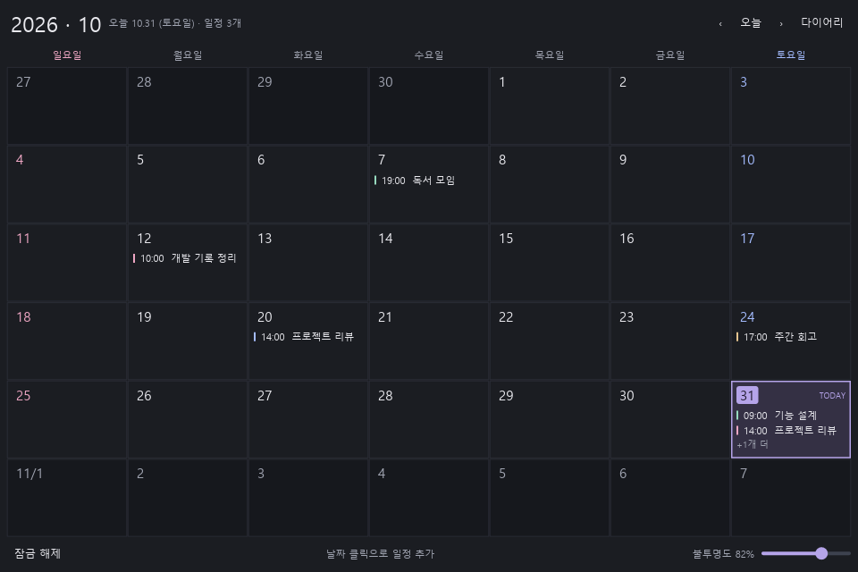
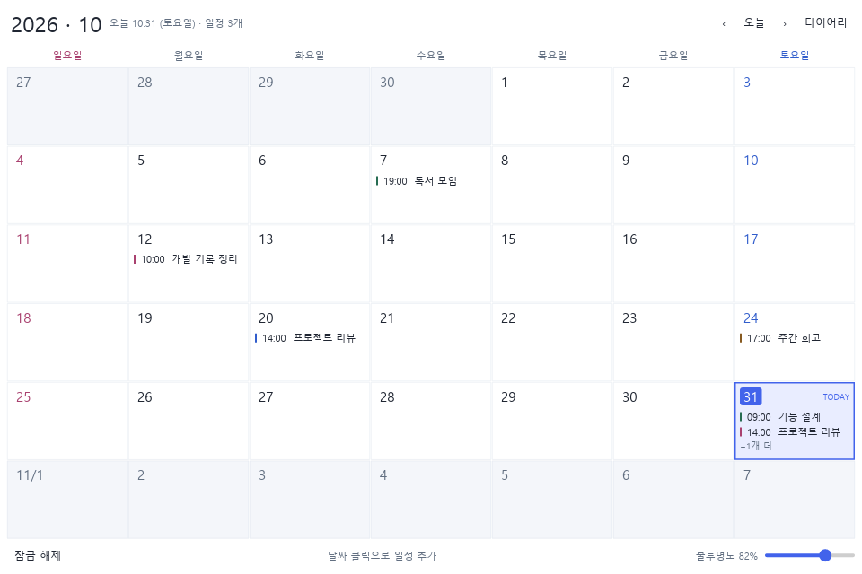

# DesktopCal 스타일 바탕화면 위젯

[DesktopCal 공식 화면](https://www.desktopcal.com/ko)을 참고해 가로형 월간 격자와 간결한 상단바로 구성했습니다. 기본 크기는 960×640 논리 픽셀이며, 화면 작업 영역이 작으면 기존 Windows 어댑터가 크기와 위치를 보정합니다.

Midnight/Porcelain 선택과 기존 위젯의 불투명도·위치·잠금·표시 설정을 사용합니다. 날짜 클릭으로 일정 추가, 월 이동, 오늘 이동, 다이어리 열기를 유지합니다. 기존 하단의 오늘 일정 목록은 상단의 오늘 날짜/건수와 달력 안의 일정 표시로 정리했습니다.

아래 이미지는 앱의 tiny-skia 렌더러 출력입니다. Windows 바탕화면 배경 및 창 전체 불투명도 합성은 포함하지 않습니다.





## 사용자 확인

1. 기존 앱을 트레이에서 완전히 종료하고 `artifacts/TimeSchedule-desktopcal.exe`를 실행합니다.
2. 위젯이 숨김 상태라면 다이어리의 설정 또는 트레이 메뉴에서 바탕화면 위젯을 표시합니다.
3. 날짜 클릭으로 해당 날짜의 일정 입력 창이 열리는지 확인합니다. 작성 중인 입력이 있으면 새 날짜 클릭이 내용을 덮어쓰지 않아야 합니다.
4. `잠금 해제` 후 월 제목을 드래그해 이동합니다. `위치 잠금` 후에는 움직이지 않아야 합니다. 불투명도 슬라이더로 바탕화면과 어울리는 농도를 조정합니다.
5. 다이어리의 밝은/어두운 모드를 바꿔 위젯에도 반영되는지 확인합니다. 앱 종료 후 다시 실행해 위치·잠금·불투명도가 유지되는지 확인합니다.

## 개발 검증

- Workspace 자동 테스트 61개 통과. 수동 렌더링 fixture는 별도 실행해 통과했고, 자식 프로세스 fixture는 해당 테스트가 호출합니다.
- 잠긴 위젯의 drag 메시지가 native drag를 발행하지 않는 테스트를 실패→통과로 확인했습니다.
- 긴 한글/영문 일정 6개씩을 넣은 42일 달력으로 두 테마의 320×300 / 500×620 / 960×640 레이아웃 경계를 확인했습니다. 기본·작게 보정된 창의 PNG도 확인했습니다.
- 글자 폭 측정은 화면과 같은 글꼴 및 10/11/15px 크기로 검증합니다. 관리자 달력은 기존 10px 표시를 유지합니다.
- 디자인 값과 위젯 레이아웃은 `apps/timeschedule-native/src/desktop_widget.rs`, 공통 말줄임은 `text_layout.rs`에 분리했습니다. 런타임 의존성·주기적 타이머 추가는 없습니다.
- `cargo fmt` 검사와 release 빌드 통과. 독립 전체 변경 검토에서 조치가 필요한 문제를 발견하지 못했습니다.
- 최종 EXE를 별도 샘플 DB로 실행해 저장소 열기, 일정 6개/프로젝트 2개/기록 1개 로드, 두 창 초기화, 바탕화면 연결 및 표시 성공을 로그로 확인했습니다.
- Windows UI 자동화 응답이 지연되어 실제 바탕화면 위 투명도·드래그·다양한 DPI에서의 상호작용은 자동 확인하지 못했습니다. 렌더러 PNG는 이를 대신하는 증거가 아니며, 위 사용자 확인 순서에 포함했습니다.
- 실행 파일: 5,579,264 bytes. SHA-256: `56F5C40AB985312AC8B910C7CFFCD3BBA8B5BCBAF3813F4ADB07CD2FE4AC0766`.

```powershell
. .\scripts\toolchain.ps1
cargo fmt --all -- --check
cargo test --workspace --locked
cargo build -p timeschedule-native --release --locked
$env:TIMESCHEDULE_PREVIEW_DIR = Join-Path $PWD 'artifacts/desktopcal-preview'
cargo test -p timeschedule-native render_theme_previews --locked -- --ignored --nocapture
```

사용자 테스트 후 명시적 승인 전까지 PR을 머지하지 않습니다.
