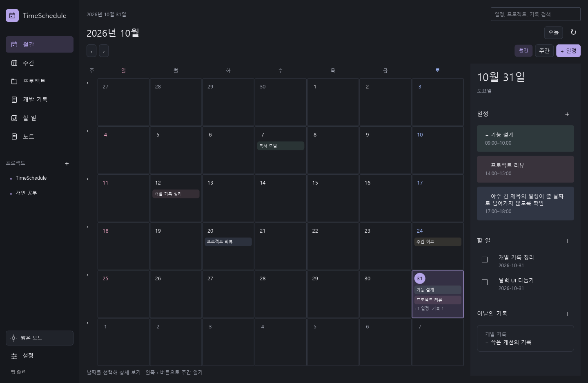
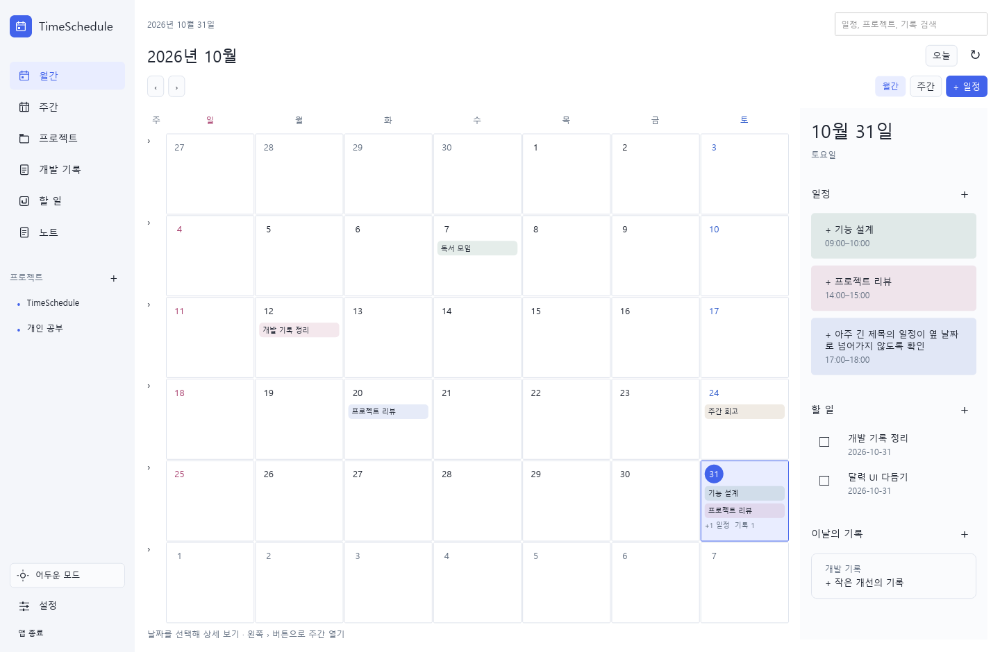

# Midnight / Porcelain 확인 안내

Rust + Iced 네이티브 앱에 Midnight 기본 테마와 Porcelain 밝은 테마를 적용했습니다. 왼쪽 아래 또는 설정의 `밝은 모드` / `어두운 모드` 버튼으로 바꾸며, 선택은 기존 preferences 파일에 저장됩니다.

실제 앱 렌더러로 생성한 샘플 화면입니다. OS 창 캡처는 아닙니다.





## 사용자 확인 순서

1. 기존 TimeSchedule 앱을 트레이 메뉴에서 종료하고 `artifacts/TimeSchedule-themed.exe`를 실행합니다. 기존 네이티브 앱과 같은 데이터 경로와 단일 인스턴스 규칙을 사용합니다.
2. 왼쪽 아래 `밝은 모드`를 누르고 월간·주간·프로젝트·기록·할 일·노트·설정과 입력 창의 색상을 확인합니다.
3. `앱 종료`로 완전히 종료한 뒤 다시 실행하여 밝은 모드가 유지되는지 확인합니다.
4. 날짜를 누르면 해당 날짜의 상세가 바뀝니다. `+ 일정` 또는 상세 영역의 `+`로 추가하고, 선택 날짜가 입력되어 있는지 확인합니다.
5. 창을 좁히면 상세가 달력 아래에 배치됩니다. 아래로 스크롤해 확인합니다. 높이를 낮추면 칸에 표시하는 일정 수가 줄고 나머지는 건수로 표시됩니다.
6. 작성 중인 입력, 한글 조합, 저장/취소 확인창, 바탕화면 위젯과 트레이 동작을 확인합니다.

사용자 테스트 승인 전까지 머지하지 않습니다. 이 PR은 기존 Rust 실험 브랜치를 대상으로 합니다.

## 검증 결과

- 전체 workspace 자동 테스트: 59개 통과. 일반 실행에서 제외되는 2개는 자식 프로세스 fixture와 수동 PNG 렌더링 테스트입니다.
- 기존 설정 마이그레이션, 밝은 테마 파일 저장/재로드, 알 수 없는 테마의 기본값, 연속 토글 저장 순서, 작성 중인 입력 보존을 검증했습니다.
- 800×620, 1160×620, 1160×820, 1440×900에서 두 테마의 7개 페이지 가로 경계, 조밀한 달력의 세로 경계, 한글/영문 혼합 제목의 실제 글자 폭을 검증했습니다.
- `cargo fmt --all -- --check`와 release 빌드가 통과했습니다.
- 독립 검토에서 발견한 긴 제목 가로 넘침과 낮은 창 세로 넘침을 수정했고, 재검토에서 추가 P1/P2를 발견하지 못했습니다.
- 별도 샘플 데이터로 Windows 실행과 데이터 로드, 관리자 창 준비, 바탕화면 위젯 연결을 로그로 확인했습니다.
- PNG는 앱과 같은 tiny-skia 렌더러에서 생성한 화면입니다. 실제 Windows 창 캡처가 시간 초과되어 OS 제목 표시줄, 실제 클릭·IME·재실행까지 이어지는 상호작용은 수동 확인이 남아 있습니다.
- 런타임 의존성, WebView, 애니메이션 타이머를 추가하지 않았습니다. 이번 변경 후 CPU/RAM 성능을 별도로 측정하지는 않았습니다.

## 재현 명령

저장소 루트 PowerShell에서 실행합니다.

```powershell
. .\scripts\toolchain.ps1
cargo fmt --all -- --check
cargo test --workspace --locked
cargo build -p timeschedule-native --release --locked
$env:TIMESCHEDULE_PREVIEW_DIR = Join-Path $PWD 'artifacts/theme-preview'
cargo test -p timeschedule-native render_theme_previews --locked -- --ignored --nocapture
```

렌더링 출력: `midnight.png`, `porcelain.png`, `midnight-default.png`, `midnight-short.png`, `porcelain-narrow.png`. PNG 생성용 `tiny-skia` / `png` 직접 의존성은 테스트 전용입니다.
